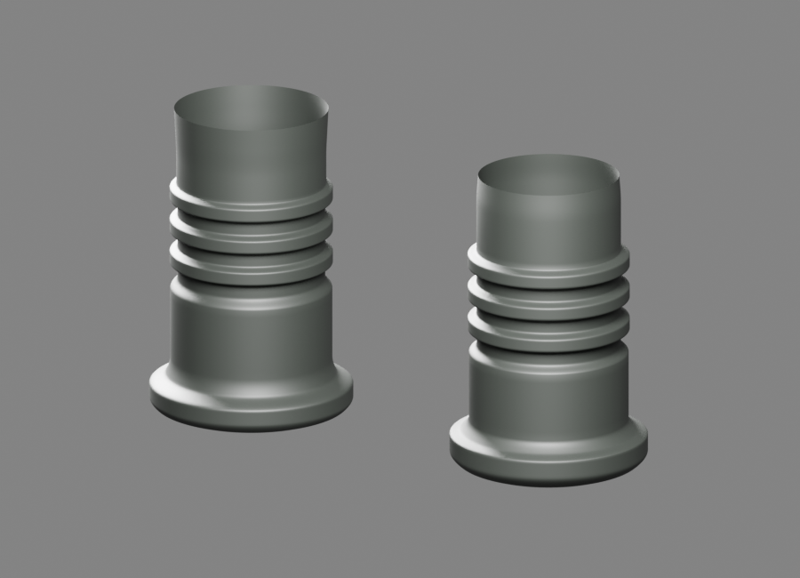
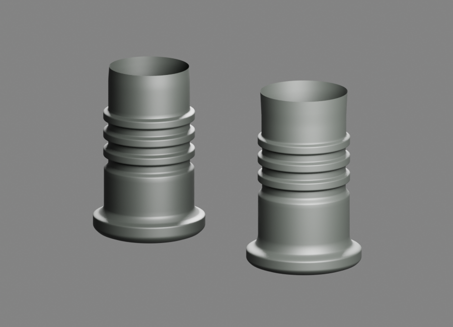
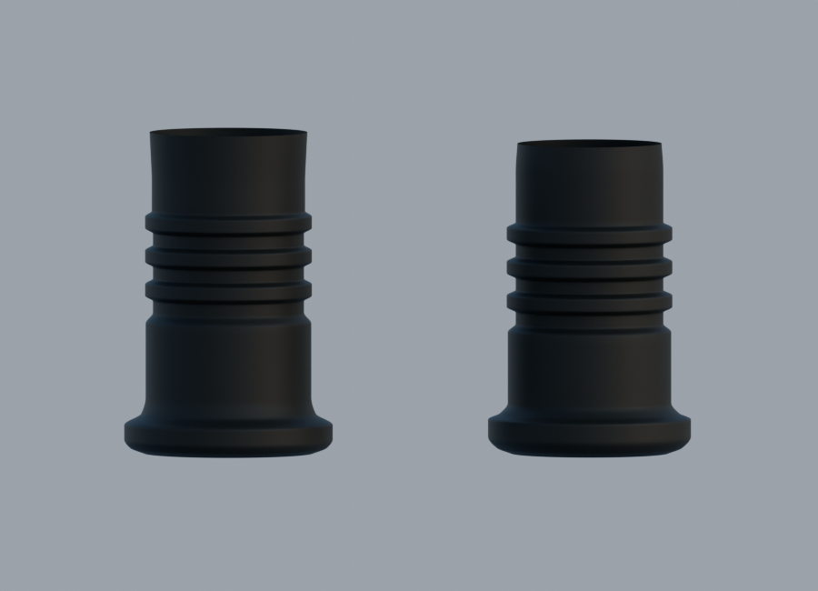

# Tiges arrière — révision de matière

Les tiges gauche et droite conservent leurs formes indépendantes. Trois vues natives96 et leurs EXR FLOAT32 sont relus ; le neutre confirme une teinte sombre. Le matériau est une proposition non calibrée.

[Blender](../../../assets-src/moto-components/rear-indicator-dark-polymer-v2/rear-indicator-dark-polymer-v2.blend) · [Contrôle exact des buffers](export-check.json) · [Sources](../../research/rear-indicator-dark-polymer-v2/G0-G2-material-plan.json) · [Lecture](coordinator-review.json). Le premier export droit multi-scènes refusé est conservé, puis réexporté avec la scène active seule ; source et vues natives inchangées.
