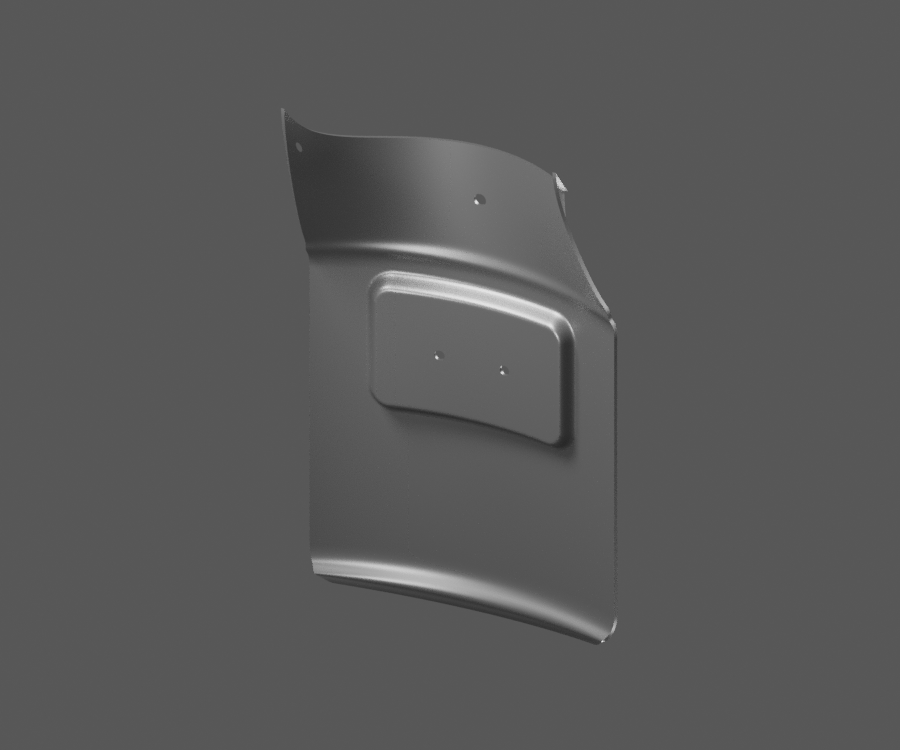
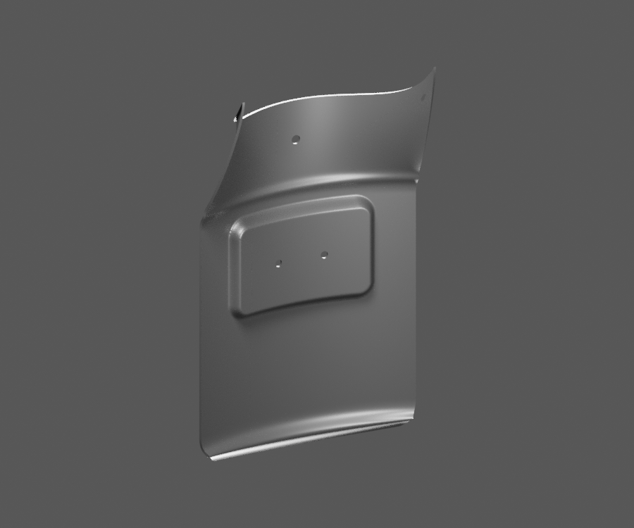
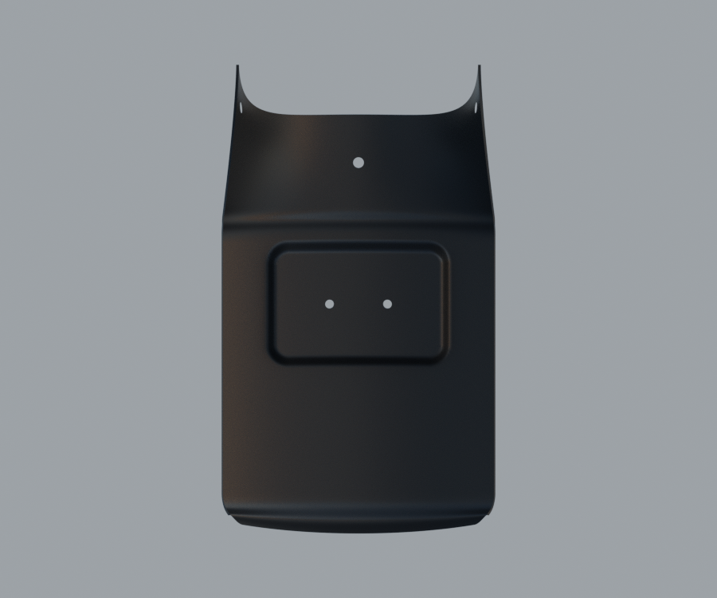
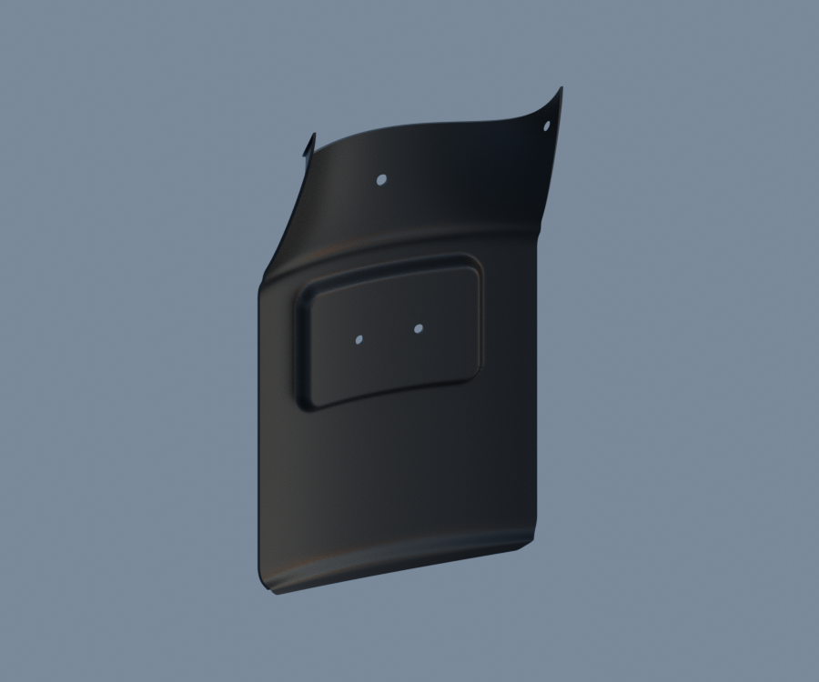

# LEGACY15-REAR-FLAP — JV181410 rear mudflap observed exterior study

[Source Blender](../../../assets-src/moto-components/rear-mudflap-jv181410-visible-front22-v4/rear-flap-material.blend) · [GLB](../../../assets-src/moto-components/rear-mudflap-jv181410-visible-front22-v4/rear-flap-material.glb) · [Dossier](../../../creative/research/rear-mudflap-jv181410-visible-front22-v4-coordination-v1/G0-G2-plan-v1.json) · [Étude auteur](../rear-mudflap-jv181410-visible-front22-v4/delivery.json)

[Source rouverte](source-geometry-check.json), [export réel](export-buffer-check.json), [rendus96 associés à la source figée](render-report.json), [EXR FLOAT32](raw-render-check.json), [quatre vues Babylon de coordination](inspection-v5/engine-check.json), [lecture réelle](coordinator-review.json), [manifestes](production-manifest.json). Les images et rapports auteur restent inchangés. Leur association à la source est vérifiée dans le lot figé. Une éventuelle vue indépendante `coordination-neutral` est identifiée séparément avec sa provenance ; elle ne modifie pas la source.

JV181410 : contour courbe, bande haute concave, cinq passages réels et bossage central à deux trous lisibles. Le ciel neutre conserve un polymère sombre ; studio et moteur montrent des reflets clairs. Petit chant supérieur simplifié et coupes ouvertes demeurent visibles. Revers, matière exacte, contact avec la coque et pose RDC non reçus ; catadioptre distinct absent de cette unité.

Les dimensions et interfaces restent estimées. Aucune réception artistique ou qualification matérielle n’est transmise. Le paquet reste ouvert pour ses enfants et raccords manquants.
