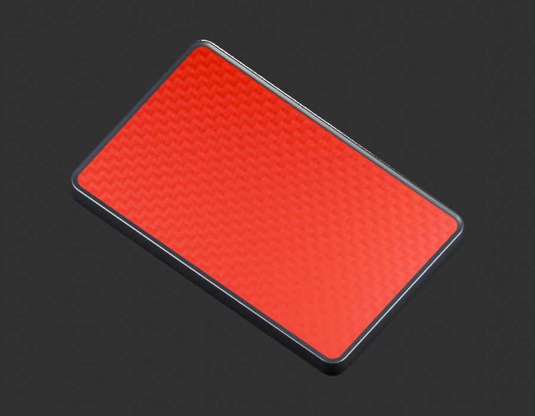
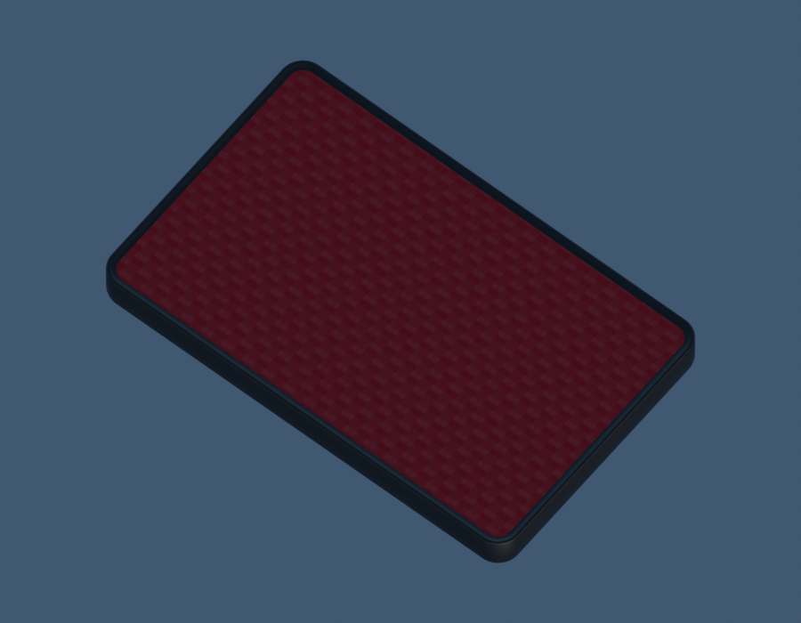
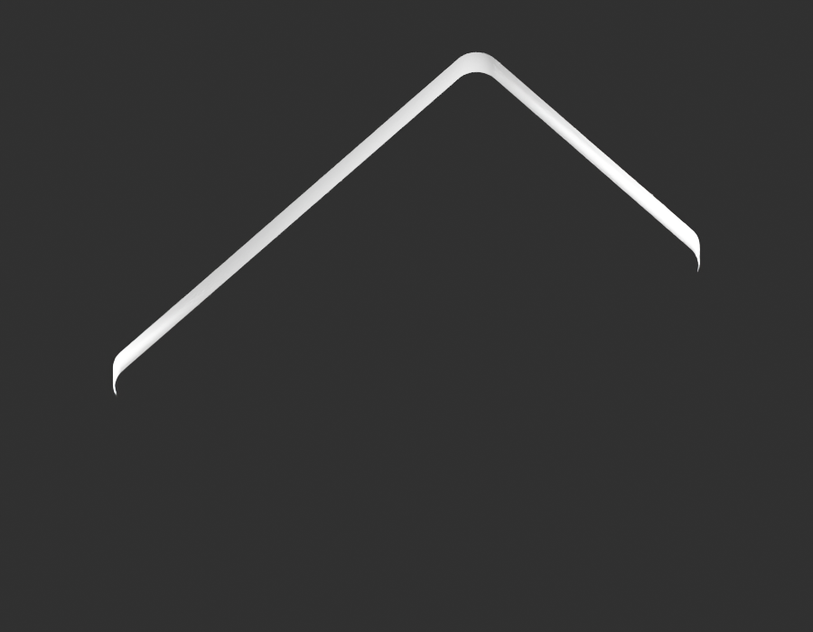

# LEGACY15-REAR-REFLECTOR — candidat visible30201069

**Un exemplaire Boyle, pas de G8 ni fit.** Face/lèvre/cadre construits, dos inconnu omis par coupe ouverte. Dimensions80×50×6mm estimées avec larges intervalles explicites. Matière optique originale interprétée ; **G4rework**, motif encore trop régulier par rapport à la source physique.

[Source/GLB/paramètres](../../../assets-src/moto-components/rear-reflector-30201069-visible-v1/README.md) · [G0–G2 et méthode d’estimation](../../research/rear-reflector-30201069-visible-v1/G0-G2-plan-v1.json) · [Fragment unique](catalog-fragment.json) · [Décision détaillée](coordinator-review.json).

Séquence effectivement suivie : gris [face](gray-front.png), [quart](gray-quarter.png) et [coupe](gray-reverse.png) lus avant matériau, [gray-review](gray-review.json) ; [aperçu studio](preview-studio.png) et [neutre](preview-neutral.png) lus avant96, [preview-review](preview-review.json). [Face96](whole-front.png), quart96 et neutre96 lus. Le premier revers ambigu est conservé dans `rejected/`, pas présenté comme dos physique.

[Parité source/GLB](export-buffer-check.json), [géométrie gray/matériau et validationglTF](independent-export-check.json), [réouverture native](native-reopen-check.json), [rendus96](render-report.json), [EXRFLOAT32](raw-render-check.json). Les checks techniques ne valident ni cotes constructeur, ni apparence optique, ni interfaces. Shaderbackfaces masqués sur la coupegrise ; GLB matériaux simpleface, dos non fabriqué.

Babylon réel : [quart](inspection-boyle-v1/engine-quarter.png), [face](inspection-boyle-v1/engine-driver.png), [revers coupé](inspection-boyle-v1/engine-reverse.png), [rapport](inspection-boyle-v1/engine-check.json). Chromium logicielWebGL, aucun matérielmobile/FPS qualifié. Contrôlesdepage et capture locaux au composant ; aucun catalogue partagé ou rootmodifié.

Une seule identité dans le fragment : `LEGACY15-REAR-REFLECTOR`. Normale originale512² incluse GLB, aucun pixel documentaire ; source privée exclusivement. Pas de marquages constructeur inventés, de goujon/écrouM5, de verre/réflecteur avant ou de prismesinternes. Les éléments inconnus demeurent inconnus malgré la présence d’un candidat visible.

GelSHA256 `production-manifest.json`, source/recherche/revue/protocols et sorties exacts. Lecture seule0444, pasWORM. G4rework, G5blocked, G8pending. Aucune réception/pose transmise par les autres composants.
