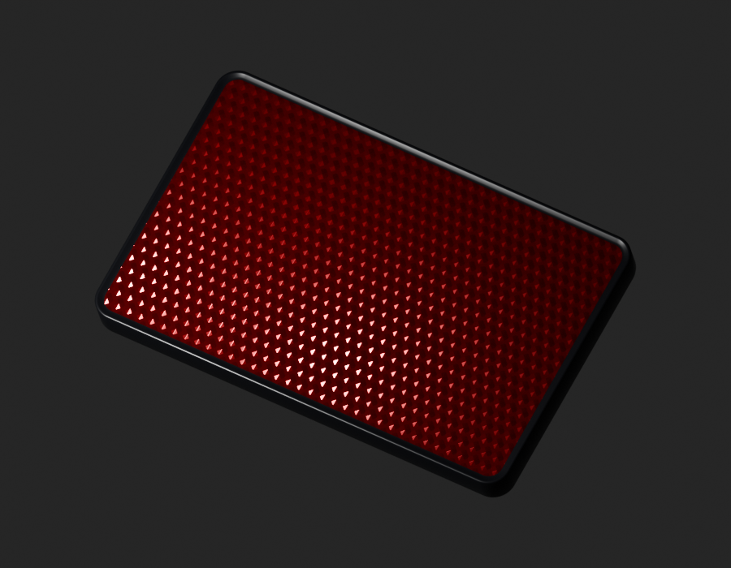
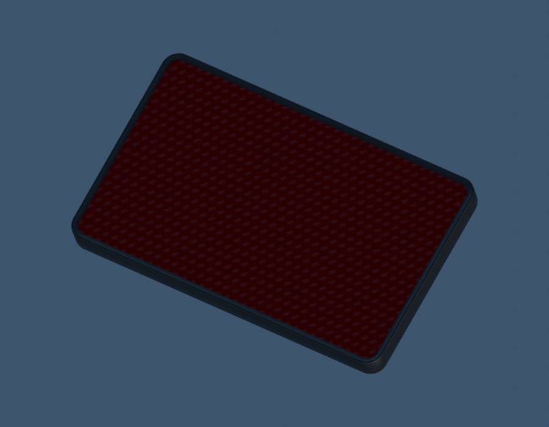

# Même LEGACY15-REAR-REFLECTOR — matièrev2

**Candidat de correction matière, pas de réceptionG4/fit/G8.** Coordination : `MOTO-REAR-REFLECTOR-30201069-VISIBLE-STUDY-001`, package `LEGACY15-REAR-REFLECTOR`. V1 et son manifestev2 demeurent intacts.

[SourceBlender/GLB/paramètres](../../../assets-src/moto-components/rear-reflector-30201069-visible-v2/README.md) · **[FragmentPLAT pour main](component-fragment.json)** · [Décision finale](final-review.json) · [ManifesteSHA](production-manifest.json).

## Diagnostic avant matière

V1mesh/UV/matériaux inchangés : [ancienangle/large](G2-v1-old-angle-broad.png), [premierangle/large](G2-v1-source-angle-broad.png), [premierangle/ponctuelle](G2-v1-source-angle-compact.png). Le premierroulis était trop raide : [anglecorrigé/large](G2-refined-source-broad.png), [anglecorrigé/ponctuelle](G2-refined-source-compact.png). [LectureG2](G2-diagnostic-review.json), [rapportinitial](G2-diagnostic-report.json), [rapportcorrigé](G2-refined-diagnostic-report.json). Angle/roulis sont une hypothèsevisuelle, pas un calage métrique de la photo.

La lumièreponctuelle approfondit déjà le rouge de v1 ; elle ne transforme pas le damier en rangéesdécalées. Modification de matière autorisée seulement après cette lecture. Les essaisA/B refusés (noir/pointsblancs, puis reliefs trop ronds) restent dans `rejected-material-attempt-a/b`. Ce sont des étapes du même exemplaire, pas des pièces supplémentaires.

## Aperçus puis trois vues96

[Large](preview-source-broad.png) et [ponctuelle](preview-source-compact.png) réellement lus, [décision](preview-review.json), avant les rendus96. Rendus96 à900×700 réellement lus : [large](whole-source-broad.png), [ponctuelle](whole-source-compact.png), [neutre](neutral-outdoor.png). [Rapport](render-report.json), [dixEXRFLOAT32 courants](raw-render-check.json).

Les cellules sont décalées, les plages diagonales et le rougeprofond apparaissent sous lumièreponctuelle. La lumièrelarge reste très brillante, et leHDRneutre plus sombre : différences laissées visibles. Densité36×22,5 et paramètres spéculaires sont une interprétationoriginale non calibrée, pas une mesure duJPEG ni une validation rétro-réfléchissante. Aucun marquageinventé, phototexture ou prismeinterne.

## Géométrie et runtime

[Empreintes avant/après](geometry-material-parity.json), [sourcesrouverts](source-reopen-check.json), [GLBv1/v2+UV/tangentesutilisées](runtime-material-parity.json) : **positions/normales/UV/matrice face et cadre inchangés**. Matériau du cadre aussi exact. Export0erreur/0avertissement, deux informations de tangente/UV inutilisées sur cadre non texturé. La face seule utilise la normaleoriginale ;100trianglesUV utiles non aplatis,101tangentesN·T=0.

[Valeursmatières exportées](exported-material-values.json) : facteurbasecouleur uniforme, normalescale0,75, paramètresKHRspecular/clearcoat vérifiés ; pas de basecolortexture copiée. Les graphes natifs du cadre sont identiques. Le source contient aussi une étude couleur auteur non reliée ; leGLB n’embarque que la normaleoriginale courante, sans imagephotographique.

Babylonréel : [troisquarts](inspection-boyle-v1/engine-quarter.png), [face](inspection-boyle-v1/engine-driver.png), [revers](inspection-boyle-v1/engine-reverse.png), [rapport](inspection-boyle-v1/engine-check.json). Le runtime est propre à cette revue ; caméra avec vecteurhaut natif pour le roulis, [correspondance](native-camera-parity.json). Même export chargé, éclairage de revue distinct ; pas de paritéphotométrique ou qualificationmobile revendiquée.

**Les quatre interfacesM5/revers demeurent inconnues**, dos omis comme v1, aucune quincaillerie ou pose. Géométrie estimée/RDCconditionnelle héritéesv1. G4resteàrevoir, G5blocked, G8pending. Le nouvelidentifiant de coordination et LEGACY15 sont deux champs d’une même pièce.

## Conservation

Manifeste auto-exclu et fichiers0444, pasWORM. Protocoles exacts versionnés dans `protocols/`. Photo source et caches privés restent horsdépôt ; aucun anciengel/helperroot ou cataloguepartagé modifié. Aucun Git. Fragmentplat distinct du `runtime-config.json` interne à l’inspecteur, qui n’est pas un cataloguepartagé.
