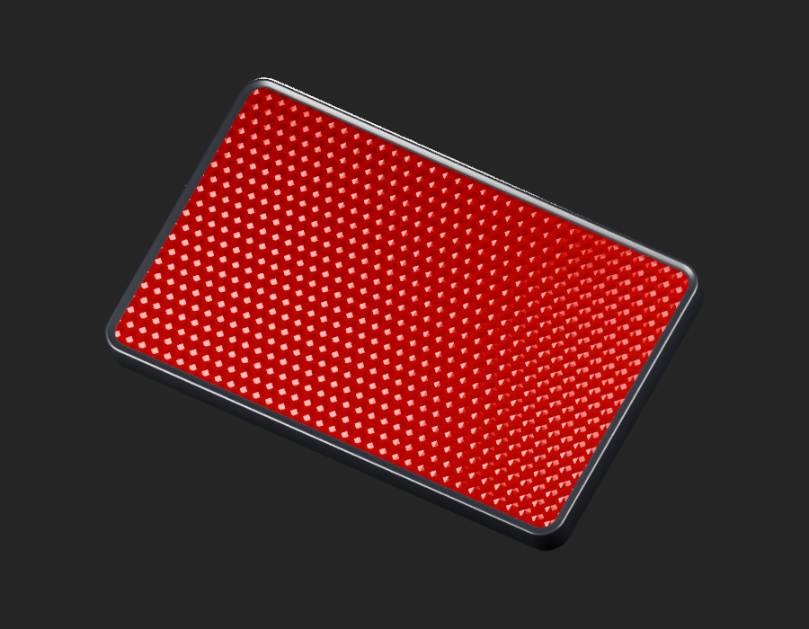
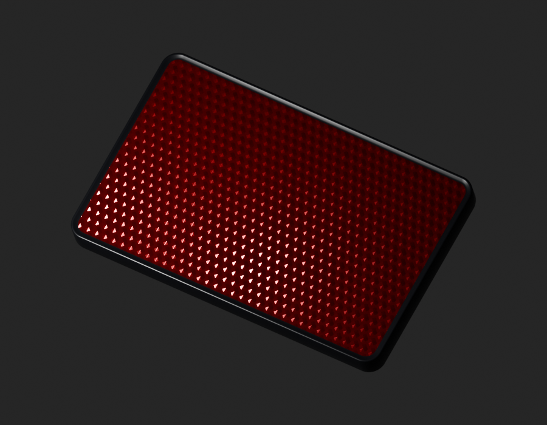
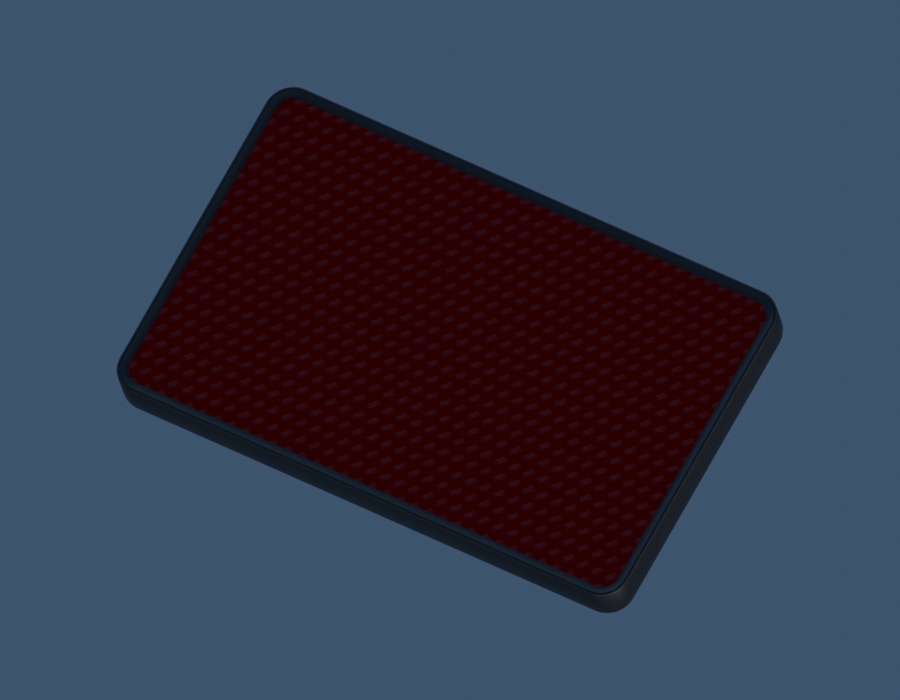

# LEGACY15-REAR-REFLECTOR — 30201069 — même exemplaire / UV cadre v3

[Source Blender](../../../assets-src/moto-components/rear-reflector-30201069-visible-v3/rear-reflector-30201069-visible-v3.blend) · [GLB](../../../assets-src/moto-components/rear-reflector-30201069-visible-v3/rear-reflector-30201069-visible-v3.glb) · [Dossier](../../../creative/research/rear-reflector-30201069-visible-v3-coordination-v1/G0-G2-plan-v1.json) · [Étude auteur](../rear-reflector-30201069-visible-v3/README.md)

[Source rouverte](source-geometry-check.json), [export réel](export-buffer-check.json), [rendus96 associés à la source figée](render-report.json), [EXR FLOAT32](raw-render-check.json), [quatre vues Babylon de coordination](inspection-v5/engine-check.json), [lecture réelle](coordinator-review.json), [manifestes](production-manifest.json). Les images et rapports auteur restent inchangés. Leur association à la source est vérifiée dans le lot figé. Une éventuelle vue indépendante `coordination-neutral` est identifiée séparément avec sa provenance ; elle ne modifie pas la source.

Même exemplaire30201069 : face rouge à cellules décalées apparentes et cadre sombre conservés. Natif large très brillant, ponctuel rouge profond, HDR sombre ; absence de calibration. Engine trois-quarts a un roulis différent du natif : caméra source non appariée dans cet inspecteur de coordination, pas de parité pixel/photométrique. Revers ouvert volontaire : aucune preuve de dos, goujon, siège ou contact. Toutes tangentes contrôlées, mais G4/G5/G8 non reçus et aucun fit.

Les dimensions et interfaces restent estimées. Aucune réception artistique ou qualification matérielle n’est transmise. Le paquet reste ouvert pour ses enfants et raccords manquants.
