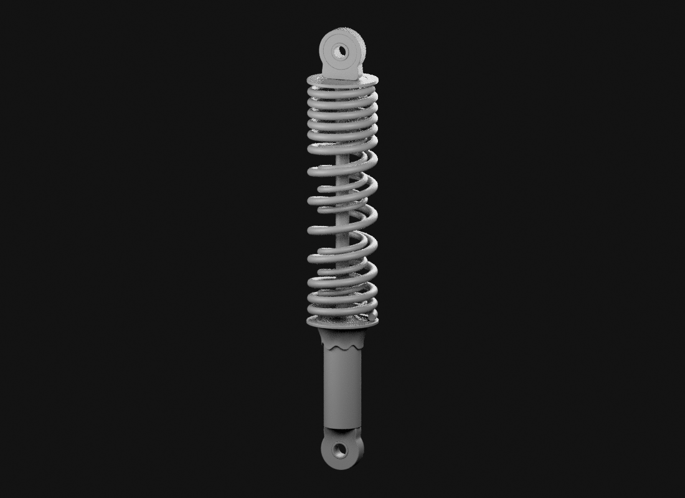
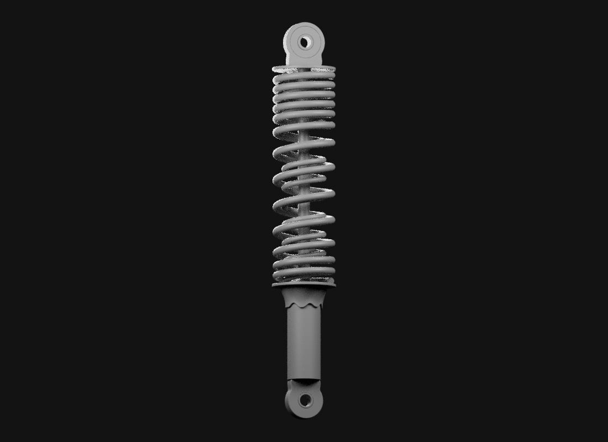
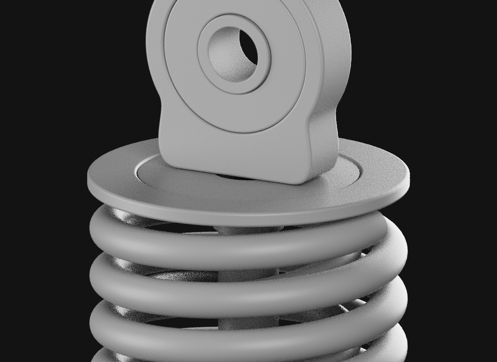
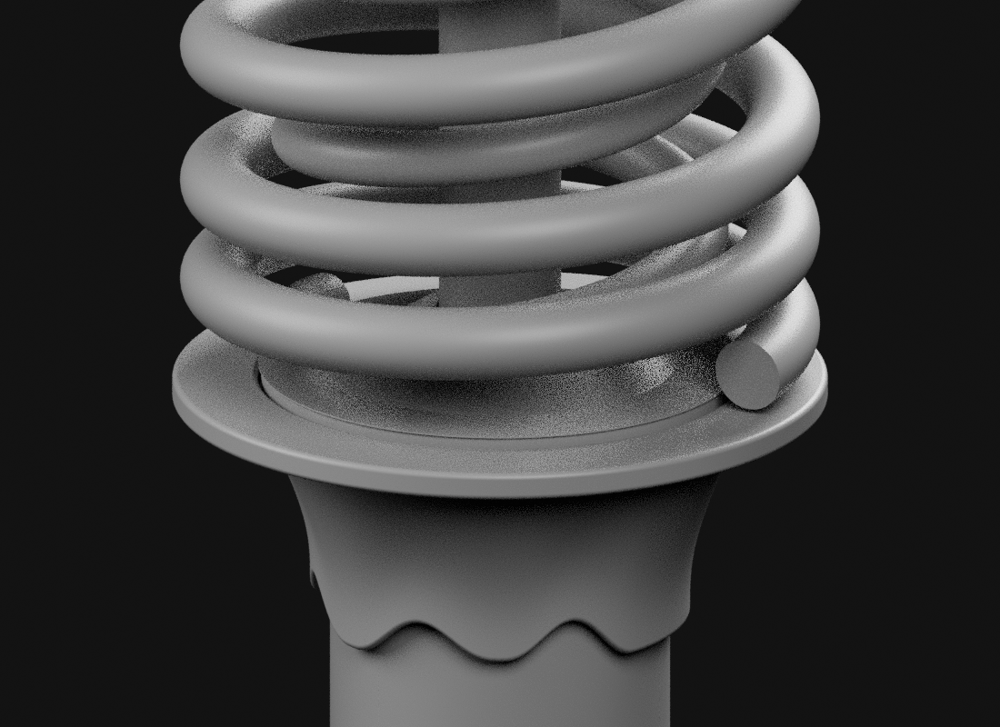
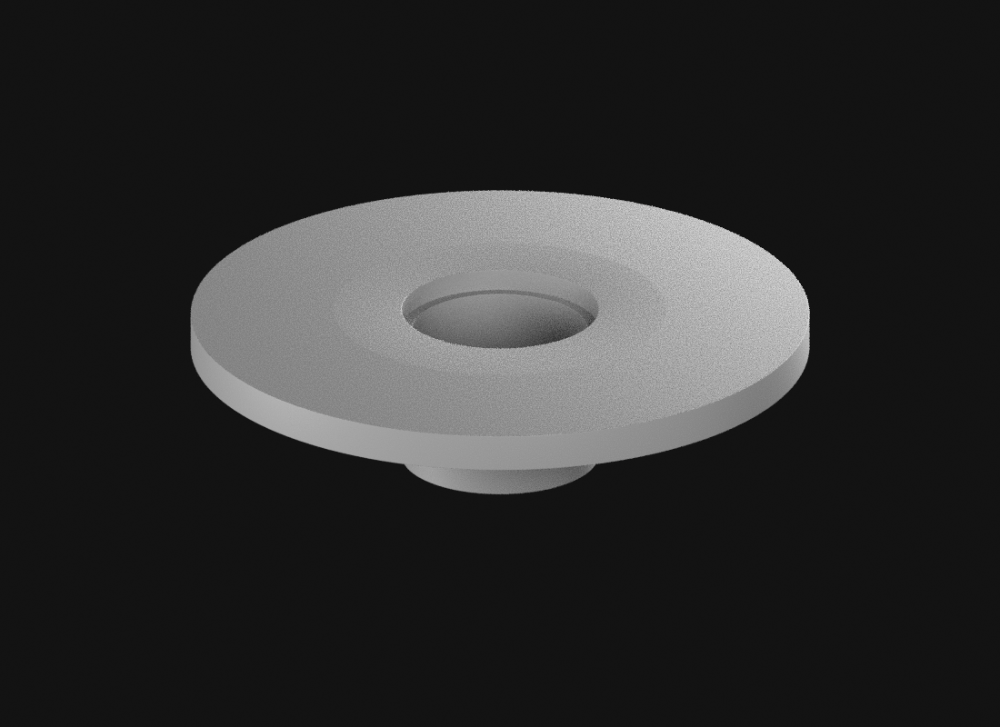
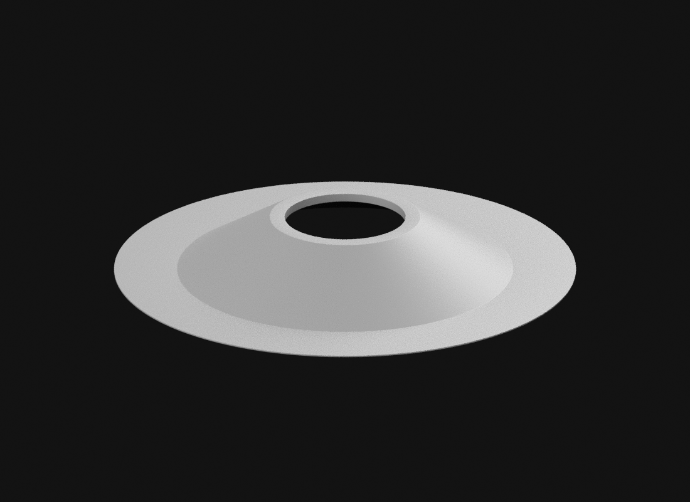

# SNS — deux fermetures extérieures en étude grise

Cette revue prolonge le diagnostic exact à douze sources de Source20. Deux
enveloppes nouvelles sont examinées dans le même repère, sans modifier les
pièces historiques. Source et recette :
`assets-src/moto-components/rear-sns/end-closures-study-v1/`.

Le rapport `build-report.json` contient les contrôles des maillages et les
empreintes des vues. `gltf-validation.json` concerne uniquement les exports.
`visual-review.json` consigne leur lecture distincte. Le manifeste ne vaut pas
réception artistique.

La fermeture côté fût reste particulièrement provisoire : lèvre trop peu
documentée, épaisseur de travail 0,15 mm et séparation axiale au bord existant.
Les petites séparations entre candidats ne sont pas des ajustements industriels.
Une reprise coordonnée des pièces voisines peut être nécessaire. La matière
finale attend cette décision de forme. L'amortisseur complet, son implantation,
la moto entière, les LOD et les performances iPhone restent ouverts.
