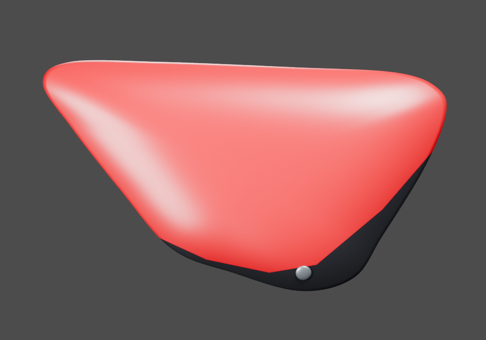
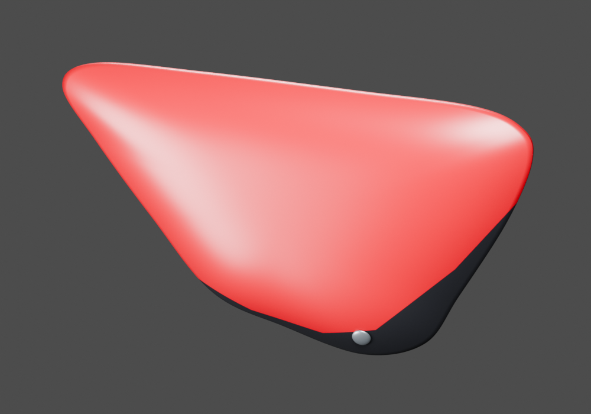
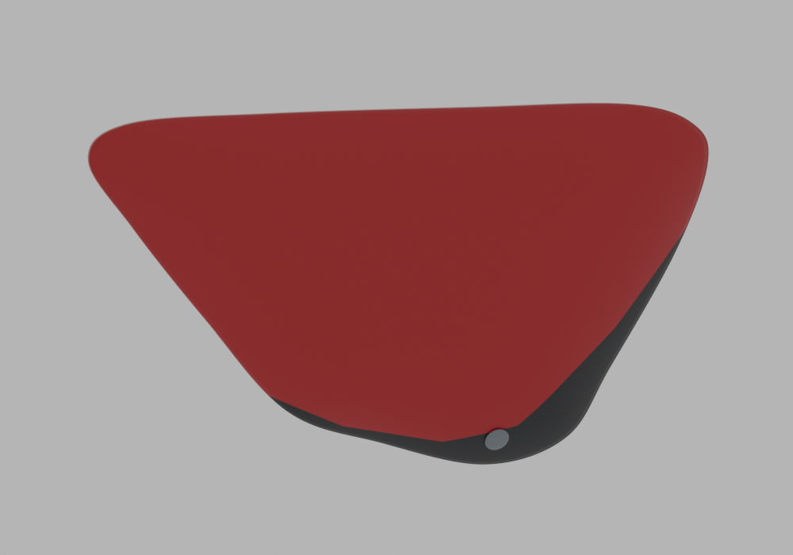

# P04 — Existing RH cover and visible head — normalized coordinate derivative

[Source Blender](../../../assets-src/moto-components/right-side-cover-coordinate-conversion-v1/child-candidate.blend) · [GLB](../../../assets-src/moto-components/right-side-cover-coordinate-conversion-v1/child-candidate.glb) · [Dossier](../../../creative/research/right-side-cover-coordinate-conversion-v1-coordination-v1/G0-G2-plan-v1.json) · [Étude auteur](../right-side-cover-coordinate-conversion-v1/README.md)

[Source rouverte](source-geometry-check.json), [export réel](export-buffer-check.json), [rendus96 associés à la source figée](render-report.json), [EXR FLOAT32](raw-render-check.json), [quatre vues Babylon de coordination](inspection-v5/engine-check.json), [lecture réelle](coordinator-review.json), [manifestes](production-manifest.json). Les images et rapports auteur restent inchangés. Leur association à la source est vérifiée dans le lot figé. Une éventuelle vue indépendante `coordination-neutral` est identifiée séparément avec sa provenance ; elle ne modifie pas la source.

Cache droit et tête visible convertis ensemble vers les axes moto ; parité de la convention corrigée dans un dérivé autonome, winding et normales contrôlés. Profil rouge et retour noir préservés ; aspect studio plus clair que sous ciel neutre. Forme et matière sources non reçues ; pose estimée avec65mm de décalage documentaire conservé. Aucun nouveau composant physique.

Les dimensions et interfaces restent estimées. Aucune réception artistique ou qualification matérielle n’est transmise. Le paquet reste ouvert pour ses enfants et raccords manquants.
