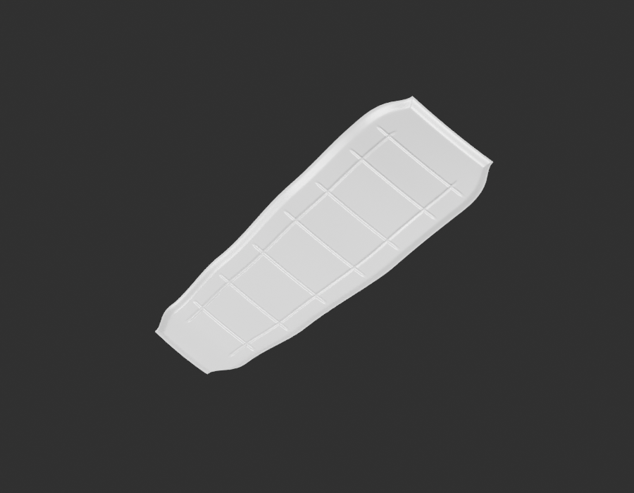

# Embase — diagnostic gris refusé

Le réseau régulier est trop générique face aux références : décrochements centraux, interruptions et reliefs manquent. Aucun passage matière, rendu96 ou enregistrement comme nouvelle pièce livrée. Les données restent conservées pour correction.

[Décision](gray-review.json) · [Sources et estimations](../../research/seat-base-observed-underside-v1/G0-G2-plan-v1.json).
