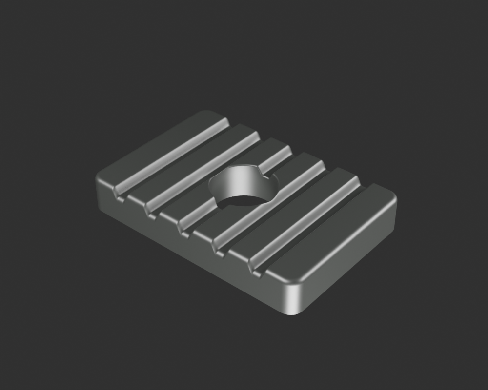
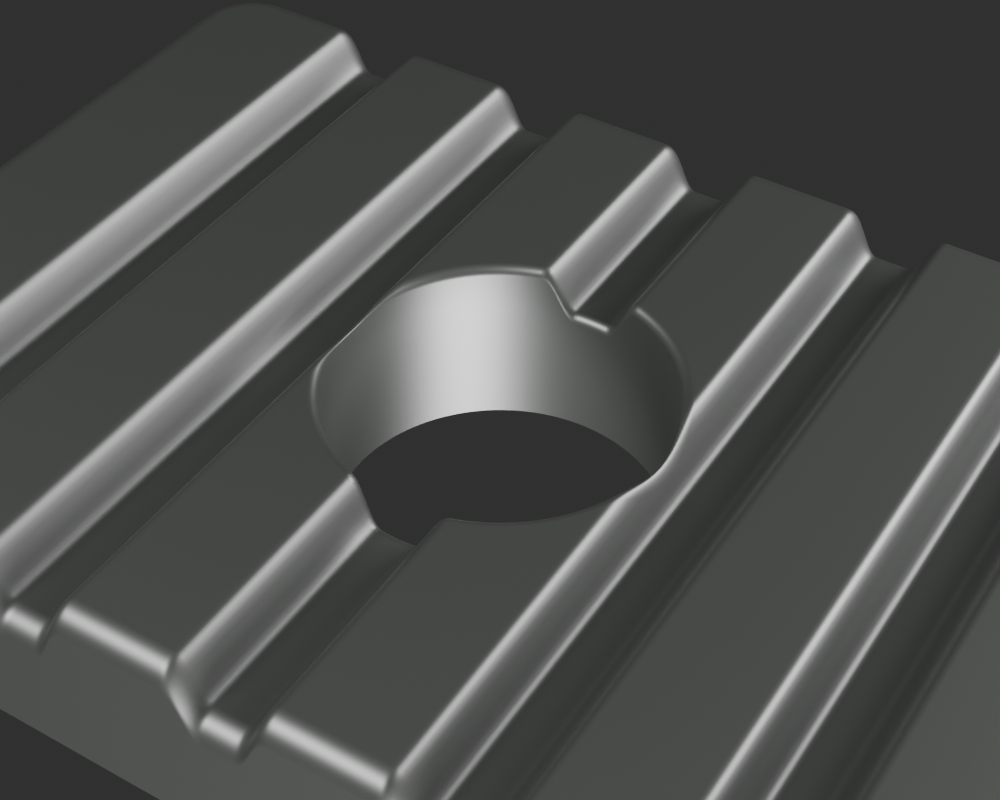
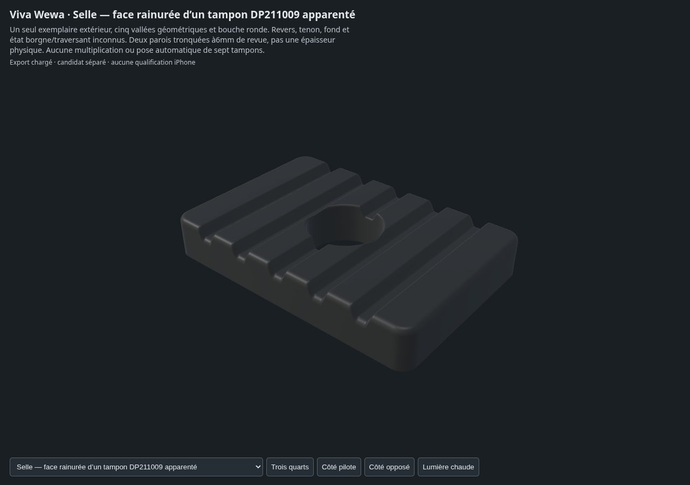

# Selle — peau de contact d'un tampon DP211009 apparenté

Un seul exemplaire est fabriqué : face rainurée, lèvre extérieure arrondie et
bouche centrale, avec deux parois tronquées pour la revue. Les cinq vallées
sont de la géométrie. **Le revers, le tenon, le fond et le caractère borgne ou
traversant ne sont pas établis.** La coupe de 6 mm n'est pas une mesure de
l'épaisseur réelle. Aucun placement ni multiplication des sept tampons n'est
présenté comme reçu.

- [Source Blender et GLB](../../../assets-src/moto-components/seat-damper/)
- [Recette et limites](../../../assets-src/moto-components/seat-damper/README.md)
- [Corrections des facettes refusées](construction-corrections.json)
- [Lecture des gris avant matière](gray-review.json)
- [Protection des vrais buffers entre gris et matière](material-transfer-check.json)
- [Rapport des trois rendus détaillés et leurs empreintes](render-report.json)
- [EXR FLOAT32, passes brutes et débruitage](raw-render-check.json)
- [Vraies captures et pixels Babylon](inspection-v3/engine-check.json)
- [Revue de coordination](coordinator-review.json)
- [Manifeste de la livraison](production-manifest.json)

La matière noire propre est originale, sans grain, dureté ou chimie OEM mesurés.
Les reflets de studio et le ciel ne sont pas recopiés dans sa couleur. Ce
candidat ne reçoit ni une pièce caoutchouc complète, ni son montage, ni toute la
selle, ni une validation artistique ou iPhone.
