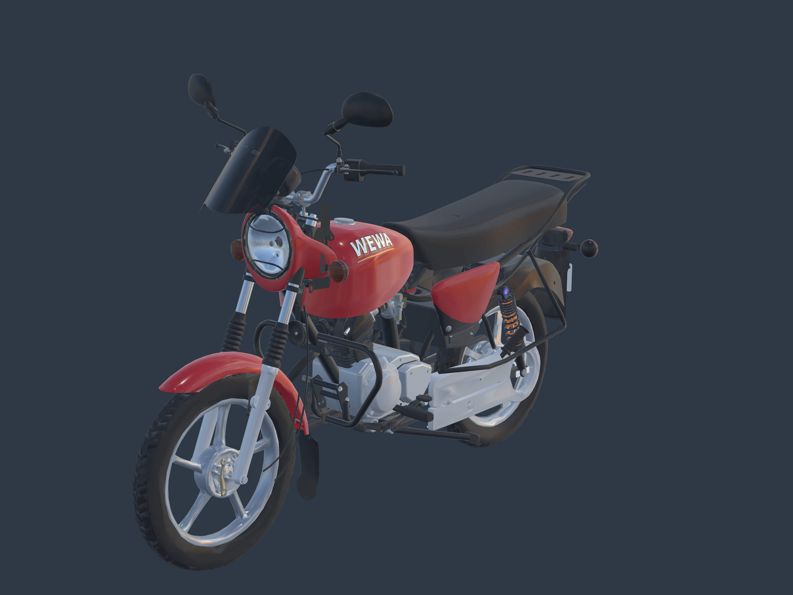
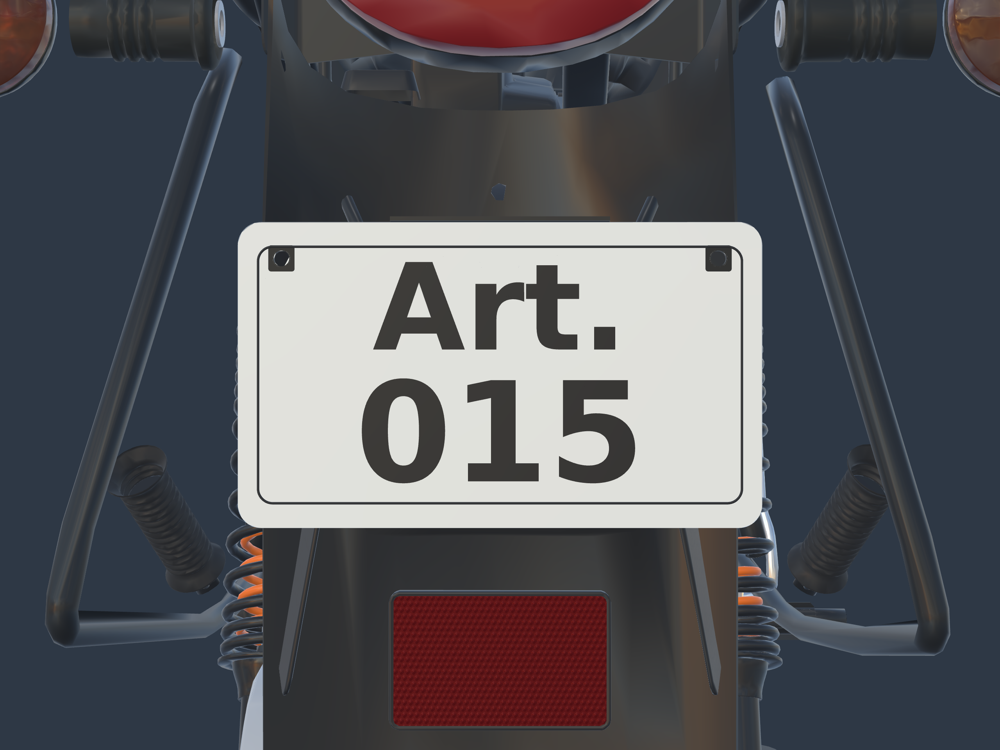

# WEWA — plaque Art. / 015 et vues haute résolution

**La moto n’est pas terminée.** La livraison précédente a ajouté un ensemble de carters et raccords, mais ne clôt pas l’ajustement de l’assemblage. En particulier, les jonctions entre selle, cadre, supports et caches latéraux doivent encore être reprises visuellement. Les variantes de transmission finale et les câbles en mouvement restent également ouverts. Aucun retour utilisateur n’a réceptionné l’ensemble.

L’inspection du fichier Blender confirme la présence de la batterie et de son support, de la boîte à air, du fond de selle, d’une patte latérale et d’un piédestal de silentbloc. Le moteur et le carburateur existent également. Les [photos officielles Bajaj RDC](https://www.bajajauto.com/fr-cd/bikes/boxer-125hd), déjà conservées dans le [registre documentaire](../../research/under-tank-completion-v1/sources.json), montrent une ouverture derrière le cylindre. Présence des pièces et bon raccord visuel sont deux critères différents ; cette révision ne masque pas les ouvertures par un volume arbitraire.

## Modification demandée

La plaque porte exactement deux lignes :

```text
Art.
015
```

Texte noir et bordure sur fond blanc cassé, police DejaVu Sans Bold avec licence incluse. Les lettres sont des géométries issues de texte éditable Blender ; l’ancien graphisme WEWA / 001 est retiré de la matière active. Le contour, les deux trous et la pose de la plaque sont préservés. Aucun autre élément de la moto n’a été déplacé ou supprimé.

## Images à leur résolution réelle

- [Vue trois quarts avant — 3 840 × 2 880](front-high-resolution.png).
- [Vue trois quarts arrière et plaque — 3 840 × 2 880](rear-high-resolution.png).
- [Zone sous la selle et le réservoir — 2 560 × 1 920](centre-high-resolution.png).
- [Plaque de face — 2 560 × 1 920](plate-high-resolution.png).





Ce sont des captures directes du modèle dans Babylon.js à la résolution annoncée, sans agrandissement d’une ancienne image, retouche ni génération d’image. Une grande image ne vaut pas finalisation de la géométrie ni du rendu.

## Sources et vérification

[GLB de la moto](../../../assets-src/moto-components/seat-plate-v2/motorcycle-Art-015.glb) · [Blender complet avec textes éditables](../../../assets-src/moto-components/seat-plate-v2/motorcycle-Art-015.blend) · [Lettres et bordure isolées](../../../assets-src/moto-components/seat-plate-v2/plate-lettering.glb) · [Licence de police](../../../assets-src/moto-components/seat-plate-v2/LICENSE-DejaVu.txt).

[Plan et bilan des manques](../../research/seat-plate-v2/plan.json) · [Inspection des objets et de leurs enveloppes](../../research/seat-plate-v2/assembly-inspection.json) · [Construction de la plaque](plate-build.json) · [Préservation des géométries](composition-check.json) · [Validation glTF](gltf-check.json) · [Résolutions, caméras et captures](browser-check.json) · [Empreintes de livraison](manifest.json).

Les buffers originaux sont conservés octet pour octet. Seule la matière de face de la plaque change dans les définitions originales ; les lettres et la bordure sont ajoutées. Zéro erreur glTF ; l’avertissement de tangentes hérité d’une autre pièce reste inchangé. Les textures chargent et les quatre vues s’affichent sans erreur JavaScript/HTTP. Les captures sont relues pour la présence des deux lignes, leur sens de lecture et le cadrage.

Reproduction depuis la racine du dépôt :

```sh
blender -b --python-exit-code 1 --python tools/build_art015_plate_v2.py
python tools/compose_art015_plate_v2.py
npx vite --host 0.0.0.0 --port 4143
# dans un autre terminal
python tools/capture_art015_v2.py
python tools/check_art015_delivery_v2.py
```

Inspecteur : `/tools/seat-plate-review-v2/`. Le modèle reste un candidat séparé du jeu public ; réception artistique et essais physiques iPhone non effectués.
