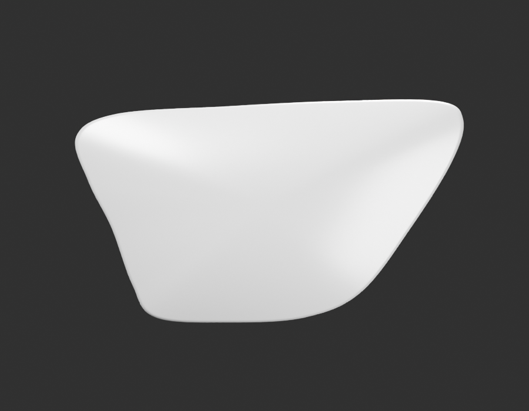
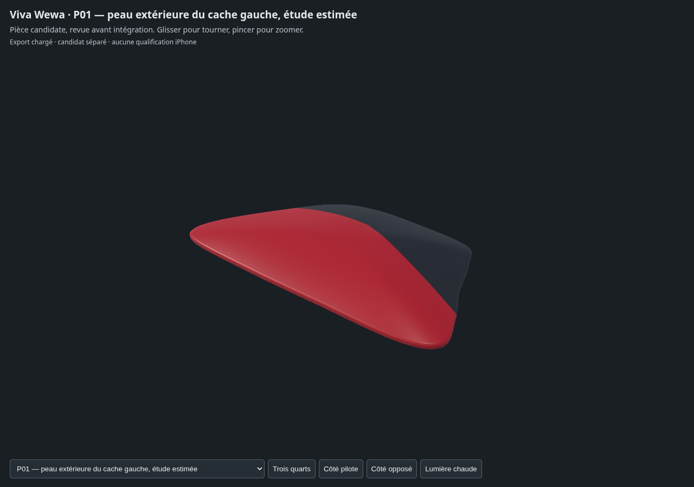

# P01 — première fabrication du cache latéral gauche

**Étude extérieure, paquet P01 encore ouvert.** La fixation basse, les interfaces
et le montage sur cadre ne sont pas fabriqués/validés. Forme, échelle et matière
restent à reprendre ; aucune réception artistique n’est déclarée.

## Preuves produites

- [Sources Blender, GLB et paramètres](../../../assets-src/moto-components/side-cover-left/README.md).
- [Références officielles, observations et inconnues](../../research/side-cover-left-p01/G0-G2-plan-v1.json).
- [Géométrie source](geometry-check.json), [contrôle indépendant des deux GLB](independent-export-check.json), [transfert matière sans changement de géométrie/UV source](material-transfer-check.json).
- Gris : [profil](gray-profile.png), [trois-quarts](gray-quarter.png), [bord](gray-edge.png), [lecture réelle](gray-review.json).
- Aperçus : [studio](preview-studio.png), [ciel neutre](preview-neutral.png), [lecture réelle](preview-review.json).
- Vues détaillées96 échantillons : [profil](whole-profile.png), [trois-quarts](whole-quarter.png), [ciel neutre](neutral-outdoor.png).
- [Rapport des rendus](render-report.json), [canaux FLOAT32 des EXR](raw-render-check.json), [manifestes et empreintes](production-manifest.json).
- [Babylon : quatre vues non vides et erreurs navigateur](inspection-v3/engine-check.json), [lecture de coordination](coordinator-review.json).
- [Défaut de peinture corrigé](paint-correction.json) et [version rejetée conservée](rejected-face-paint-v1/).

## Ce que cette étude ne ferme pas

Le profil provient d’un relevé manuel non calibré de la photo constructeur gauche.
L’échelle approximative272×156mm, le bombé18mm et le retour4mm sont des choix
bornés, pas des mesures OEM. Les vues disponibles ne permettent pas de certifier
les sections. Le reflet du bombé et la transition au bord demandent une meilleure
comparaison oblique. Le bord arrière reste intentionnellement ouvert.

La séparation rouge/noir lissée est une texture analytique originale ; aucun
pixel documentaire ni graphisme125HD n’est copié. La première version par faces,
visiblement en escalier, a été rejetée avant les vues détaillées et conservée.
L’exposition reste0, gamma1, AgX Medium High Contrast ; le HDRI neutre a une force
artistique0,65. Aucune calibration de couleur n’est revendiquée : les hautes
lumières du studio sont plus claires que la lecture rouge sombre sous ciel neutre.

Le GLB conserve26 640 triangles. Les contrôles de topologie, normales et format
ne prouvent ni correspondance exacte aux références, ni montage, ni performance
Safari/iPhone. Aucun pilote, aucune intégration dans le jeu public.

## Suite du paquet

1. Affiner les sections/bords avec les références obliques et un protocole de comparaison.
2. Documenter et fabriquer la fixation basse visible en enfant indépendant.
3. Documenter les retours et interfaces observables, puis vérifier les jeux avec
   selle, réservoir et cadre. Ne pas inventer les pions cachés.
4. Présenter la révision exacte pour réception ; P02 porte-bagages et P03 garde-boue
   avant restent les prochains paquets indépendants prêts pour documentation.
