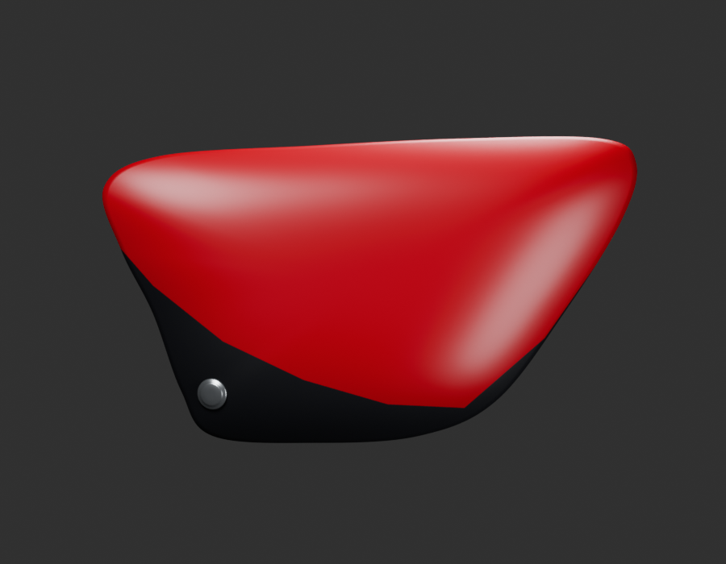
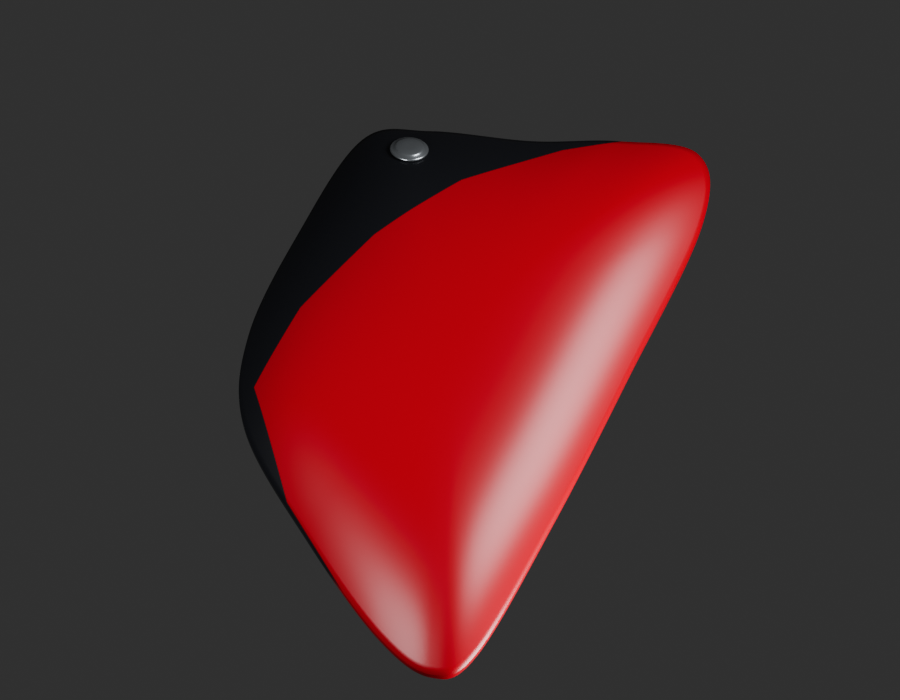
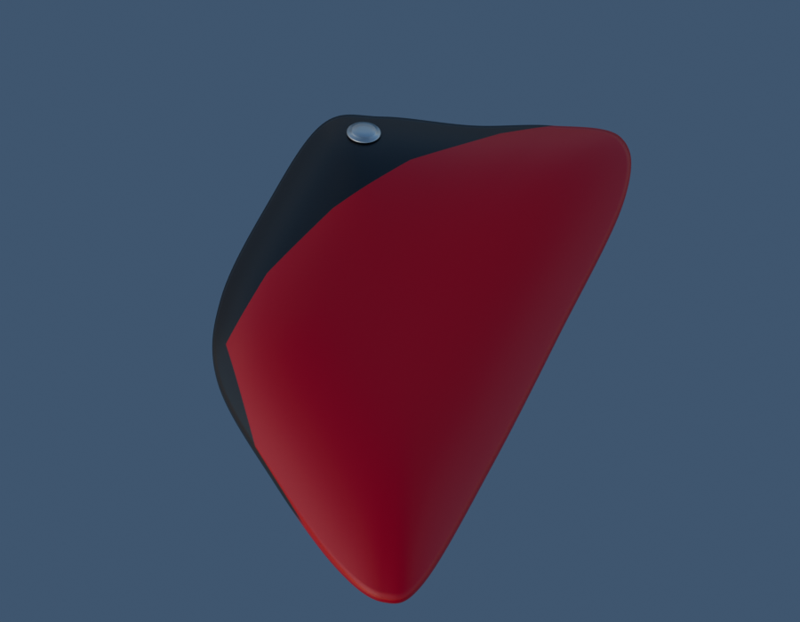

# P01 — cache gauche corrigé et fixation visible

[Sources Blender/GLB et limites](../../../assets-src/moto-components/side-cover-left-v2/README.md) · [Dossier](../../research/powertrain-completion-p01-v2/plan.json) · [Contrôle Babylon de coordination](inspection-v5/engine-check.json) · [Contrôle indépendant](independent-export-check.json) · [Manifestes](production-manifest.json).

Révision du même composant, pas une nouvelle identité ajoutée au compteur. Échelle reprise sur la base555px/1285mm, environ30% supérieure à l’hypothèse v1. La profondeur reste estimée. La tête basse visible est présente en contexte ; son empreinte de vissage n’est pas inventée.

Trois vues natives96 et une vue Babylon ont été ouvertes par la coordination. Les contrôles réels portent sur deux maillages et28 688 triangles ; le contrôle source de peau porte sur26 640 triangles, les2 048 autres concernent la tête séparée. Les images et contrôles de l’auteur restent conservés.

Géométrie du revers, séparation réelle coque/support et pose avec réservoir/selle/cadre restent à résoudre. P01 n’est pas complet, aucune réception artistique ou qualification iPhone.
