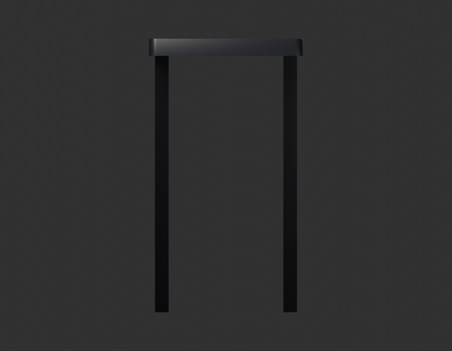
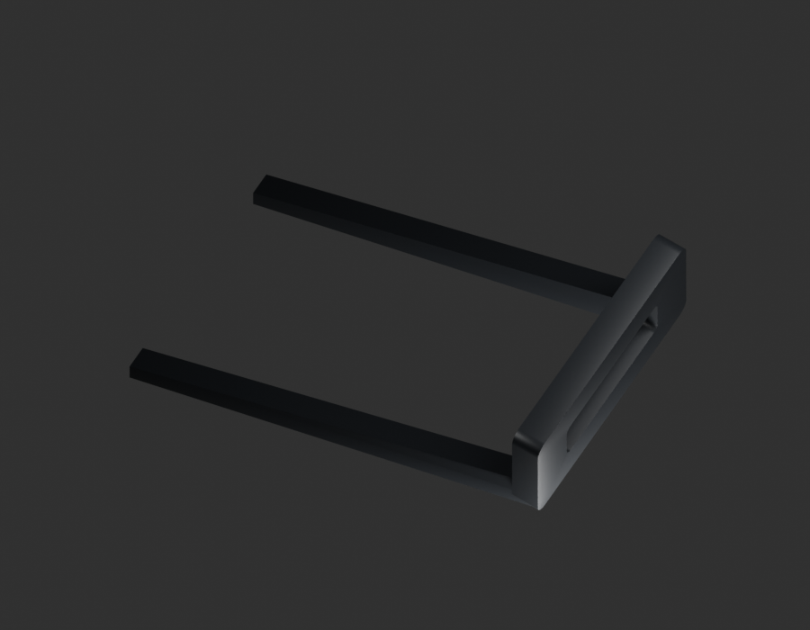
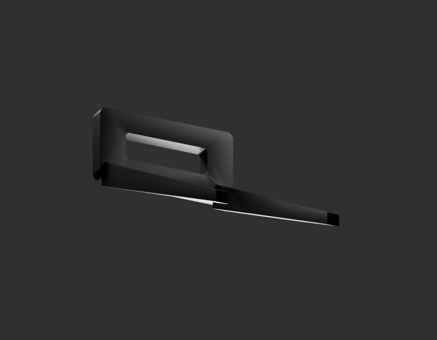
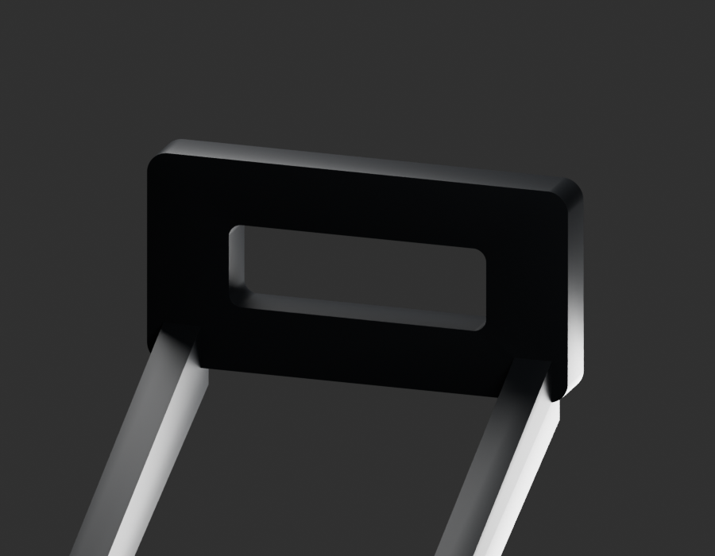

# P01 — MOTO-SIDE-COVER-LH-WINDOW-CATCH-001 — bounded exterior candidate

[Source Blender](../../../assets-src/moto-components/side-cover-left-window-catch-v1/child-candidate.blend) · [GLB](../../../assets-src/moto-components/side-cover-left-window-catch-v1/child-candidate.glb) · [Dossier](../../../creative/research/side-cover-left-window-catch-v1-coordination-v1/G0-G2-plan-v1.json) · [Étude auteur](../side-cover-left-window-catch-v1/delivery.json)

[Source rouverte](source-geometry-check.json), [export réel](export-buffer-check.json), [rendus96 associés à la source figée](render-report.json), [EXR FLOAT32](raw-render-check.json), [quatre vues Babylon de coordination](inspection-v5/engine-check.json), [lecture réelle](coordinator-review.json), [manifestes](production-manifest.json). Les images et rapports auteur restent inchangés. Leur association à la source est vérifiée dans le lot figé. Une éventuelle vue indépendante `coordination-neutral` est identifiée séparément avec sa provenance ; elle ne modifie pas la source.

Attache interne supérieure du cache latéral gauche : fenêtre rectangulaire et deux longues nervures effilées relues en quatre natifs96 et Babylon, dont macro de racine. Source de démontage BM150 noire/argent, équivalence au cache rougeRDC non établie. Le petit relief interne non résolu, le pion inférieur, le récepteur et tout mécanisme caché sont omis. Terminaison de revue, pas cache complet ou fermeture montée.

Les dimensions et interfaces restent estimées. Aucune réception artistique ou qualification matérielle n’est transmise. Le paquet reste ouvert pour ses enfants et raccords manquants.
