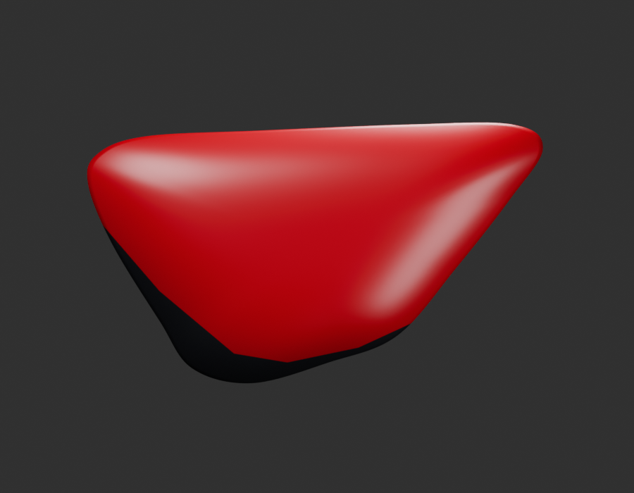
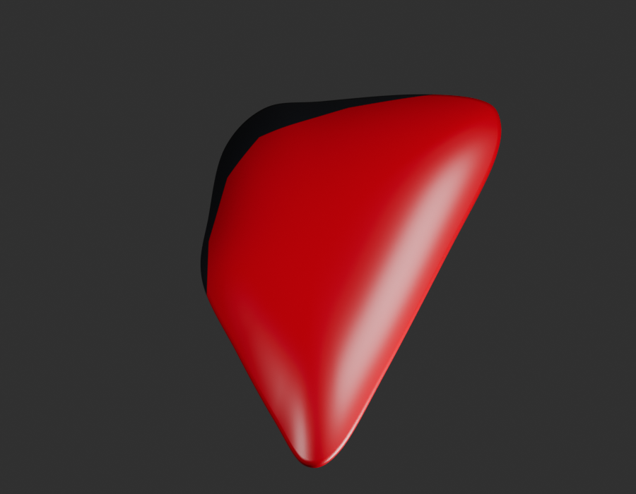
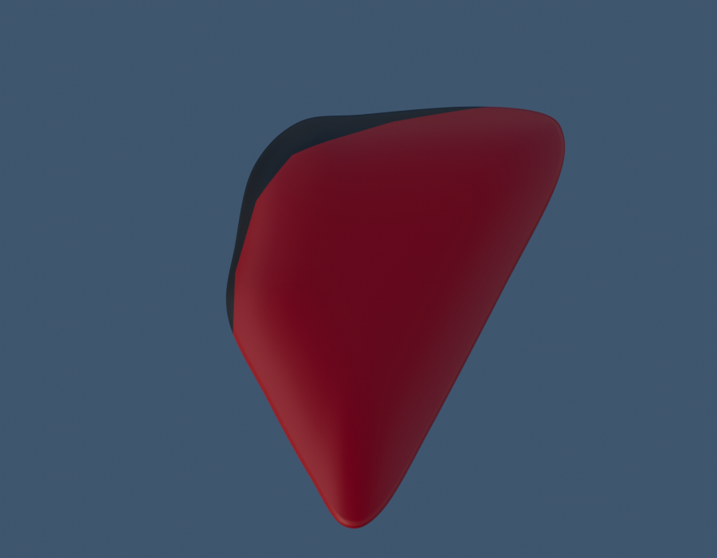

# P04 — MOTO-SIDE-COVER-RIGHT-SKIN-001 — bounded exterior candidate

[Source Blender](../../../assets-src/moto-components/side-cover-right-v1/side-cover-right-candidate-v1.blend) · [GLB](../../../assets-src/moto-components/side-cover-right-v1/side-cover-right-candidate-v1.glb) · [Dossier](../../../creative/research/powertrain-completion-p04-v1/plan.json) · [Étude auteur](../side-cover-right-v1/delivery.json)

[Source rouverte](source-geometry-check.json), [export réel](export-buffer-check.json), [rendus96 associés à la source figée](render-report.json), [EXR FLOAT32](raw-render-check.json), [quatre vues Babylon de coordination](inspection-v5/engine-check.json), [lecture réelle](coordinator-review.json), [manifestes](production-manifest.json). Les images et rapports auteur restent inchangés. Leur association à la source est vérifiée dans le lot figé ; aucun second rendu indépendant n’est revendiqué.

Cache droit tracé indépendamment depuis la vue droite ; orientation de revue locale, profondeur et jonction rouge/noir estimées. Fixation basse, revers et pose avec selle/réservoir/cadre restent à fabriquer ou vérifier. Les graphismes constructeur ne sont pas copiés.

Les dimensions et interfaces restent estimées. Aucune réception artistique ou qualification matérielle n’est transmise. Le paquet reste ouvert pour ses enfants et raccords manquants.
