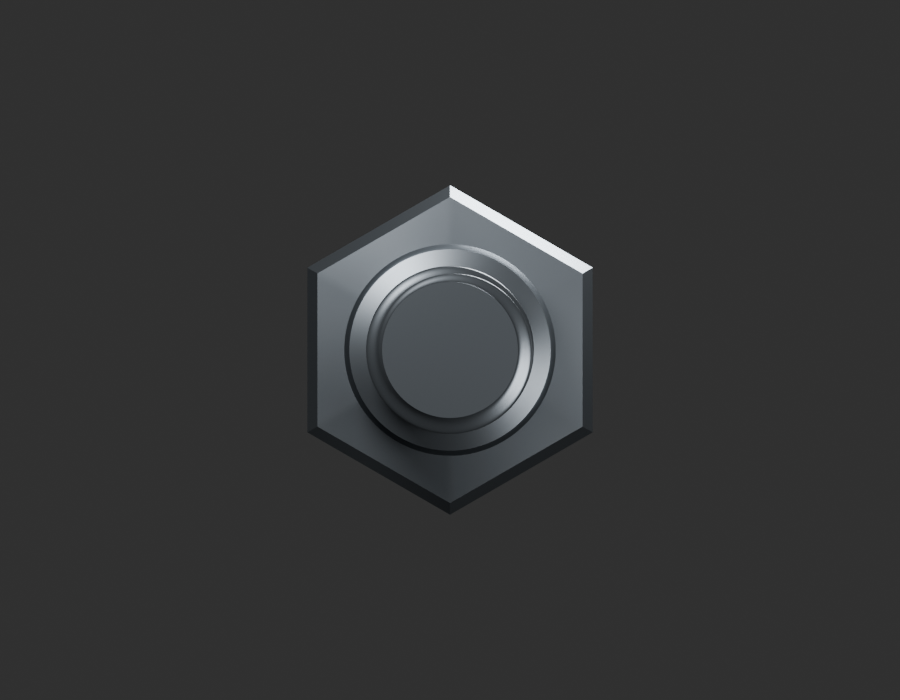
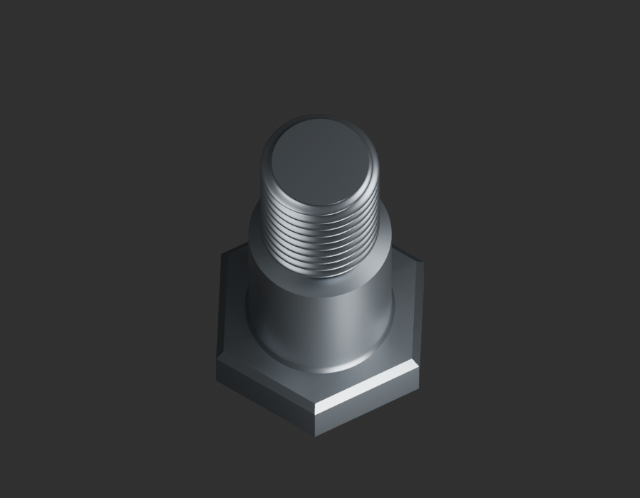
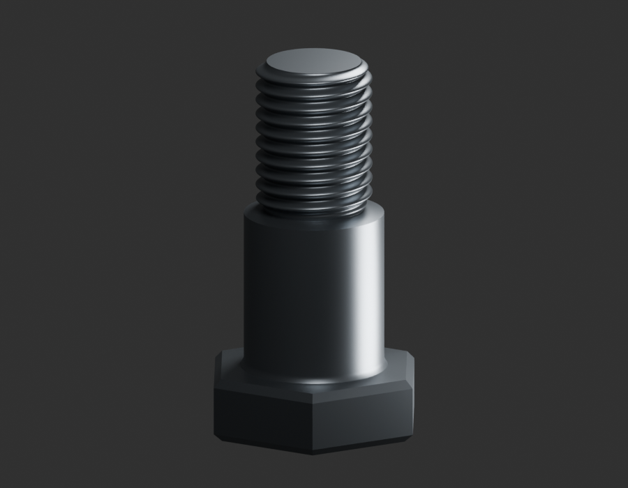

# P17 — MOTO-SIDE-STAND-PIVOT-BOLT-001 — bounded exterior candidate

[Source Blender](../../../assets-src/moto-components/side-stand-pivot-bolt-v1/child-candidate.blend) · [GLB](../../../assets-src/moto-components/side-stand-pivot-bolt-v1/child-candidate.glb) · [Dossier](../../../creative/research/powertrain-completion-p17-v1/side-pivot-physical-plan-v11.json) · [Étude auteur](../side-stand-pivot-bolt-v1/delivery.json)

[Source rouverte](source-geometry-check.json), [export réel](export-buffer-check.json), [rendus96 associés à la source figée](render-report.json), [EXR FLOAT32](raw-render-check.json), [quatre vues Babylon de coordination](inspection-v5/engine-check.json), [lecture réelle](coordinator-review.json), [manifestes](production-manifest.json). Les images et rapports auteur restent inchangés. Leur association à la source est vérifiée dans le lot figé. Une éventuelle vue indépendante `coordination-neutral` est identifiée séparément avec sa provenance ; elle ne modifie pas la source.

Tête hexagonale, portée lisse et filet modélisé visibles. Cote de tête, pas, sens, longueur d’engagement, écrou et jeu de pivot sont estimés ; aucun montage reçu.

Les dimensions et interfaces restent estimées. Aucune réception artistique ou qualification matérielle n’est transmise. Le paquet reste ouvert pour ses enfants et raccords manquants.
