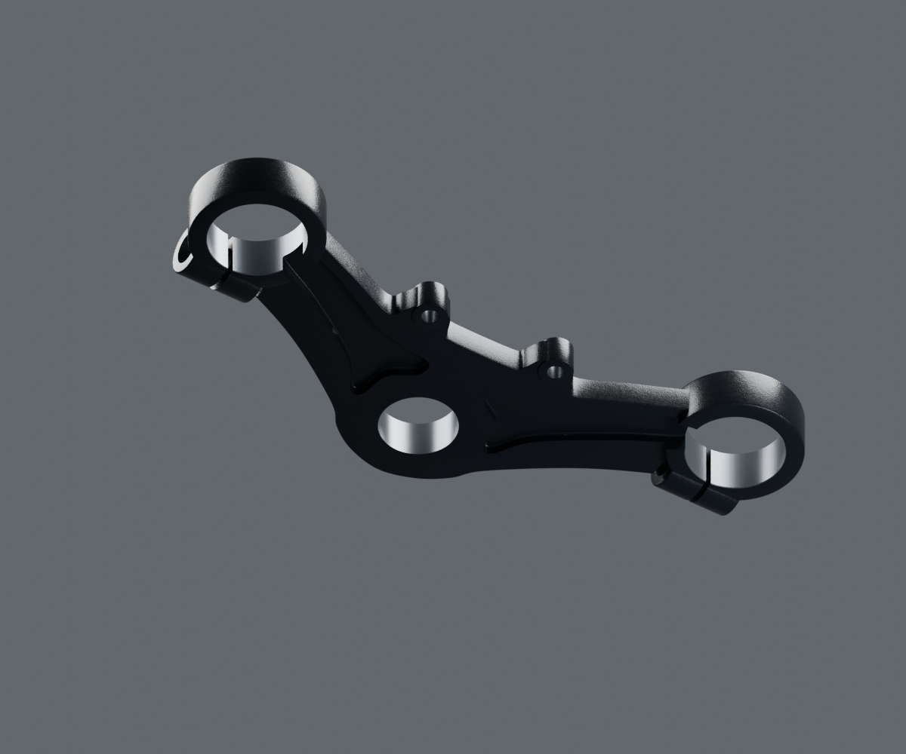

# Corps inférieur de direction — revue isolée v1

Candidat DS181020 de variante liée, corps seul : colonne, vis et roulements ne sont pas fabriqués par ce fichier. Le procédé métallique réel reste non confirmé. Toutes les cotes et sections de travail portent leur estimation.

Rendus réels Blender4.3.2/Cycles96+OIDN, checkpoints hachés par vue. [Contrôle source](source-geometry-check.json), [vrais buffers et coupes par rayons](geometry-check.json), [invariance avant/après matière](geometry-preservation-check.json), [matières originales](material-build-report.json), [pixels embarqués](material-buffer-check.json).

La [revue grise](geometry-gray-review.json) précède la finition : les arrondis du corps, des bossages et des oreilles ont été ajoutés avant union, puis relus. Les ouvertures sont de vrais vides. Les portées plus lisses sont distinguées du revêtement observé ; aucune carte normale ne leur ajoute le grain extérieur.

Les [références et conflits](../../research/steering-triples/lower-v1.json) conservent les trois vuesSCL utilisées et la quatrième non appariée. Les fonds de perçage cachés, les filetages femelles et l’empilage restent inconnus ou estimés. L’identité exacteRDC, la compatibilité mécanique et la réception artistique ne sont pas acquises.
