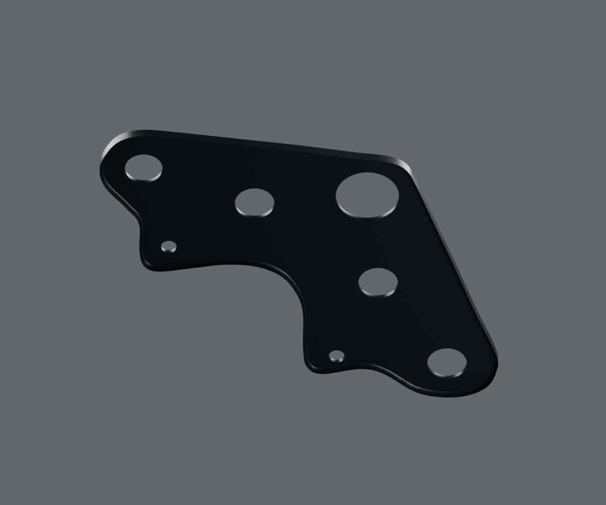

# Té supérieur — revue isolée v1

Candidat DS181005 de variantes liées, aucune conformité125HD RDC annoncée. Cinq passages de taille moyenne/grande et deux petits passages ont des parois réelles ; aucune fonction n’est inventée depuis leur position.

Rendus réels Blender4.3.2/Cycles96+OIDN, avec checkpoints hachés par vue. [Contrôle source](source-geometry-check.json), [buffers glTF](geometry-check.json), [invariance de géométrie et normales avant/après matière](geometry-preservation-check.json), [matière originale](material-build-report.json), [pixels embarqués](material-buffer-check.json).

La [revue grise](geometry-gray-review.json) conserve les deux vues de forme à24échantillons, avant matière. La construction des rangées du bord a été affinée pour éviter les reflets irréguliers de la première préparation. Le micrograin ne remplace pas cette correction.

Les [sources et paramètres](../../research/steering-triples/upper-v1.json) conservent l’échelle artistique, les incertitudes et la variante. La coupe cachée du bord, les cotes physiques et l’empilage restent estimés. Aucun montage mécanique, rendu mobile ni réception artistique acquis.
