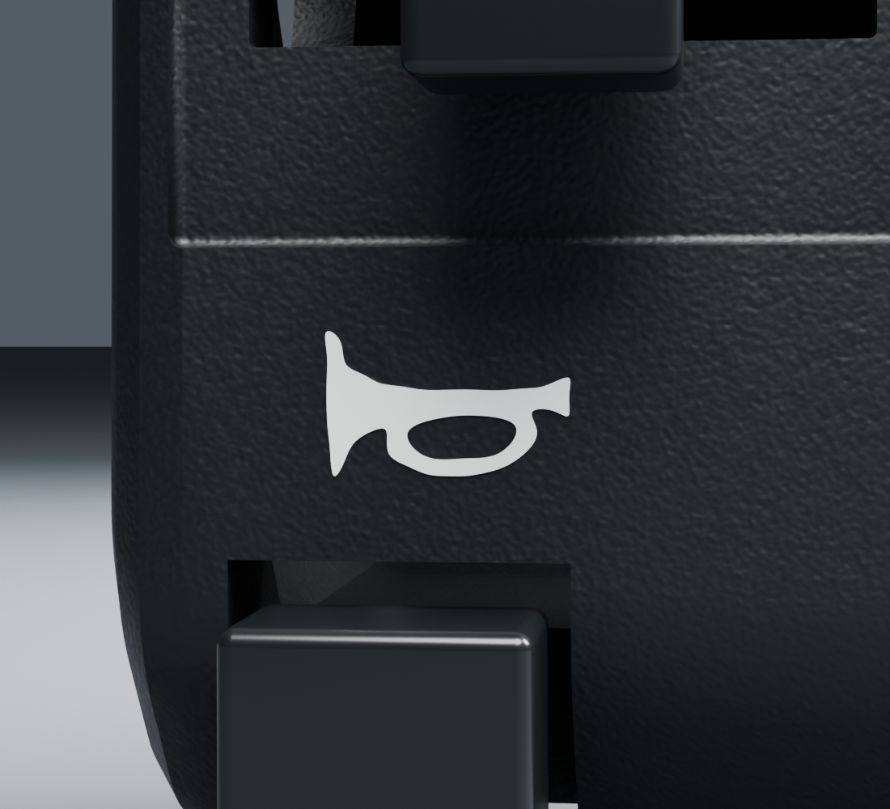

# Commodo gauche v3 — revue ciblée des pictogrammes

La révision conserve les corps et commandes v2 et remplace uniquement les trois contours d’encre par des courbes lissées. Dix nœuds protégés sont bit-identiques dans les vrais buffers, matières/images et matrices. Les dix traits des deux phares ont chacun six nœuds de capsule, leurs espaces restent ouverts ; les D et le klaxon conservent leurs ajours. Borne documentaire totale1,82px dans notre incertitude de travail2px, sans calibration physique.

Les deux images ci-dessous sont les vrais rendus du gel a8cde775 /25fe15ea : Cycles96,1100×1000, OpenImageDenoiseCPU. Source/configuration/PNG/EXR sont hachés par vue ; les canaux HDR proviennent de l’en-tête réel. Le preview de l’ensemble entier et les deux détails a été lu avant les96. Le mauvais essai au near-clip100mm est exclu et archivé en privé ; la correction1mm ne modifie pas la pièce.

Les corps inchangés réutilisent leur preuve v2 par identité, sans nouvelle réception. La variante actuelle RDC, les cotes exactes, la BRDF mesurée, l’électricité et Safari physique restent non qualifiés. Le composant reste candidat en attente de réception artistique.
