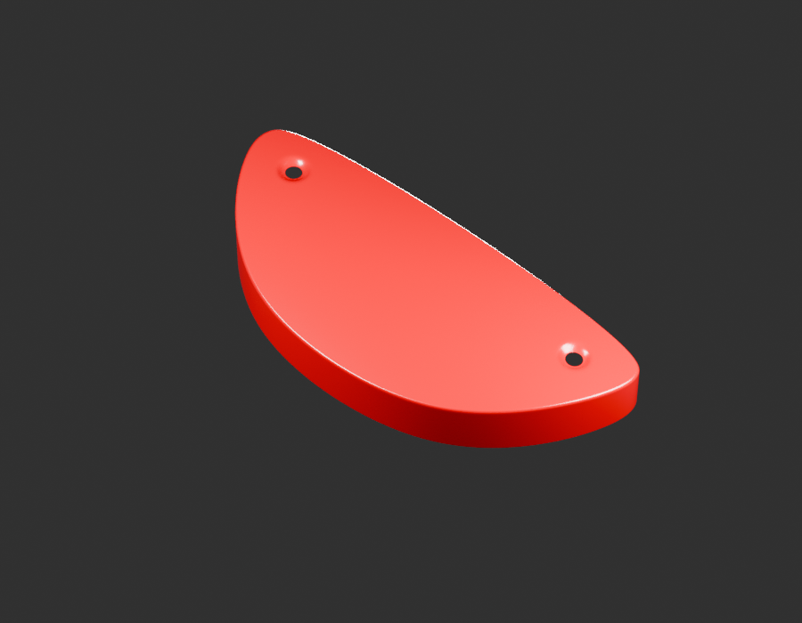
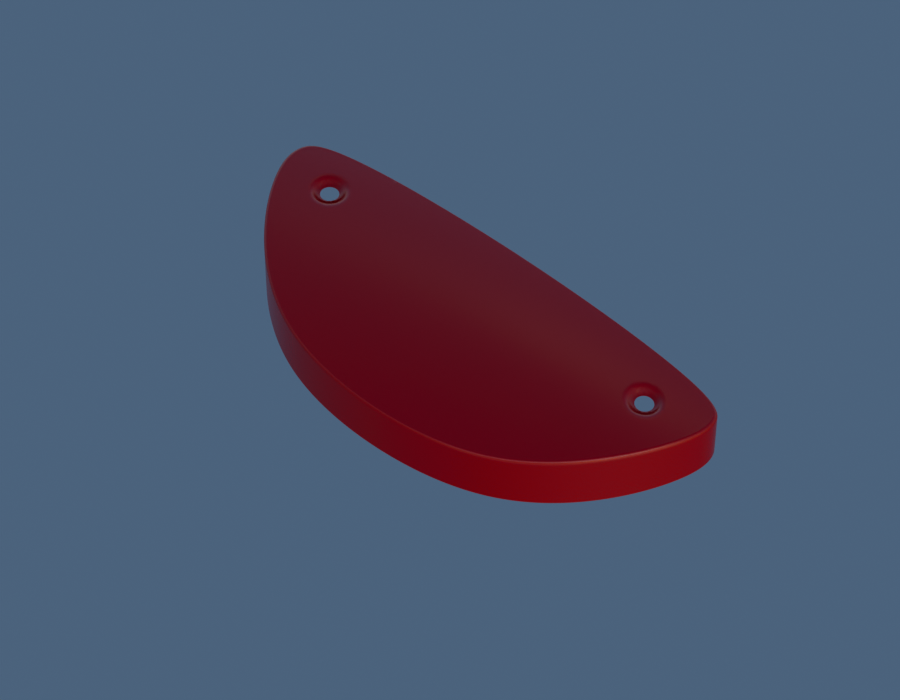
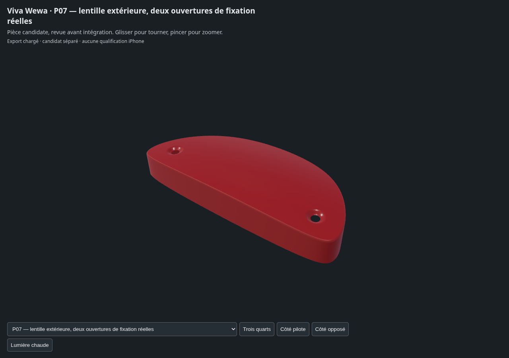

# P07 — tail-lamp-perforated-outer-lens-v3

**Un enfant candidat, pas un paquet terminé ni réceptionné.** Alternative revision of existing outer lens identity: visible convex skin, two separately observed side apertures/recesses and rolled outer return. New related BM150 lens photograph supports fixing wells; current RDC correspondence remains uncertain. Rear boundary and two holes open, no inner prism pattern, material gauge, screw stack or complete optical assembly. No second physical lamp claimed.

[Sources Blender/GLB et paramètres](../../../assets-src/moto-components/tail-lamp-perforated-outer-lens-v3/README.md) · [Dossier documentaire](../../../creative/research/tail-lamp-perforated-outer-lens-v3/G0-G2-plan-v1.json).

Gris réellement relus : [face](gray-front.png), [trois-quarts](gray-quarter.png), [revers](gray-reverse.png), [décision](gray-review.json). Aperçus : [studio](preview-studio.png), [neutre](preview-neutral.png), [décision](preview-review.json).

[Triangles/normales/UV/topologie réels](independent-export-check.json), [transfert source](source-geometry-check.json), [rendus96](render-report.json), [canaux EXR](raw-render-check.json), [quatre vues Babylon](inspection-v3/engine-check.json), [revue](coordinator-review.json), [manifestes](production-manifest.json).

Exposition0, gamma1, AgX Medium High Contrast et HDRI artistique0,65 ; pas d’étalonnage colorimétrique. Dimensions, sections et interfaces restent estimées. Aucune réception artistique, pose certifiée ou mesure iPhone.
