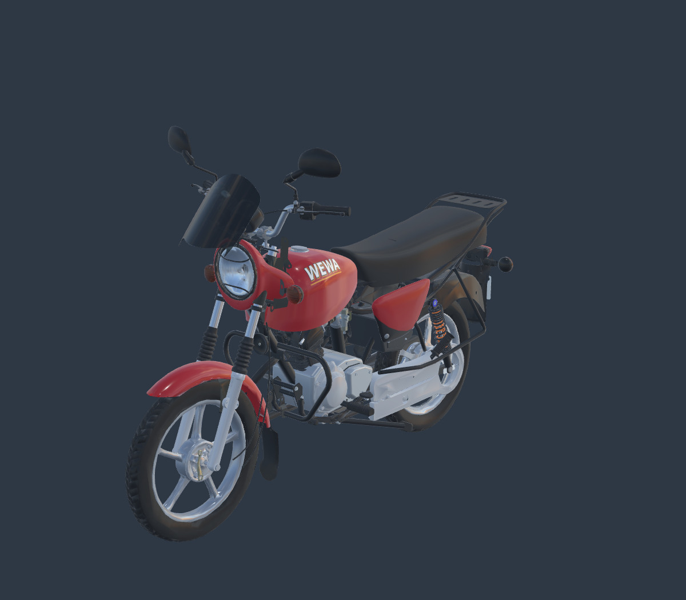
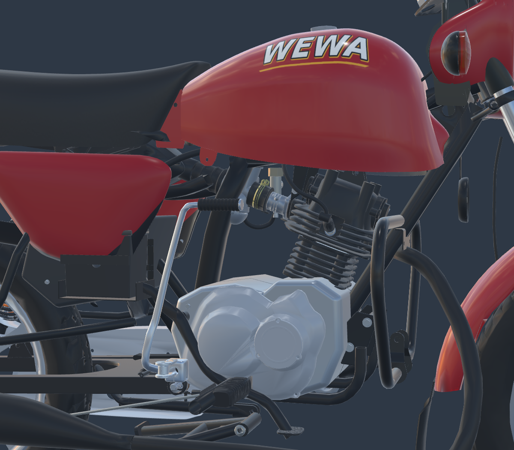

# Moto WEWA — complément extérieur sous le réservoir

La zone signalée par l’utilisateur contient déjà le cylindre, la culasse et le carburateur. La transmission primaire et la boîte se trouvent dans le bloc moteur ; la transmission finale par chaîne rejoint la roue arrière sous son carter. La comparaison avec les vues officielles montre aussi des espaces réellement ouverts : il ne faut pas transformer tout le dessous du réservoir en bloc plein.

Ce candidat ferme les études de carter incomplètes et ajoute les enveloppes, supports et raccords visibles manquants. **Reconstruction visuelle autorisée par l’utilisateur, dimensions estimées ; réception artistique à faire.** Le fichier livré est un véritable modèle 3D, et les images ci-dessous sont des rendus Babylon.js de ce fichier.



## Références constructeur

Page [Bajaj Boxer 125 HD — RDC](https://www.bajajauto.com/fr-cd/bikes/boxer-125hd), consultée le 22 octobre 2026. Le [profil officiel](https://cdn.bajajauto.com/fr-cd/-/media/globalbajajauto/common-media/product-detail-page-banners/boxer/125hd.webp), le [gros plan moteur](https://cdn.bajajauto.com/fr-cd/-/media/globalbajajauto/common-media/features/boxer/125-hd/engine.webp) et les huit angles de la visionneuse rouge à long saute-vent ont été téléchargés et examinés. Les profils [droit](https://cdn.bajajauto.com/fr-cd/-/media/globalbajajauto/common-media/360/boxer/boxer-125-hd-new/red-long-visor/00.png) et [gauche](https://cdn.bajajauto.com/fr-cd/-/media/globalbajajauto/common-media/360/boxer/boxer-125-hd-new/red-long-visor/04.png) contraignent les volumes visibles.

Les originaux restent hors du dépôt public et ne sont pas utilisés comme textures. [URLs, empreintes, observations et droits](../../research/under-tank-completion-v1/sources.json). Une image de synthèse n’a pas servi de référence technique. La génération procédurale produit directement des surfaces éditables dans Blender.

## Changements

| Élément | Réalisation | Certitude |
|---|---|---|
| Carter central | Volume fermé entre les deux couvercles latéraux existants, joint et fixations | Enveloppe estimée sur les raccords existants ; pas d’organes internes |
| Cache de sortie gauche | Surface continue remplaçant l’ancienne étude concave incomplète | Silhouette inspirée du profil gauche officiel |
| Enveloppe noire sous les caches latéraux | Corps fermé et couvercle d’accès | Photo-inférée ; ne certifie pas la séparation batterie/filtre à air |
| Supports moteur avant | Deux platines, entretoises et boulons | Implantation estimée, diamètres illustratifs |
| Attache supérieure moteur | Deux flancs et leurs fixations | Partie cachée sous le réservoir estimée |
| Allumage | Bobine, support et câble jusqu’à l’antiparasite existant | Trajet statique estimé |
| Essence | Raccords et durite du robinet au carburateur | Trajet et prises estimés |
| Faisceau sous réservoir | Gaine principale, branche et clips visibles | Trajet caché estimé |
| Accélérateur | Câble continu entre guide de poignée et coude du carburateur | Trajet statique estimé ; braquage non qualifié |

Dix groupes, 75 maillages fermés et 33 562 triangles nouveaux. Quatre anciens groupes incomplets sont remplacés dans la scène active ; 173 groupes originaux, leurs transformations, matières et textures sont conservés. Le candidat entier affiche 183 groupes, 631 maillages et 973 765 triangles. Le GLB pèse 42 189 600 octets. Les anciens nœuds et buffers restent archivés dans le GLB mais ne sont pas instanciés dans sa scène active ; le contexte Blender retire ces quatre groupes pour éviter leur import parasite.

## Comparaison réelle

| Vue | Avant | Complété |
|---|---|---|
| Trois quarts | [Image](whole-before.png) | [Image](whole-after.png) |
| Profil gauche | [Image](left-before.png) | [Image](left-after.png) |
| Profil droit | [Image](right-before.png) | [Image](right-after.png) |
| Sous réservoir gauche | [Image](detailLeft-before.png) | [Image](detailLeft-after.png) |
| Sous réservoir droit | [Image](detailRight-before.png) | [Image](detailRight-after.png) |
| Pièces remplacées / nouvelles | [Image](isolated-before.png) | [Image](isolated-after.png) |



Même caméra et mêmes lumières pour chaque paire. L’inspecteur permet de tourner autour de la moto et de basculer avant/après : lancer `npx vite --host 0.0.0.0 --port 4143`, puis ouvrir `/tools/under-tank-review-v1/`.

## Fichiers récupérables et contrôles

- [Moto complète GLB](../../../assets-src/moto-components/under-tank-completion-v1/motorcycle-completed-candidate.glb).
- [Contexte Blender complet, textures embarquées](../../../assets-src/moto-components/under-tank-completion-v1/motorcycle-completed-context.blend). Réimport du modèle allégé, pas la source haute résolution historique.
- [Nouvelles pièces Blender](../../../assets-src/moto-components/under-tank-completion-v1/under-tank-completion.blend) et [GLB isolé](../../../assets-src/moto-components/under-tank-completion-v1/additions.glb).
- [Plan de fabrication](../../research/under-tank-completion-v1/plan.json), [contrôle natif](native-check.json), [préservation des buffers originaux](composition-check.json), [triangles et validation glTF](export-check.json), [captures navigateur et commandes tactiles](browser-check.json), [textures embarquées](context-check.json), [empreintes de livraison](production-manifest.json).

Les 75 nouvelles surfaces sont fermées dans Blender, avec volume positif. Tous leurs triangles exportés sont finis et non dégénérés, et leurs normales sont unitaires. Zéro erreur glTF ; l’avertissement préexistant sur les tangentes d’une pièce historique est conservé sans nouvel avertissement. Douze captures réelles, aucun échec JavaScript/HTTP et commandes tactiles contrôlées en émulation Chromium. La correction précédente des pontets et son manifeste restent intacts.

Reproduction :

```sh
blender -b --python-exit-code 1 --python tools/build_under_tank_completion_v1.py
python tools/compose_under_tank_completion_v1.py
node tools/check_under_tank_completion_v1.mjs
blender -b --python-exit-code 1 --python tools/save_under_tank_context_v1.py
# serveur Vite démarré dans un autre terminal
python tools/capture_under_tank_completion_v1.py
python tools/check_under_tank_delivery_v1.py
```

Le rendu extérieur demandé est complété pour cette zone. Les épaisseurs et routes cachées restent des adaptations, sans mesures constructeur ni validation de débattement. Cette livraison ne résout pas les variantes contradictoires de la transmission finale, ne reçoit pas artistiquement toute la moto et n’intègre pas ce modèle au jeu public. Aucun test Safari sur appareil physique n’est déclaré.
