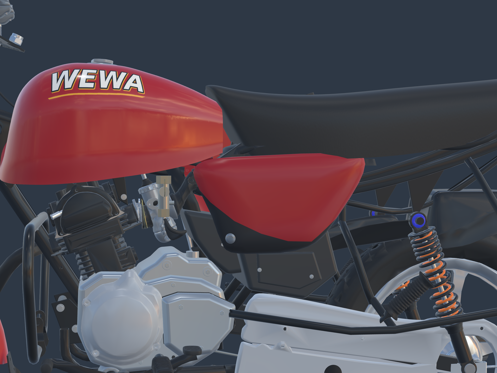

# Agencement sous le réservoir — 24 octobre 2026

Le retour utilisateur sur le vide persistant a conduit à reprendre les **positions relatives** du carburateur, de l’admission, de la boîte à air et des caches latéraux. Comparaison des deux profils officiels Bajaj 00/04, de la grande vue droite et du gros plan moteur de la [Boxer 125 HD RDC](https://www.bajajauto.com/fr-cd/bikes/boxer-125hd).

[Profil gauche](left-high-resolution.png) · [Profil droit](right-high-resolution.png) · [Gros plan droit](centre-right-high-resolution.png) · [Moto entière 3840 × 2880](front-high-resolution.png) · [Arrière 3840 × 2880](rear-high-resolution.png) · [Plaque Art. / 015](plate-high-resolution.png).

## Comparaison et adaptation

Sur la photo officielle, la pointe avant du cache latéral passe sous l’arrière du réservoir. L’ancien modèle ne reproduisait qu’environ 42 mm de recouvrement longitudinal ; le nouveau atteint 117 mm. La lecture manuelle de la vue 04 donne un recouvrement d’environ 0,093 fois l’empattement : le modèle corrigé atteint 0,091. L’incertitude de lecture est d’environ ±5 pixels ; ce repère de silhouette n’est pas une cote OEM ni une calibration de perspective.

Le carburateur complet est avancé de 45 mm et abaissé de 35 mm, sans déformer ses pièces. La distance verticale entre les enveloppes de sa cuve et de l’épaulement du carter passe de 51 à 16 mm. Cette mesure décrit les enveloppes du modèle, **pas un jeu mécanique certifié**. Les caches latéraux avancent de 75 mm à hauteur constante ; la boîte à air et son enveloppe inférieure suivent de 60 mm. Le conduit d’admission est raccourci et raccordé par déformation continue ; le manchon arrière, la durite d’essence et le câble d’accélérateur suivent le nouveau carburateur en conservant leurs extrémités fixes.

La hauteur du cylindre et de la culasse, le carter principal, le réservoir et la selle sont conservés. Un essai d’abaissement du haut moteur a été écarté parce qu’il créait un nouveau vide. Les ouvertures de refroidissement devant le cylindre restent présentes, comme sur les photos.

Avant : [profil gauche](before-left-preview.png), [gros plan gauche](before-centre-preview.png), [gros plan droit](before-centre-right-preview.png). Les captures avant/après partagent leurs caméras ; les profils du modèle sont orthographiques. Les photos officielles gardent leur propre perspective.

## Source et vérifications

- [Source Blender éditable](../../../assets-src/moto-components/under-tank-layout-v3/motorcycle-layout.blend), [GLB autonome](../../../assets-src/moto-components/under-tank-layout-v3/motorcycle-layout.glb), [visionneuse](../../../tools/under-tank-layout-review-v3/index.html) (`?before=1` pour la version précédente).
- [Plan, repères et essais écartés](../../research/under-tank-layout-v3/plan.json), [références vérifiées](../../research/under-tank-layout-v3/references.json), [mesures source avant/après](measured-check.json).
- [Composition](composition-check.json), [export](export-check.json), [captures](browser-check.json), [empreintes de livraison](manifest.json).

Dix transformations d’assemblage et onze maillages de raccord adaptés. Les buffers originaux et tous les matériaux sont conservés ; les attributs ajustés sont ajoutés séparément. Deux triangles déjà sans aire dans le conduit quantifié d’origine sont retirés de son export ajusté. Les normales suivent les déformations. Contrôles de source/export, de géométrie et de rendu effectués : zéro erreur glTF, aucun nouvel avertissement et sept captures Babylon sans erreur JavaScript/HTTP. Les anciens fichiers restent inchangés.

La plaque conserve **Art.** puis **015**. Les ajustements sont estimés d’après les photos ; la réception artistique, les débattements et l’optimisation pour le jeu restent à vérifier. Le candidat statique n’est pas intégré au jeu public.

Reproduction : `blender -b --python-exit-code 1 --python tools/build_under_tank_layout_v3.py`, puis `python tools/compose_under_tank_layout_v3.py`, `node tools/check_under_tank_layout_export_v3.mjs` et `blender -b --python-exit-code 1 --python tools/measure_under_tank_layout_v3.py`. Avec Vite sur le port 4143, lancer `python tools/capture_under_tank_layout_v3.py`. Vérifier la livraison avec `python tools/check_under_tank_layout_delivery_v3.py`.
