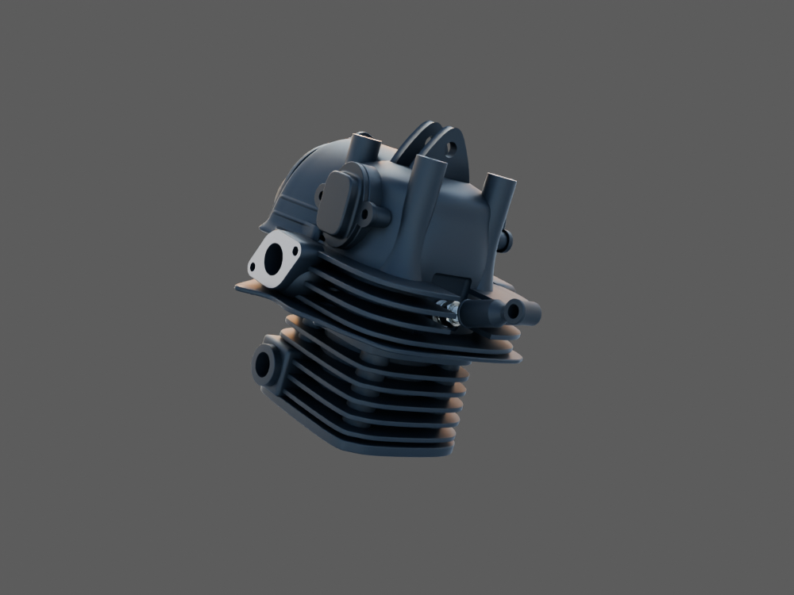
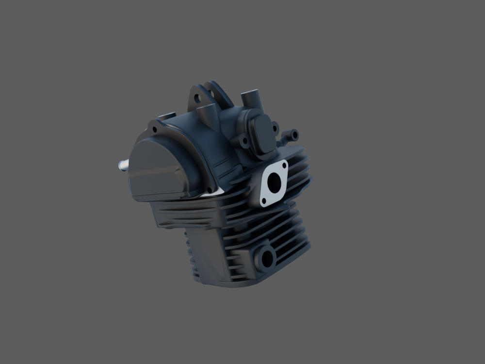

# Haut moteur — sept sources liées pour revue

Cette scène Blender réunit le cylindre1, la culasse3, les deux instances du couvercle de visite1, le corps OHC1, son embout1, la bougie2 et le capuchon2. Les sept bibliothèques restent éditables séparément et conservent leurs repères provisoires. Aucun placement, conducteur ou mécanisme caché n'est ajouté. Ce n'est pas un moteur complet ni un montage reçu.

Les quatre aperçus natifs sont de vrais rendus Blender à 12 échantillons, sous deux caméras perspectives et deux lumières. Ils permettent une lecture d'ensemble ; les finales détaillées de chaque pièce restent leurs preuves distinctes. Une carte diffuse 18 % sert à fixer l'exposition, sans étalonnage radiométrique du HDR ni calibration photographique des caméras. Les matières et géométries des sources ne sont pas modifiées.

La [source Blender liée](../../../assets-src/moto-components/upper-engine-current-review-v1/upper-engine-current-review-v1.blend) et le [GLB de livraison](../../../assets-src/moto-components/upper-engine-current-review-v1/upper-engine-current-review-v1-delivery.glb) sont contrôlés. Le [rapport d'export](export-buffer-check.json) compte 587 164 triangles de primitives uniques ; le dessin des deux couvercles de visite porte ce total à 657 316. Les instances et les sous-matières ne constituent pas de nouvelles pièces.

L'[audit indépendant](../../research/upper-engine-current-review-v1-audit/README.md) retrouve les sept bibliothèques, les douze copies physiques et leurs attributs locaux exacts. Les triangles orientés du GLB correspondent aux sources ; les écarts de transformation en coordonnées monde sont explicitement attribués aux arrondis float32/TRS. Les contrôles de contact existants sont réutilisés avec leurs limites, sans annoncer un nouveau test global de tous les jeux.

Trois [captures Babylon réelles](inspection-linked-v1/engine-check.json) vérifient chargement, textures, cadrage et pixels. L'inspecteur utilise une autre lumière et d'autres caméras ; cette preuve technique ne démontre pas une parité visuelle avec Blender. Aucun contrôle interactif du moteur mécanique n'est revendiqué.

Les sections et profondeurs restent largement estimées. Fixations, joints, fil HT, admission, échappement et raccord avec le reste du moteur ne sont pas fabriqués par cet assemblage. La finition noire et les échelles de grain ne sont pas mesurées ; les photos de culasse nue apparentée ne certifient pas la peinture RDC. Les rendus ne valent ni réception artistique, ni qualification iPhone, ni LOD jouable. Aucun nouveau type physique n'est ajouté au registre.
