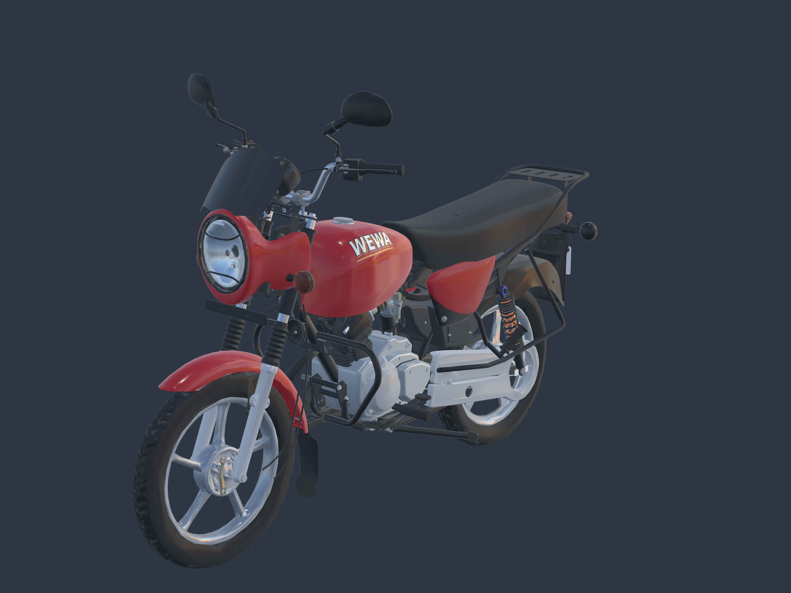

# Cache-chaîne, sous-réservoir et phare — correction visuelle v2

Révision du 23 octobre 2026, réalisée après le retour utilisateur sur l’inclinaison du cache-chaîne, le vide sous le réservoir et les proportions du phare/supports. Comparaison avec les vues 00, 01, 02 et 04 et le gros plan moteur du [constructeur, Boxer 125 HD RDC](https://www.bajajauto.com/fr-cd/bikes/boxer-125hd).

[Profil gauche et cache-chaîne](left-high-resolution.png) · [Profil droit](right-high-resolution.png) · [Transmission en détail](transmission-high-resolution.png) · [Sous le réservoir](centre-high-resolution.png) · [Phare et supports](lamp-high-resolution.png) · [Face](head-high-resolution.png) · [Arrière 3840 × 2880](rear-high-resolution.png) · [Dos](tail-high-resolution.png) · [Plaque Art. / 015](plate-high-resolution.png).

## Vérification et corrections

| Zone | Constat sur les photos et le candidat | Correction livrée |
|---|---|---|
| Cache-chaîne | Le nez est plus haut que l’axe arrière sur la vue 04 ; l’ancien assemblage était trop horizontal | Rotation de 9° autour de l’axe arrière, avec bras oscillant, pivot, bagues, patte et patin associés. Rebord intérieur ajouté derrière le joint des deux demi-coques |
| Sous le réservoir | Volume arrière supérieur du moteur et prolongement inférieur de la boîte à air insuffisants | Épaulement de carter en retrait des couvercles, col inférieur de boîte à air, reniflard et fixations. Les passages d’air devant le cylindre restent ouverts |
| Phare | Coque peu profonde et fourreaux noirs de support absents | Profondeur du boîtier de 72,8 à 120,1 mm ; coiffe prolongée de 50 % en profondeur, retour supérieur reformé continûment ; optique allongée de 12 % en hauteur |
| Support du phare | Tubes supérieurs de fourche largement apparents ; support inférieur absent | Deux fourreaux noirs d’environ 252 mm et traverse inférieure percée, raccordés à la fourche |
| Visière | Silhouette trop longue et interférence visible avec les compteurs | Visière raccourcie et redressée vers l’avant en conservant sa lèvre au-dessus du phare |

Les valeurs ci-dessus mesurent **les modifications du modèle**, pas des cotes OEM. Le repérage manuel sur la photo 04 donne environ 11° pour la ligne pivot/axe, à ±2° près. La mesure indépendante de la source Blender passe de **3,00° à 12,00°** ; l’axe arrière et les deux roues restent strictement à leur place. Les supports cachés et enveloppes sous réservoir sont estimés d’après les photos, avec une incertitude de l’ordre de 10–20 mm.

Avant : [profil gauche](before-left-preview.png), [trois quarts](before-front-preview.png), [zone moteur](before-centre-preview.png), [phare](before-lamp-preview.png). Les vues de profil avant/après utilisent la même projection orthographique ; les autres vues partagent leurs caméras de contrôle. Les photos constructeur conservent leur perspective et ne sont pas présentées comme une superposition calibrée.

Référence officielle de profil, affichée depuis le CDN du constructeur :

## Fichiers et preuves

- [Modèle GLB autonome](../../../assets-src/moto-components/visual-proportions-v2/motorcycle-proportions.glb) ; [source Blender éditable](../../../assets-src/moto-components/visual-proportions-v2/motorcycle-proportions.blend).
- [Plan et observations photo](../../research/visual-proportions-v2/plan.json), [sources officielles et empreintes](../../research/under-tank-completion-v1/sources.json), [mesures avant/après](measured-check.json).
- [Composition du GLB](composition-check.json), [contrôles d’export](export-check.json), [rendus Babylon](browser-check.json), [manifeste de livraison](manifest.json).

La coiffe est une déformation continue de la source, avec correction analytique de ses normales. Son ancienne version est conservée mais inactive ; il n’y a pas de panneau rouge superposé. Sa topologie native antérieure est conservée. L’export nettoie 125 triangles sans aire, sans toucher aux positions, normales ou matériaux ; [export brut](../../../assets-src/moto-components/visual-proportions-v2/proportion-additions-raw.glb) et [relevé du nettoyage](triangle-cleanup.json) sont gardés. La fermeture des 30 nouveaux maillages est contrôlée séparément de cette coque héritée.

Contrôles : zéro erreur glTF, aucun nouvel avertissement, sommets finis et triangles non dégénérés dans les ajouts exportés ; 21 transformations comparées entre source et export ; dix captures Babylon sans erreur JavaScript/HTTP. Les images sont rendues à leur résolution native : 3840 × 2880 pour les trois quarts avant/arrière, 2560 × 1920 pour les autres. Aucun agrandissement ou remplacement par une image générée.

La revue porte sur la présentation statique demandée. La réception artistique globale, les débattements mécaniques et l’optimisation pour le jeu restent distincts. La plaque conserve **Art.** puis **015**. Le jeu public n’est pas remplacé par ce candidat.

## Reproduction

Depuis la racine : `blender -b --python-exit-code 1 --python tools/build_visual_proportions_v2.py`, puis `python tools/clean_visual_proportions_export_v2.py`, `python tools/compose_visual_proportions_v2.py` et `node tools/check_visual_proportions_export_v2.mjs`. Les mesures utilisent `tools/measure_visual_proportions_v2.py` avec Blender. Servir le dépôt par `npx vite --host 0.0.0.0 --port 4143`, puis lancer `python tools/capture_visual_proportions_v2.py`. La [visionneuse](../../../tools/visual-proportions-review-v2/index.html) accepte `?before=1`. Les empreintes sont contrôlées par `python tools/check_visual_proportions_delivery_v2.py`.
