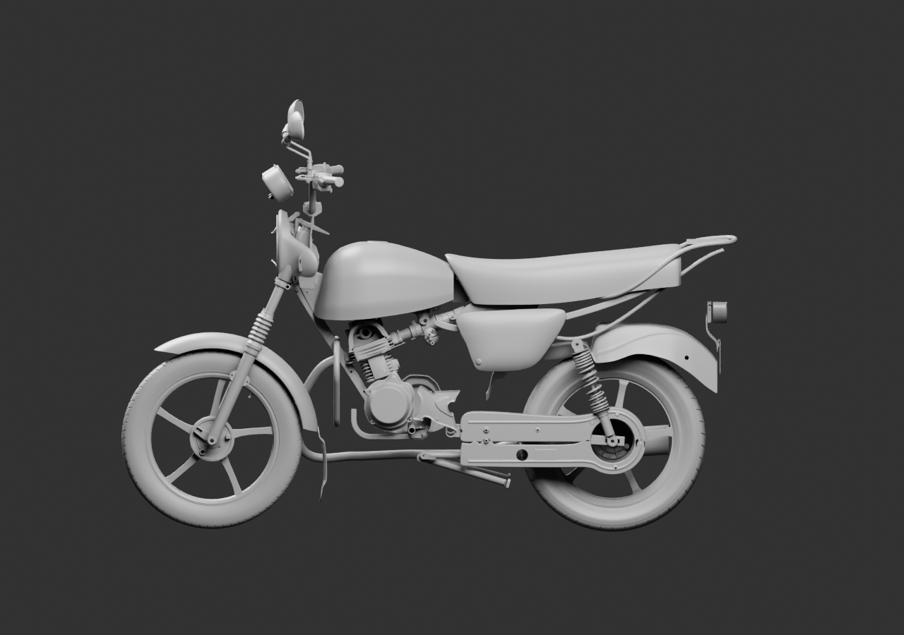
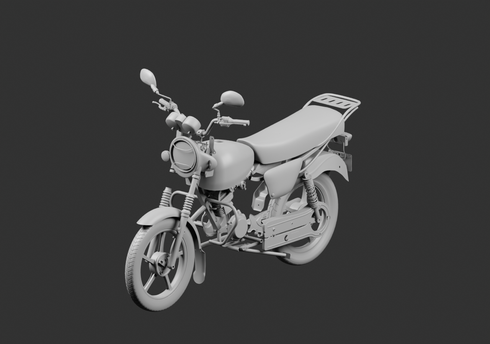
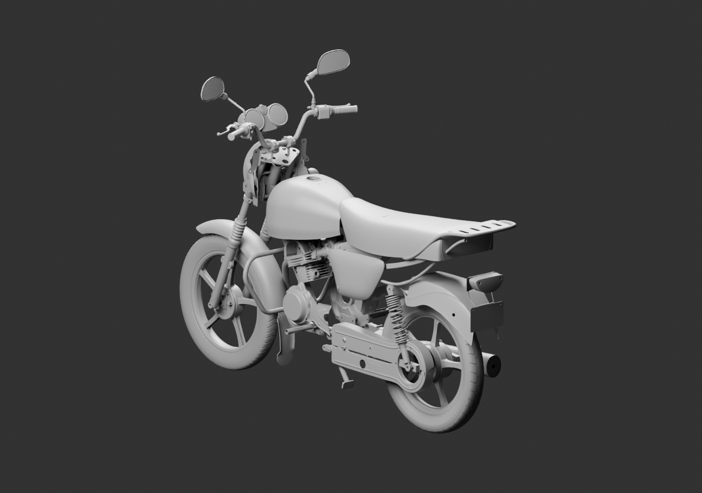

# Contexte global — 84 parents, poses des béquilles corrigées

Les béquilles existantes sont déplacées rigidement après le refus de v9. Le chevauchement latéral visible avec le garde-chaîne disparaît. Le [contrôle des surfaces réelles](../../research/whole-exterior-coverage-v10/folded-stand-context-bounds-v2.json) ne détecte aucun croisement de triangles sur neuf paires avec les deux carters de chaîne et le pneu arrière. Un chevauchement de boîtes englobantes subsiste pour la centrale et le carter inférieur ; il ne suffit pas à prouver une pénétration.

Un seul exemplaire du clignotant est présent. Pas de duplication des unités en attente. Les pivots, butées, ressorts et raccords restent non qualifiés ; ce diagnostic n’est pas une validation mécanique.

[Source liée](../../../assets-src/moto-components/whole-exterior-coverage-v10/whole-exterior-coverage-v10.blend) · [Réouverture](native-reopen-check.json) · [Lecture réelle](coordinator-review.json) · [EXR](raw-render-check.json). Trois vues16échantillons, aucune réception G8.
