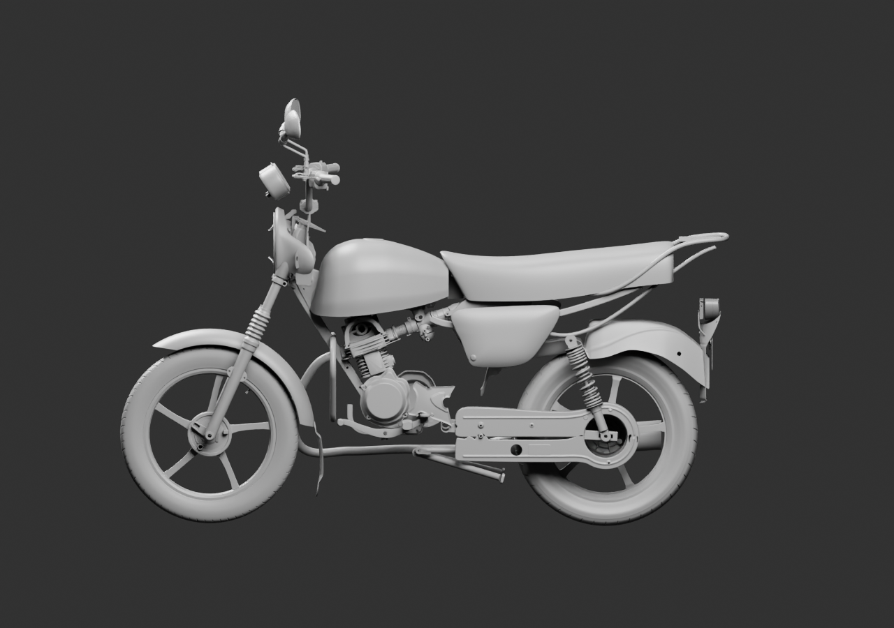
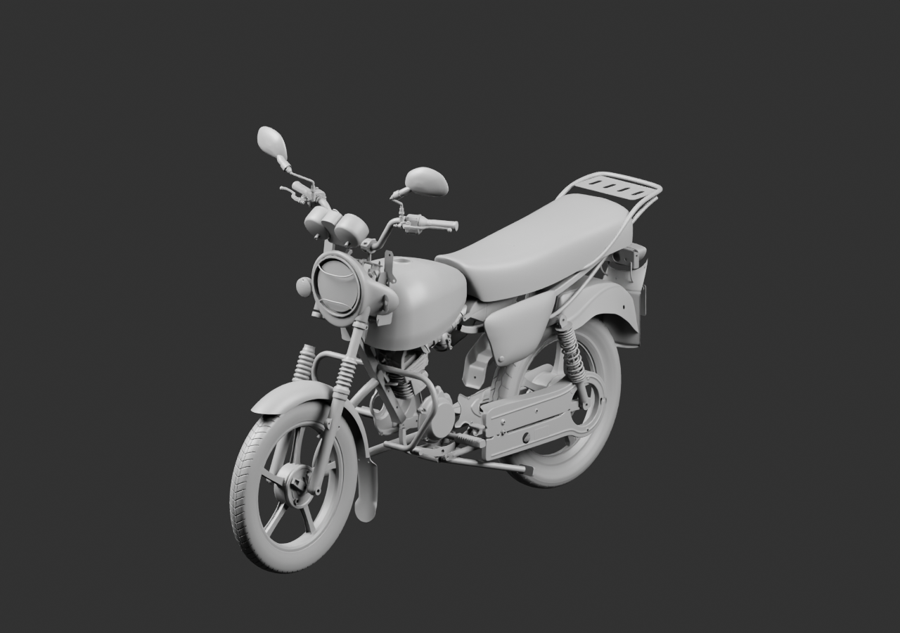
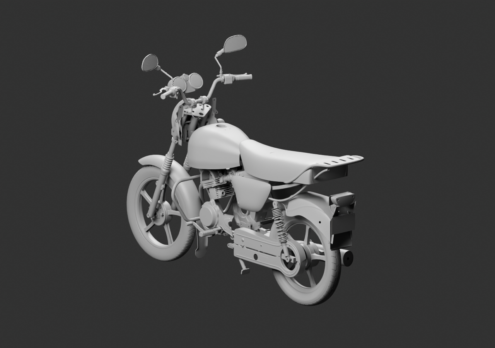

# Diagnostic global — 88 parents liés

Sélecteur extérieur existant, bavette arrière JV181410, cache droit normalisé et un manchon conducteur DF161413 ajoutés sans nouvelle géométrie de pièce. Le sélecteur conserve ses cinq sources natives imbriquées et leurs séparations de revue. Les contrôles de réouverture vérifient aussi ces dépendances.

Ces trois vues regardent depuis le côté gauche : elles ne suffisent pas à recevoir le cache droit. Un complément droit, face et arrière est nécessaire. Les cotes nominales du manchon et du tube interfèrent de6mm en hauteur ; aucune compression, retenue ou compatibilité mécanique n’est certifiée. La liaison bavette/coque/plaque reste à contrôler.

[Source Blender](../../../assets-src/moto-components/whole-exterior-coverage-v11/whole-exterior-coverage-v11.blend) · [Sources et poses](linked-parents-check.json) · [Réouverture avec dépendances](native-reopen-check.json) · [Lecture réelle](coordinator-review.json) · [Hypothèses](../../research/whole-exterior-coverage-v11/layout-plan-v11.json) · [EXR](raw-render-check.json).

88 parents ne signifient pas88 pièces physiques finies. Placements estimés, sources de variantes conditionnelles, aucune répétition d’exemplaire en attente ou réception G8.
