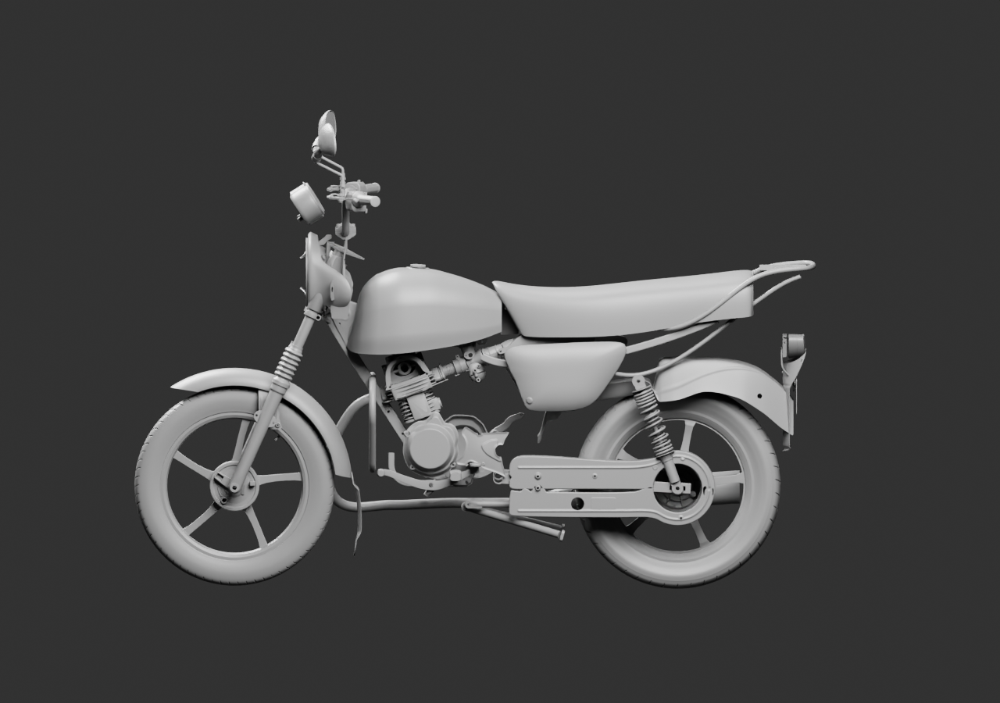
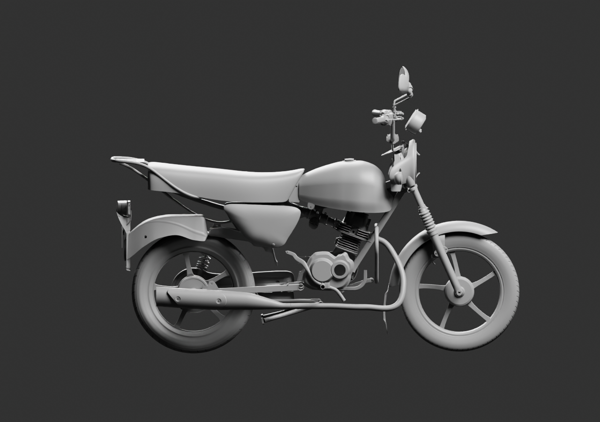
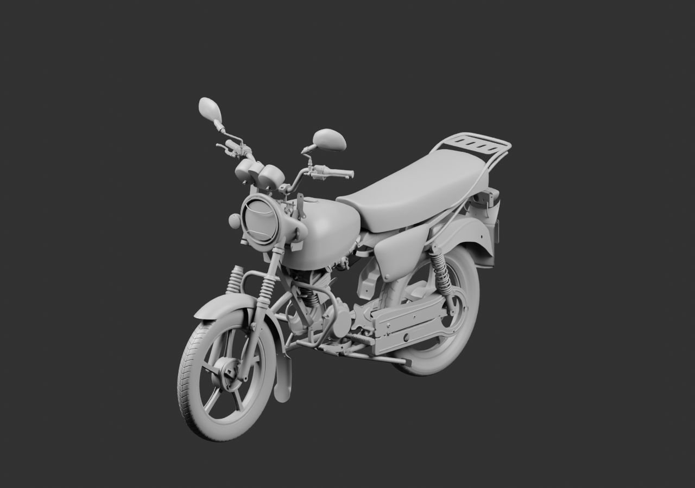
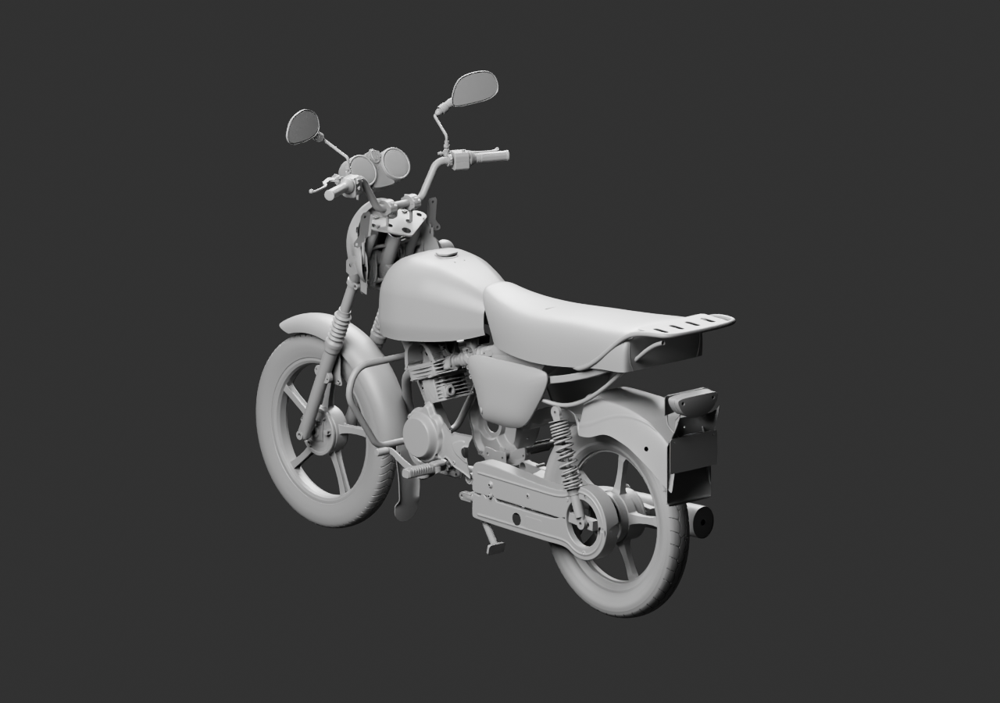

# Contexte global — 91 parents, quatre vues

Bouchon extérieur existant, renfort avant PF181410 et trois parents de commande de frein arrière ajoutés comme contexte. Le patin séparé du banc de frein reste exclu de cette pose globale : sa pose photographique n’est pas une surface de pied montée. Aucun joint, axe, adaptateur ou mécanisme caché n’est inventé.

Le bouchon est posé au-dessus du plan du col de réservoir échantillonné dans le natif, avec2mm de séparation de revue. Les dimensions historiques du bouchon et de l’ouverture ne sont pas ajustées pour forcer un montage. Le [premier sondage rejeté et sa correction](../../research/fuel-cap-tank-context-audit-v1/README.md) sont conservés ; seul le second calcule la pose utilisée.

[Blender lié](../../../assets-src/moto-components/whole-exterior-coverage-v12/whole-exterior-coverage-v12.blend) · [Sources et poses](linked-parents-check.json) · [Réouverture](native-reopen-check.json) · [Lecture](coordinator-review.json) · [EXR](raw-render-check.json).

91 parents ne sont pas91 pièces finies. Placements estimés, interfaces non reçues, exemplaires répétés en attente, aucune réception artistique ou moto complète.
