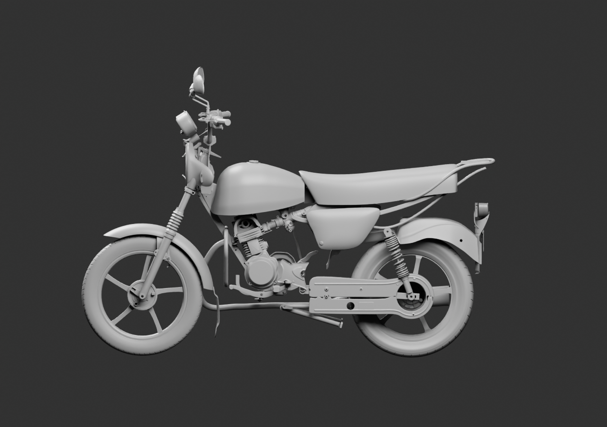
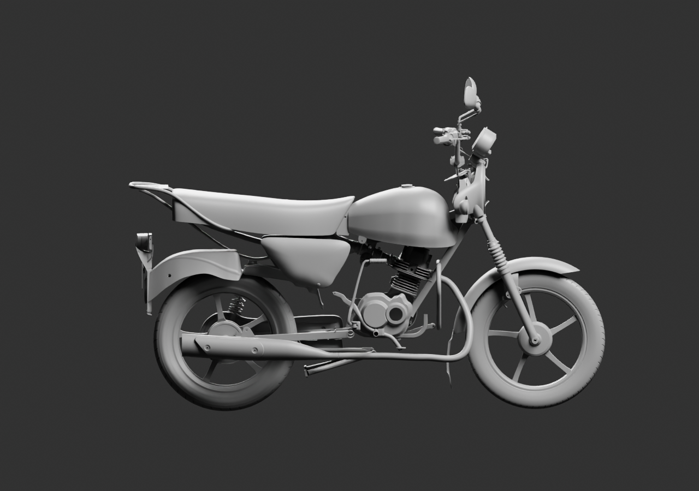
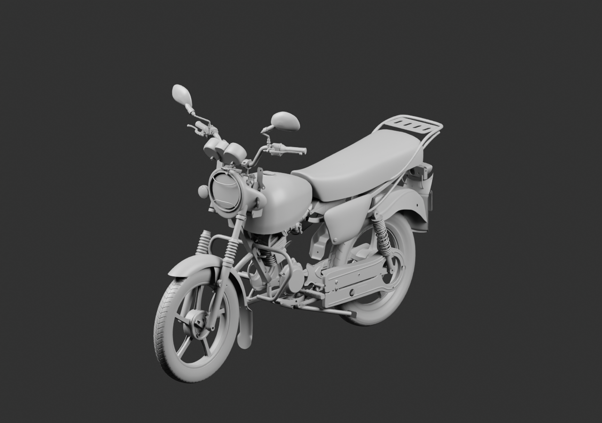
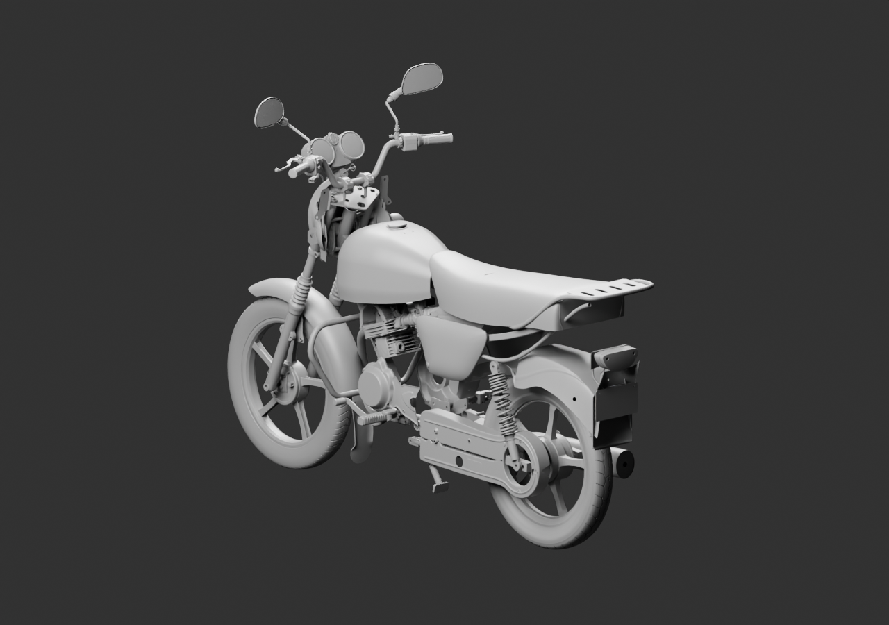

# Diagnostic global — 98 parents, cockpit et kick réemployés

Kick existant, contacteur, clé, anneau et raccord court de contact sont réunis. Les compteurs v5 remplacent v2 ; leur historique de forme et de normales est conservé, aucune réception n’est transférée. Seul le pigtail documenté du faisceau v3 est choisi : les anciennes gaines basses A/B restent exclues et non attribuées.

Un bouchon DS181012 est présenté sur le côté gauche de la fourche, avec ses écarts nominaux de diamètre toujours signalés. Le patin de frein existant reçoit une orientation de pied vers le haut dans une présentation séparée de2mm du terminal ; aucun siège, axe ou cordon caché n’est inventé. Le kick conserve la pose historique, sans les trois quincailleries estimées.

[Blender lié](../../../assets-src/moto-components/whole-exterior-coverage-v13/whole-exterior-coverage-v13.blend) · [Sources et poses](linked-parents-check.json) · [Réouverture](native-reopen-check.json) · [Lecture](coordinator-review.json) · [Hypothèses](../../research/whole-exterior-coverage-v13/layout-plan-v13.json) · [EXR](raw-render-check.json).

Quatre vues16échantillons réellement relues. Parents ne signifie pas pièces finies. Montage, interfaces, exemplaires opposés et réception G8 restent ouverts.
