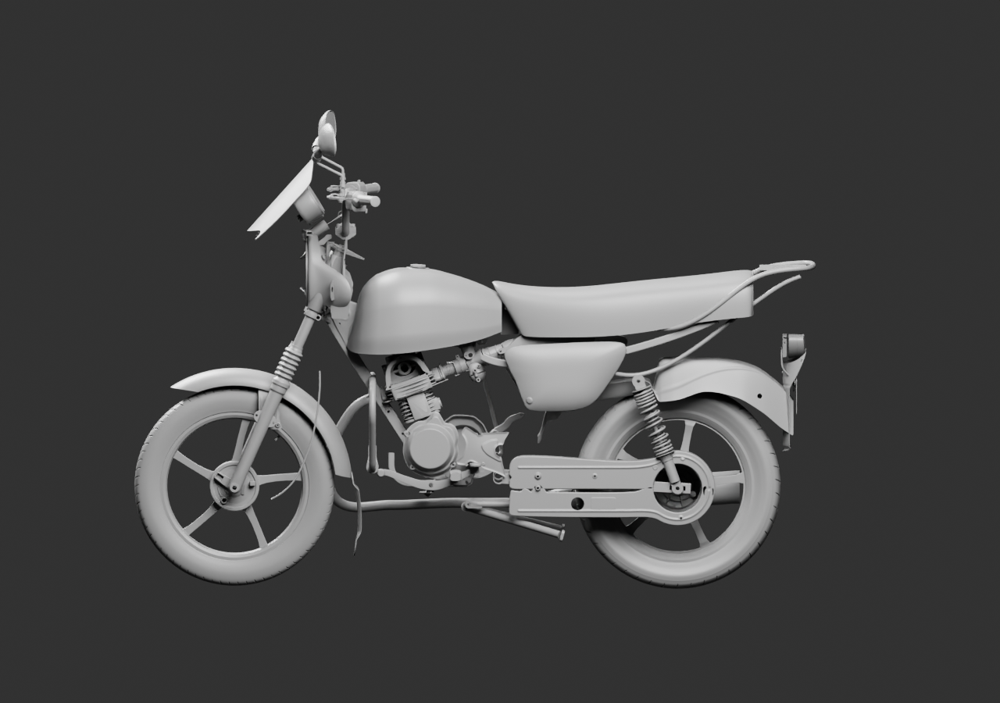
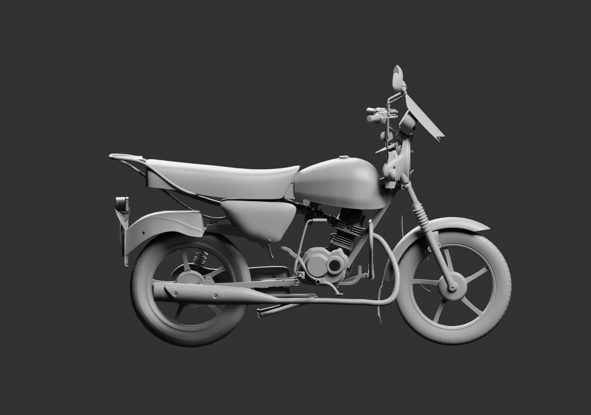
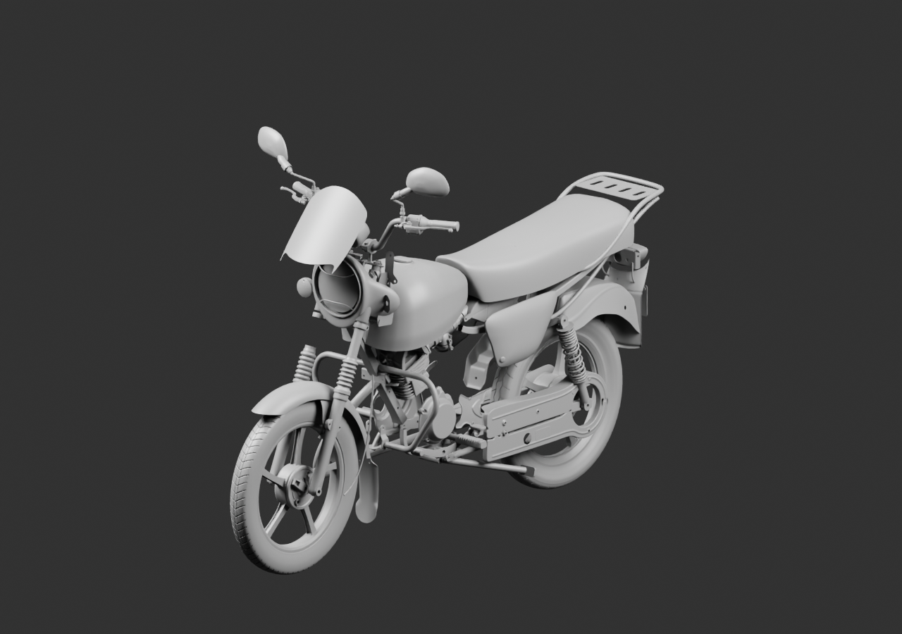
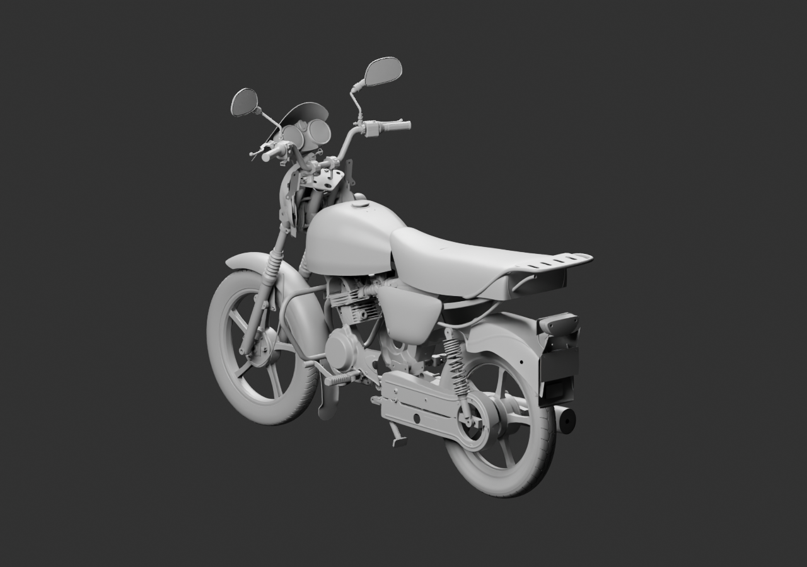

# Moto — contrôle extérieur v14

101 parents liés : saute-vent, catadioptre et gaine observée ajoutés ; kit de protection moteur substitué au tube seul. Sources et géométries préservées. Les poses restent estimées.

Le phare conserve son réflecteur nu non documenté. Les répétitions restent en attente de décision ; raccords passager, câbles et attaches ne sont pas reçus.

[Blender](../../../assets-src/moto-components/whole-exterior-coverage-v14/whole-exterior-coverage-v14.blend) · [Lecture réelle](coordinator-review.json) · [Réouverture native](native-reopen-check.json) · [Sources et poses](linked-parents-check.json) · [Plan](../../research/whole-exterior-coverage-v14/layout-plan-v14.json)
