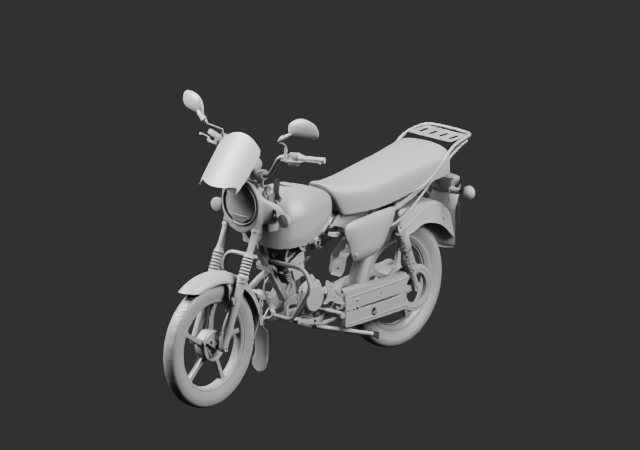
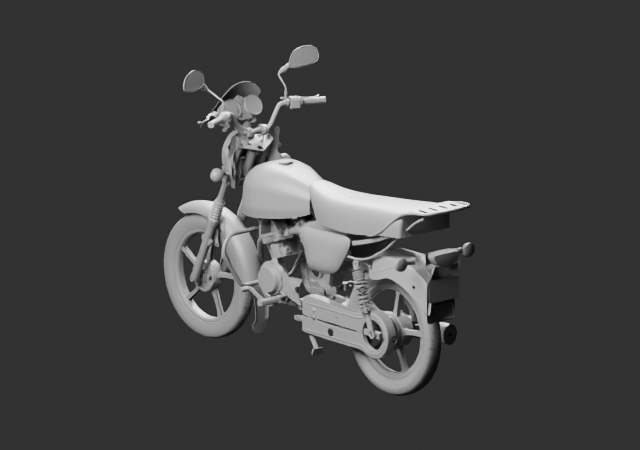

# Répétitions autorisées — brouillon v15

114 parents, deux vues grises640×450 à4échantillons, effectivement relues. Quatre clignotants extérieurs et deux amortisseurs désormais présents. Les sources des tiges gauche/droite restent distinctes ; les autres occurrences identiques sont des instances provisoires autorisées. Les tubes, bouchons et manchons sont doublés sans source altérée.

Brouillon de placement : le moteur central et le châssis intérieur attendent leurs nouvelles révisions. La matière grise des tiges arrière reste à corriger. Aucun G8 ni montage OEM reçu.

[Autorisation](../../workflow/motorcycle-provisional-repetition-authorization-v1/README.md) · [Sources et poses](linked-parents-check.json) · [Plan](../../research/whole-exterior-coverage-v15/layout-plan-v15.json) · [Réouverture](native-reopen-check.json)
