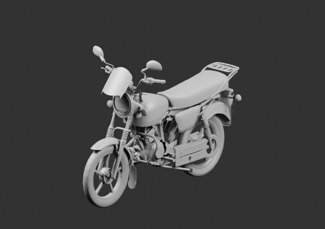
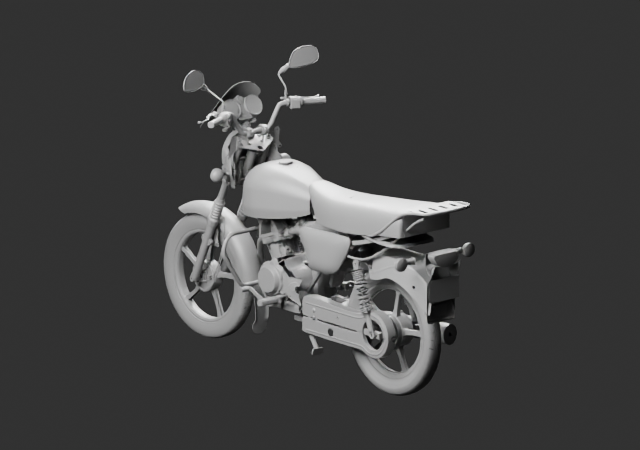

# Moteur et intérieur du châssis — contexte v16

128 parents liés, deux brouillons gris640×450 à4échantillons réellement relus. Les grands flancs moteur, la joue inférieure LH corrigée, le cadre central, le support de batterie et les éléments sous selle sont présents. Les couvercles et le moteur historique restent chacun une seule fois.

Sources de variantes apparentées et placements bornés, profondeur moteur estimée explicitement. Les interfaces restent non reçues. Les repose-pieds passager sont encore en contrôle indépendant ; la cuve nue du phare n’est pas inventée.

[Sources et transformations](linked-parents-check.json) · [Source rouverte](native-reopen-check.json) · [Plan](../../research/whole-exterior-coverage-v16/layout-plan-v16.json) · [Lecture](coordinator-review.json)
