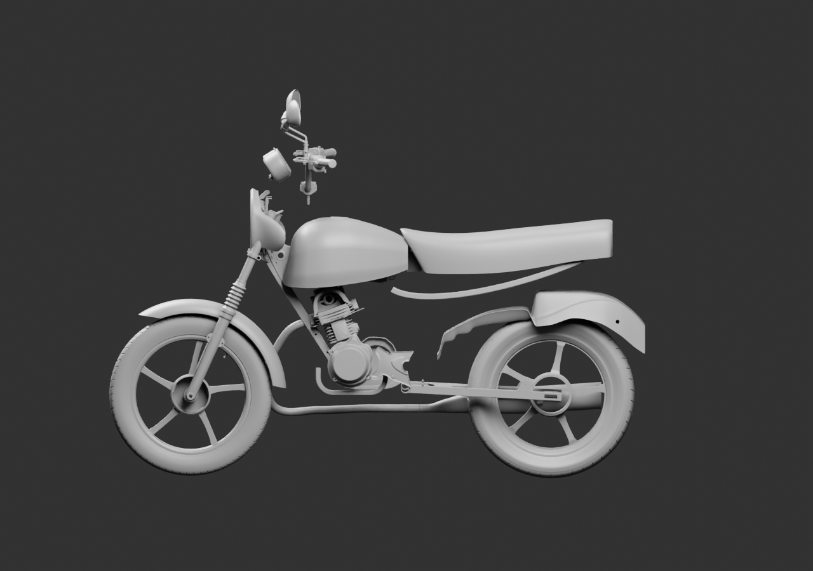
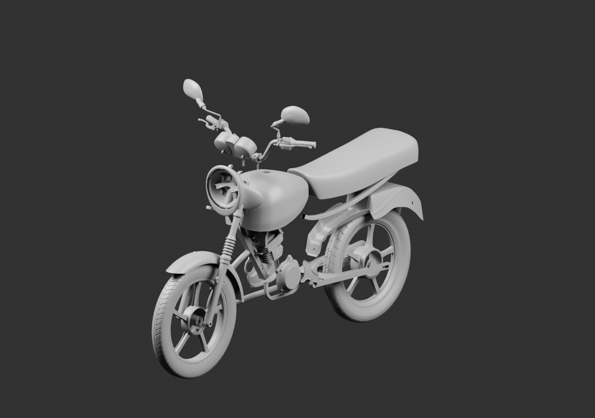
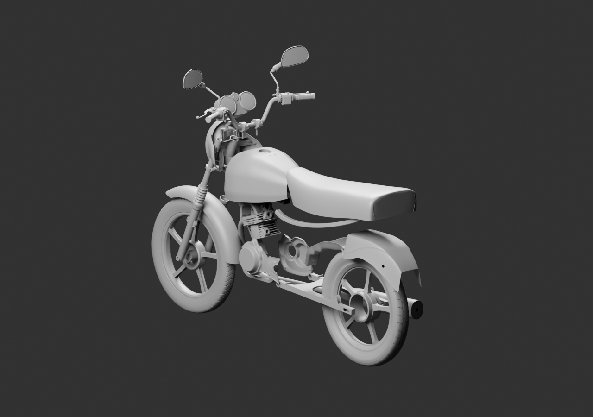

# Vue d’ensemble — diagnostic de couverture (42 sources parentes)

**Ce sous-ensemble n’est pas une moto terminée ou reçue.** Il réunit 42 fichiers Blender candidats existants, liés sans modifier leurs géométries. Les positions, inclinaisons et interfaces sont des hypothèses de revue. Le lot01 refusé est exclu.

[Source Blender liée](../../../assets-src/moto-components/whole-exterior-coverage-v2/whole-exterior-coverage-v2.blend) · [Parents et positions](linked-parents-check.json) · [Réouverture des références relatives](native-reopen-check.json) · [Décision de lecture](coordinator-review.json) · [Rendus16](render-checkpoint.json) · [EXR réels](raw-render-check.json).

La vue révèle des raccords encore ouverts au poste de conduite, à la direction et autour du phare. Plusieurs grandes pièces **déjà fabriquées** ne sont pas encore sélectionnées dans ce sous-ensemble : caches latéraux, amortisseur étalon, ensemble arrière, porte-bagages, repose-pieds, béquilles et carter de chaîne. Il faut les rapprocher sans les déclarer montées ni inventer les pièces de liaison cachées.

Une seule occurrence des membres de cadre observés et de l’exemplaire de tube/soufflet générique est utilisée. Aucun côté opposé n’est implicitement fabriqué par miroir. La nouvelle étude indépendante du soufflet droit est distincte.

Caméras de diagnostic, matière grise commune, CyclesCPU16,1280×900 et EXR FLOAT32 avec passes de débruitage. Aucun rendu final96, étalonnage, contrôle des collisions, export global de jeu, réceptionG8 ou mesure iPhone n’est déduit.

La source `.blend` conserve des liens relatifs vers les sources parentes du dépôt ; récupérer ces chemins, dont les SHA sont fournis, avant ouverture. [Inventaire de collecte](../../research/whole-exterior-coverage-v1/native-collection-inventory-v2.json).
