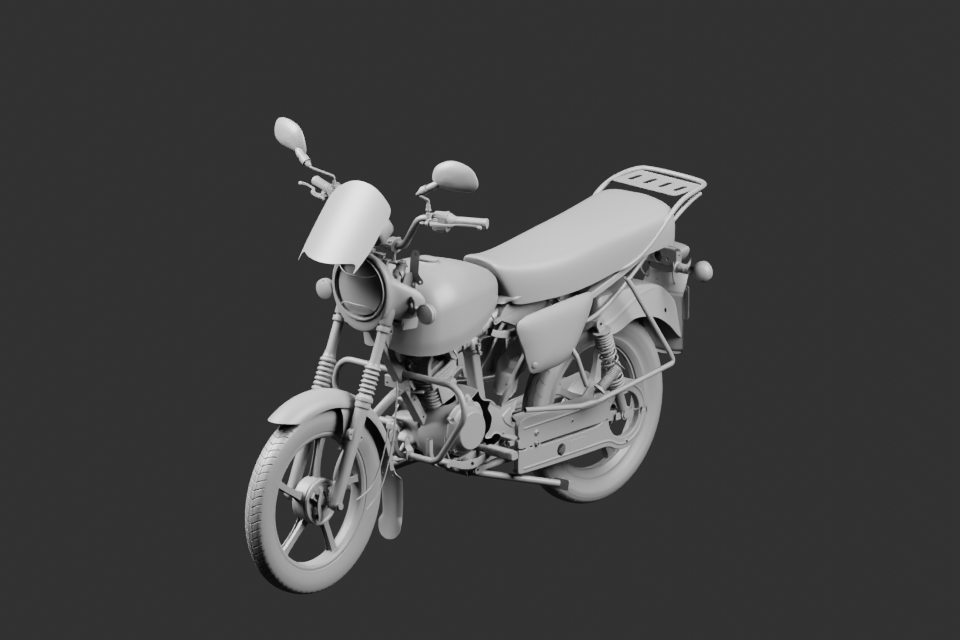

# Composition v20 —151 parents

Premier assemblage réel des nouvelles optiques visibles, deux caoutchoucs passagers complétés, oreille de carter, axe/levier avant et huit éléments de liaison de frein arrière. Toutes les sources inchangées conservent leurs matrices natives. Un rendu gris960×640 à16 échantillons ; réouverture native151 et export glTF sans erreur. La correction de pose arrière v2 est livrée séparément et intégrée dans la révision finale suivante. Ce brouillon ne la contient pas. Pas de réception G8.
