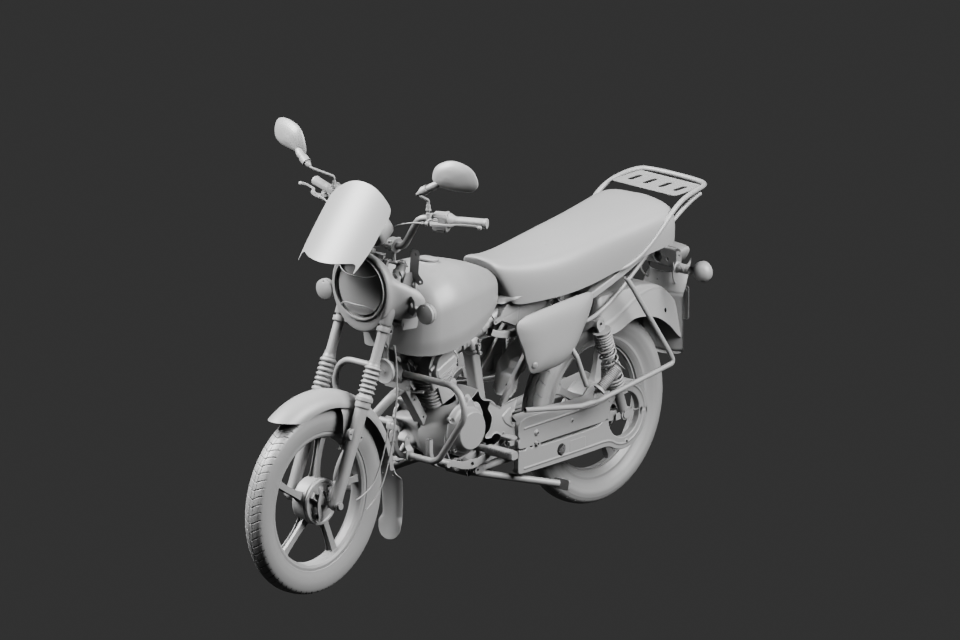

# Moto — composition native v21

161 parents liés : source nativev19 conservée, corrections du frein arrièrev2, caoutchoucs passagers complétés, optique visible simplifiée, oreille de carter, axe/levier avant, bougie/capuchon et couvercles moteur récupérés, gaines supérieures, continuation observée et klaxon. Les parents ne sont pas un compte de pièces physiques réceptionnées.

La figure est un rendu natif16échantillons960×640. Les poses et variantes restent estimées. La source matière dérivée a réellement été rouverte et contrôlée sur161parents ; [preuve native finale](../whole-exterior-material-preview-v8/native-reopen-check.json). Le glTF3 indépendant et ses bornes sont contrôlés séparément.

[Livraison complète, rendus96 et fichiers](../motorcycle-assembled-v3/README.md). Le champ du phare reste une projection plane, visiblement uniforme : ce défaut de fidélité n’est pas reçu. Raccords cachés et qualification mécanique restent distincts de cette composition de revue.
