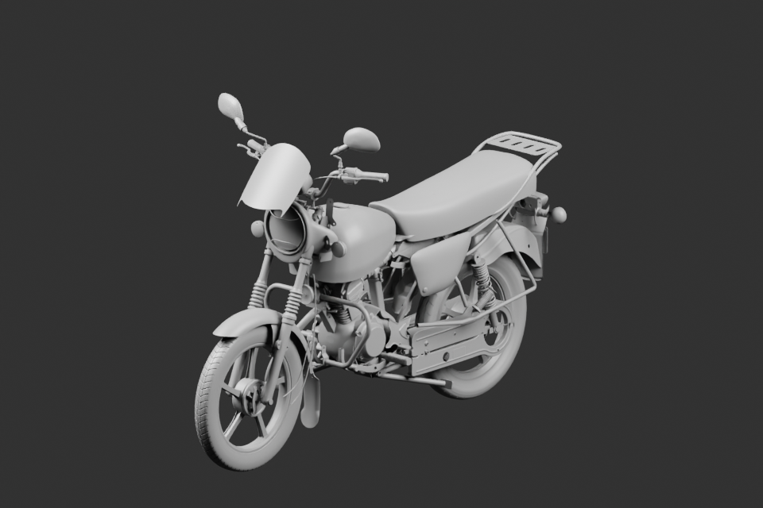

# Assemblage gris v22

162 instances : un volume extérieur moteur ajouté, une optique remplacée, les 160 autres sources et poses conservées.

[Contrôle des poses conservées](preserved-parent-metadata-check.json) · [Source liée](../../../assets-src/moto-components/whole-exterior-coverage-v22/whole-exterior-coverage-v22.blend).

Cycles16, 960×640, EXR FLOAT32 conservé. Étude extérieure avec profondeurs et variantes bornées ; les joints entre carters apparentés ne sont pas certifiés. Pas de réception artistique automatique.
