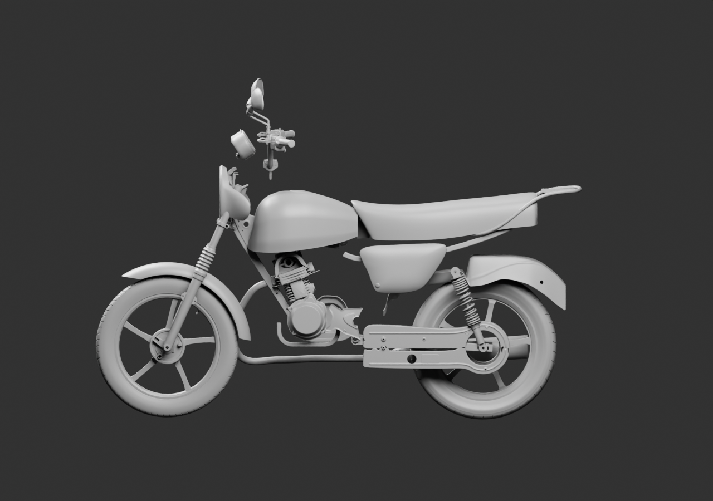
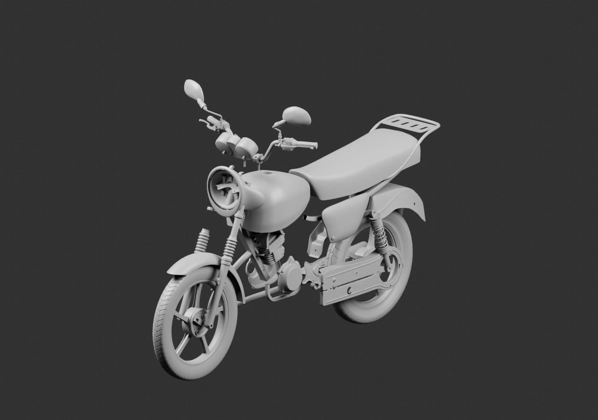
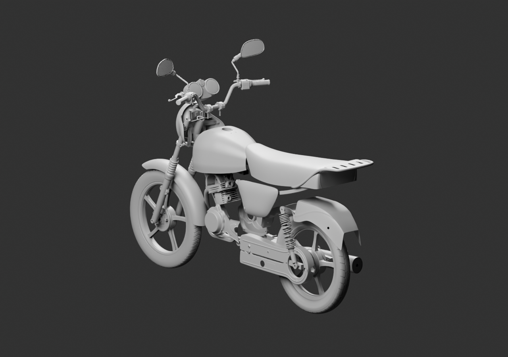

# Vue d’ensemble — 50 sources parentes

**Diagnostic en cours, moto incomplète.** Trois vues grises rassemblent des candidats natifs existants sans changer leurs géométries. Les positions restent estimées.

Ajouts : soufflet droit observé indépendamment, cache gauche et sa fixation visible, un SNS au repos, demi-carters de chaîne, rail et plateau du porte-bagages, flasque avant détaillé. Aucun deuxième amortisseur ni membre de cadre n’est inventé. Le cache droit et les repose-pieds ne sont pas montés automatiquement. L’optique, les raccords du poste de conduite, les attaches du porte-bagages et l’intégration de l’ensemble arrière restent ouverts.

[Blender lié](../../../assets-src/moto-components/whole-exterior-coverage-v3/whole-exterior-coverage-v3.blend) · [Parents SHA et positions](linked-parents-check.json) · [Réouverture réelle](native-reopen-check.json) · [Lecture](coordinator-review.json) · [Rendus16](render-checkpoint.json) · [EXR FLOAT32](raw-render-check.json) · [Repères exacts des nouveaux parents](../../research/whole-exterior-coverage-v3-parent-evidence-v1/README.md).

Le fichier Blender dépend des sources relatives listées : les récupérer avant ouverture. Les trois images sont des rendus de diagnostic16échantillons, sans réception artistique, montage certifié, rendu final96 ou qualification iPhone. Le rapport de parents a été récupéré après un défaut de sérialisation JSON ; source et rendus déjà enregistrés ont été conservés exactement puis vérifiés par réouverture.
