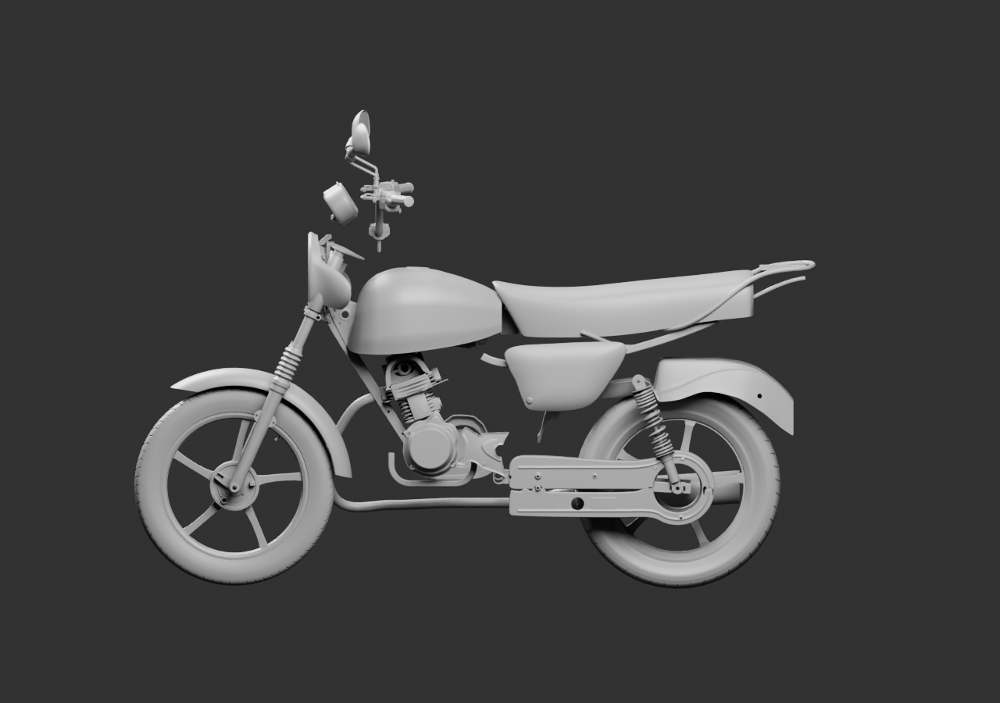
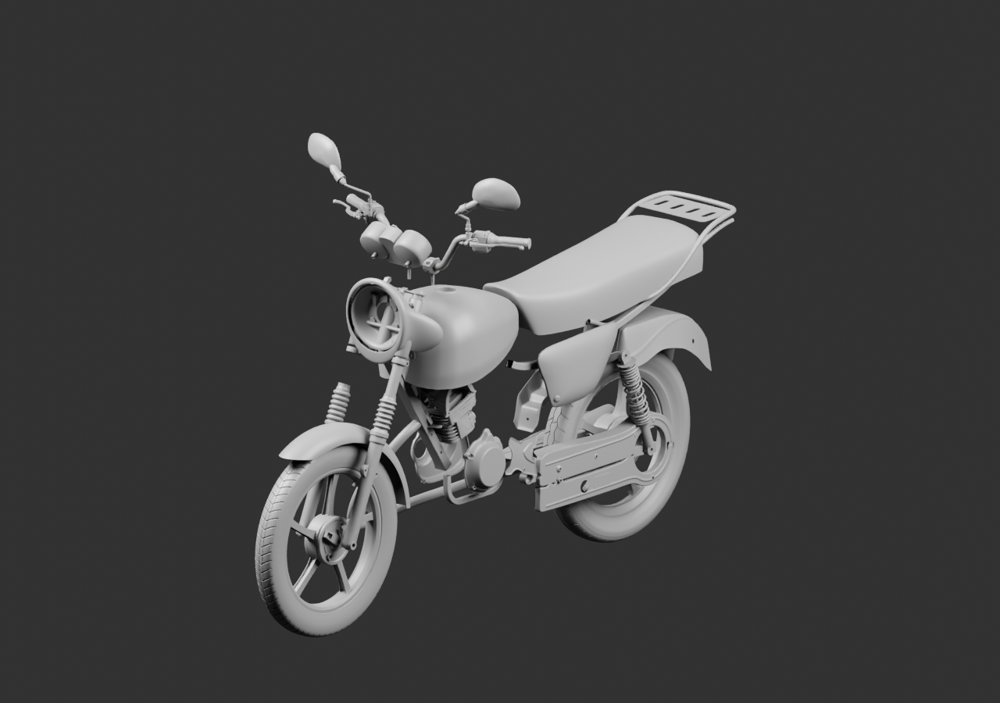
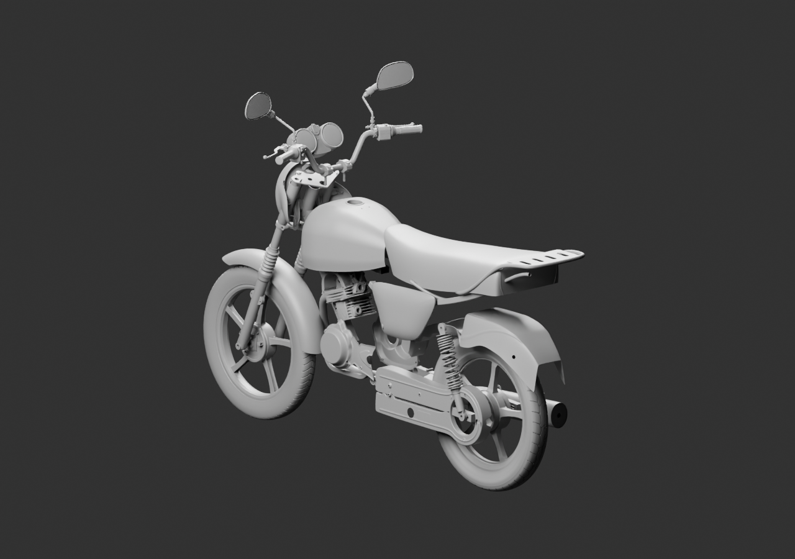

# Diagnostic global — 52 sources parentes

**Moto incomplète, positions de revue estimées.** Ajouts du support de phare PF121024 observé et d’un long membre intérieur du porte-bagages. La rotation du té supérieur suit désormais le même sens d’inclinaison que les fourches.

Le poste de conduite reste détaché : les repères historiques du guidon et de la plaque supérieure ne se superposent pas encore. Les rayons de trous candidats ne certifient pas le passage du tube de31mm ; capuchons, épaulements et variantes restent à réconcilier. Aucun tube, trou ou raccord caché n’est déformé pour fermer ce vide. Le rail intérieur n’est ni fixé ni copié à l’autre côté.

[Blender lié](../../../assets-src/moto-components/whole-exterior-coverage-v4/whole-exterior-coverage-v4.blend) · [Parents et positions](linked-parents-check.json) · [Réouverture](native-reopen-check.json) · [Lecture](coordinator-review.json) · [Hypothèses et limites des poses](../../research/whole-exterior-coverage-v4/layout-plan-v4.json) · [EXR réels](raw-render-check.json).

Trois rendus gris16échantillons, 1280×900, EXR FLOAT32. Pas de réception artistique, de montage certifié ou de qualification moteur/iPhone. L’optique, l’intégration du feu/plaque arrière et plusieurs parents existants restent ouverts.
