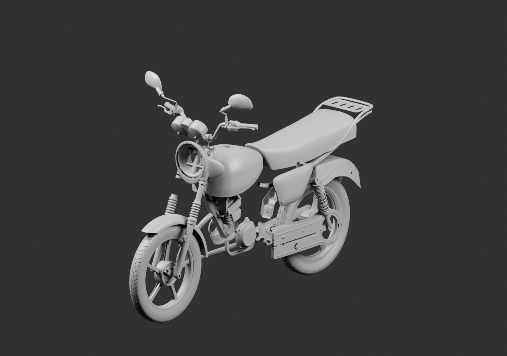
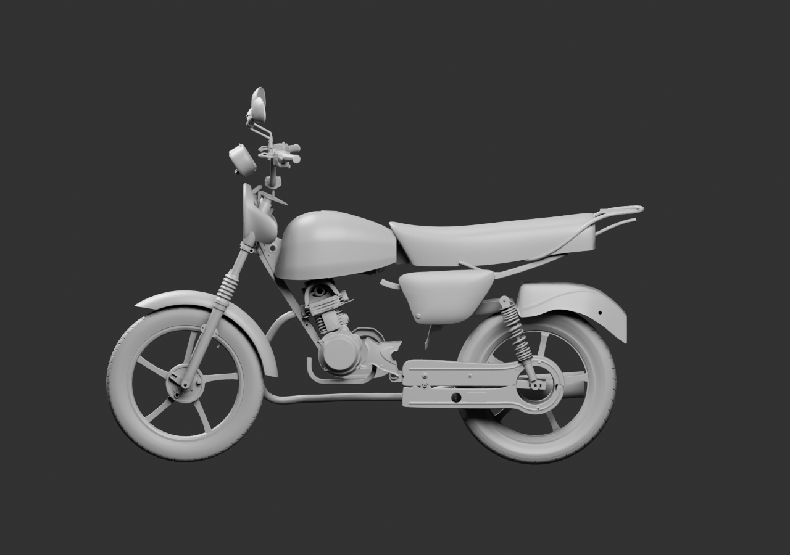
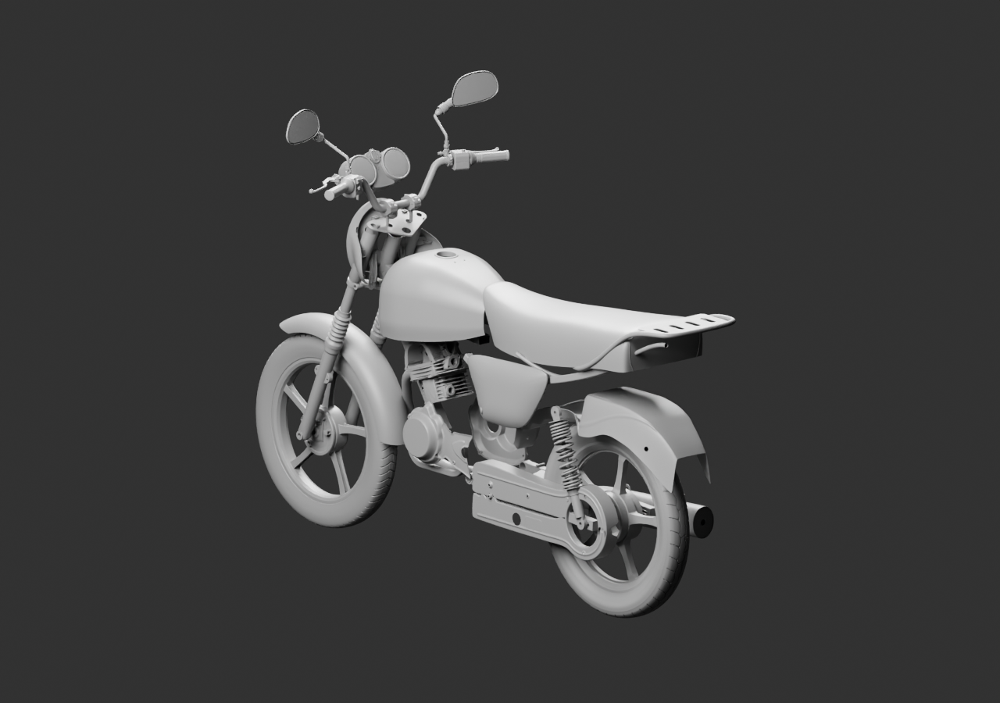

# Diagnostic global — pose commune du poste de conduite

**52 sources natives inchangées, moto encore incomplète.** Le guidon, les commandes, les compteurs, les rétroviseurs et les brides sont déplacés ensemble de97,5mm vers l’avant pour tester leur relation à la plaque supérieure.

Le vide apparent du poste de conduite diminue. Les entraxes candidats ne correspondent toutefois pas encore : ±45mm aux tiges contre environ±36mm aux trous intermédiaires supposés. Aucun ajustement de géométrie ni adaptateur masqué n’est inventé pour absorber cet écart. Le porte-bagages, le support de phare, l’optique et l’ensemble arrière restent à raccorder.

[Blender lié](../../../assets-src/moto-components/whole-exterior-coverage-v5/whole-exterior-coverage-v5.blend) · [Parents SHA](linked-parents-check.json) · [Réouverture réelle](native-reopen-check.json) · [Hypothèses](../../research/whole-exterior-coverage-v5/layout-plan-v5.json) · [Lecture](coordinator-review.json) · [EXR FLOAT32](raw-render-check.json).

Trois rendus gris16échantillons, sans réception de montage, artistique ou mobile.
