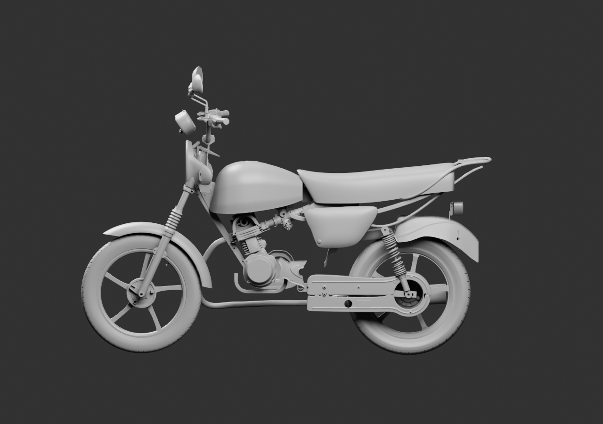
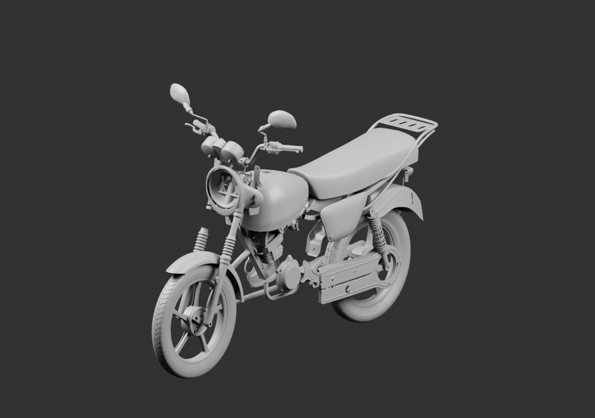
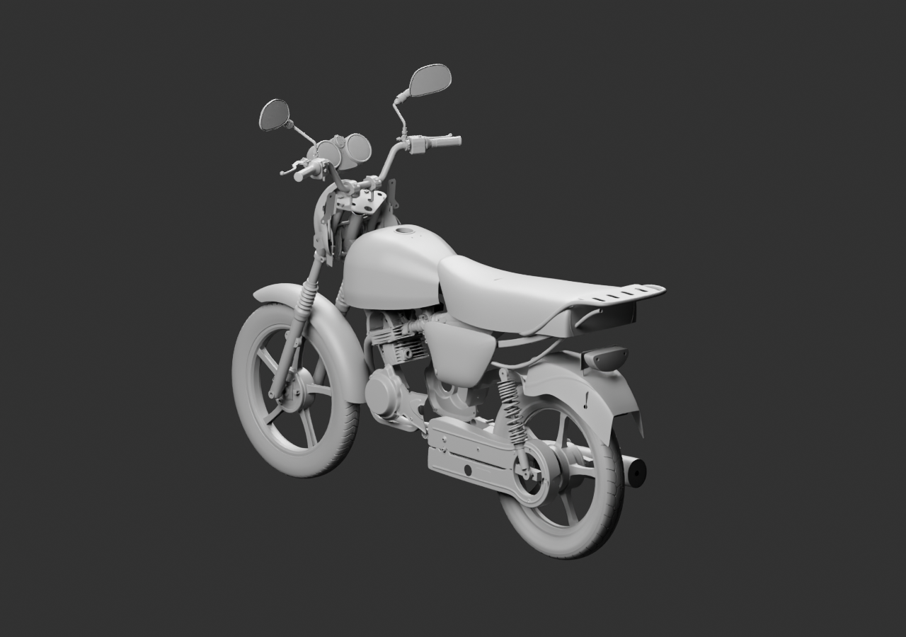

# Diagnostic global — 72 sources parentes

**Moto en cours, intégration non reçue.** Admission historique et carbu, boîte à air, flasque arrière, supports de phare, feu et plaque sont réunis comme contexte de revue. Les sources restent inchangées.

Le feu apparaît ; **la plaque est présente mais masquée par le garde-boue** dans la pose héritée du banc arrière. Le prochain essai doit corriger cette relation en contexte, pas déclarer l’arrière terminé. Les séparations2mm de l’admission sont des jeux de présentation, jamais des spacers construits ou une preuve d’étanchéité. Le collier et le manchon présentent encore des incompatibilités nominales.

[Blender lié](../../../assets-src/moto-components/whole-exterior-coverage-v6/whole-exterior-coverage-v6.blend) · [Parents SHA et poses](linked-parents-check.json) · [Réouverture](native-reopen-check.json) · [Lecture](coordinator-review.json) · [Hypothèses](../../research/whole-exterior-coverage-v6/layout-plan-v6.json) · [Audit numérique indépendant](../../research/powertrain-coverage-v6-pose-audit-v1/README.md) · [EXR FLOAT32](raw-render-check.json).

Trois vues grises16échantillons ; aucune réception artistique, mécanique ou mobile. Aucun membre opposé non reçu n’est dupliqué ; pièces cachées et raccords non documentés restent explicites.
