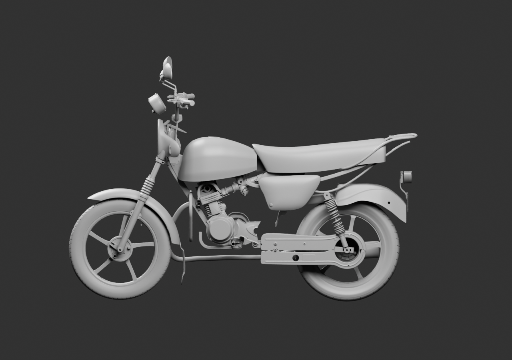
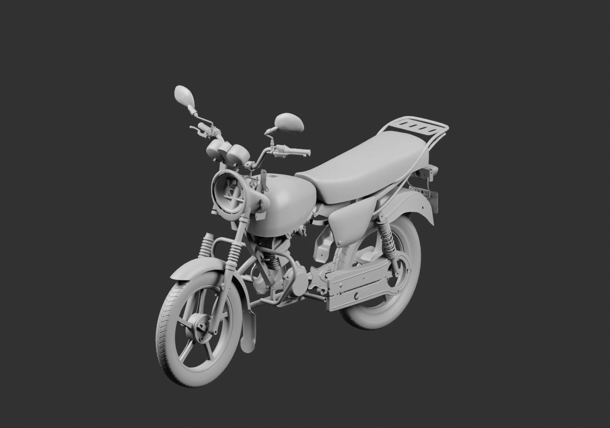
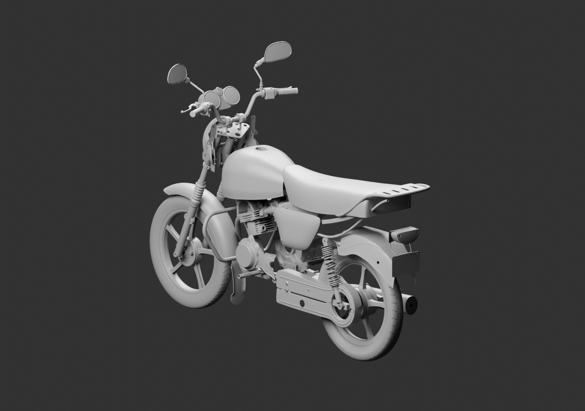

# Diagnostic global — 76 sources parentes

Moto en cours, intégration non reçue. La plaque est maintenant visible après translation rigide de105mm du groupe arrière. Le garde-boue utilise son matériau natif après comparaison exacte de la géométrie. Le pare-carter, les deux supports métalliques indépendants des repose-pieds et la bavette avant sont ajoutés comme contexte.

[Blender lié](../../../assets-src/moto-components/whole-exterior-coverage-v7/whole-exterior-coverage-v7.blend) · [Parents et poses](linked-parents-check.json) · [Lecture réelle](coordinator-review.json) · [Égalité du garde-boue](../../research/whole-exterior-coverage-v7/rear-fender-material-reuse-check.json).

Trois vues grises16échantillons. Attaches, contacts, compatibilité et réception artistique restent ouverts. Aucun exemplaire opposé non reçu n’est dupliqué. Les jeux de présentation ne constituent pas un assemblage mécanique.
