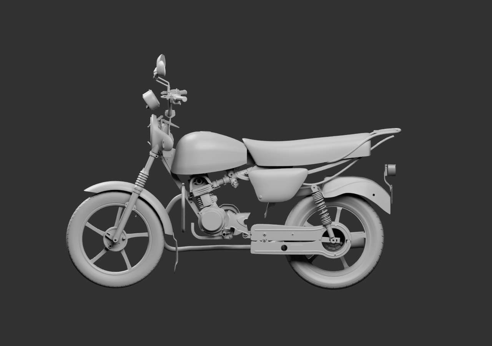
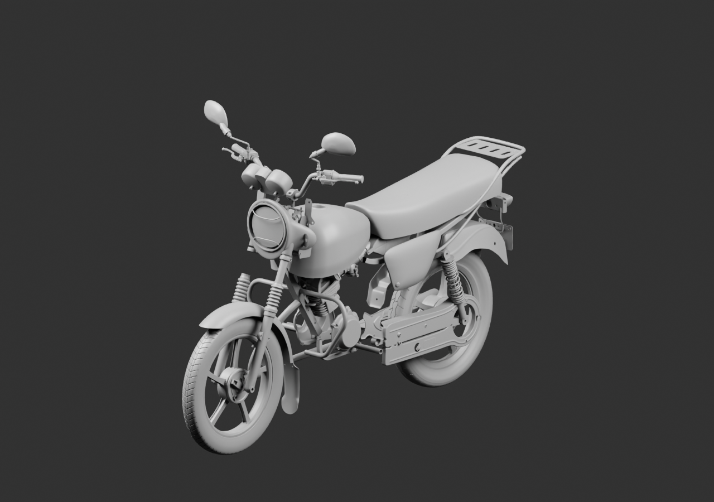
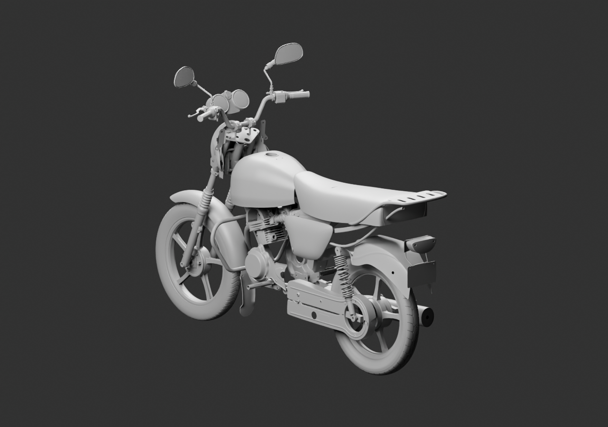

# Diagnostic global — 78 sources parentes

La protection avant existante, avec anneau et deux arceaux, et l’enveloppe du verre sont ajoutées sans modifier leurs sources. Le gris remplace temporairement les matériaux : il ne prouve pas la lisibilité du verre transparent. Son échec antérieur demeure signalé. Aucun fond de réflecteur ou relief optique n’est inventé.

[Source liée](../../../assets-src/moto-components/whole-exterior-coverage-v8/whole-exterior-coverage-v8.blend) · [Parents et poses](linked-parents-check.json) · [Réouverture](native-reopen-check.json) · [Lecture réelle](coordinator-review.json) · [EXR FLOAT32](raw-render-check.json).

Trois vues16échantillons réellement relues. Moto incomplète, placements estimés, aucune réception artistique ou mécanique.
