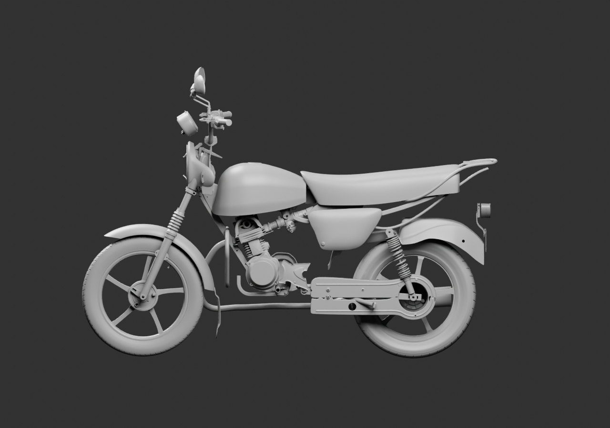
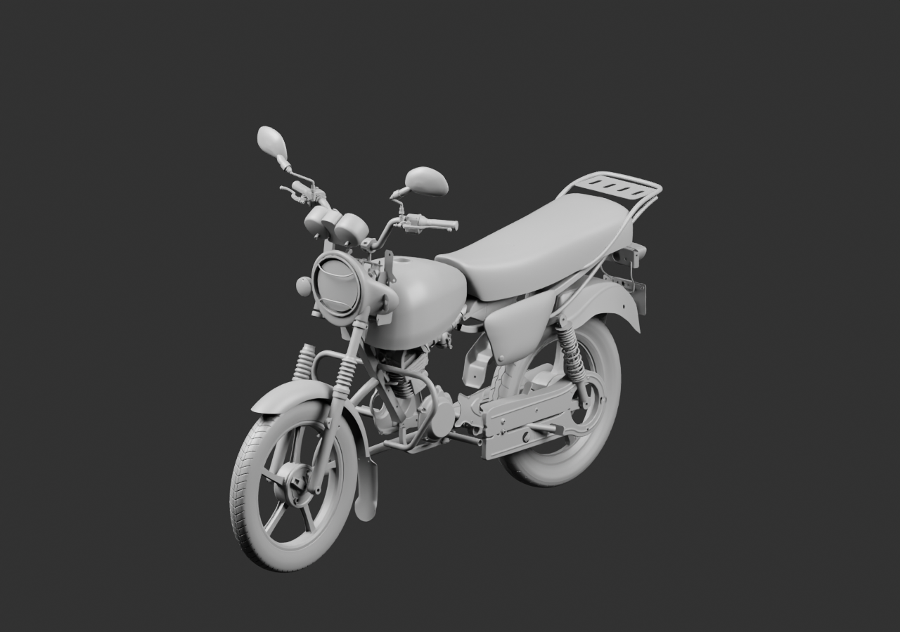
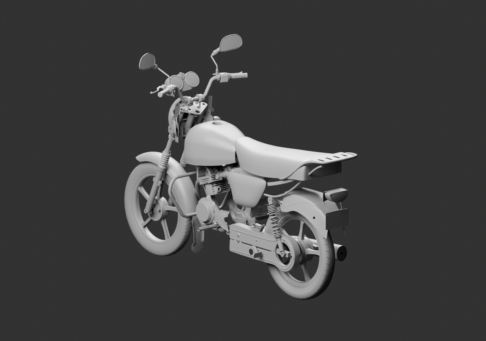

# Premier contexte béquilles — pose refusée

84 sources parentes natives, dont un seul exemplaire du clignotant et les béquilles existantes. Lecture réelle : la position repliée de la béquille latérale chevauche visiblement le garde-chaîne ; la centrale se prolonge trop vers la roue arrière. Ces poses sont refusées et doivent être corrigées rigidement dans v10. Les sources restent intactes ; aucun pivot ou arrêt caché n’est ajouté.

[Source](../../../assets-src/moto-components/whole-exterior-coverage-v9/whole-exterior-coverage-v9.blend) · [Lecture](coordinator-review.json) · [Réouverture](native-reopen-check.json). Diagnostic16échantillons, aucune réception mécanique ou artistique.
