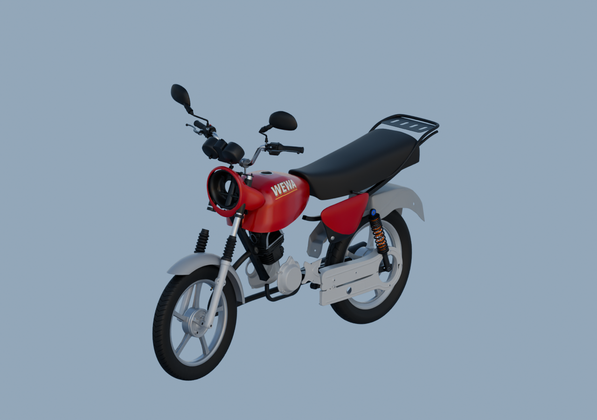

# Aperçu global des matières — travail en cours

**La moto n’est pas terminée.** Cet aperçu réunit les matières originales de52sources candidates, après lecture des vues grises.

La selle reste sombre sous ciel neutre. Le réservoir et le carénage rouges portent les graphismes WEWA originaux. Les matériaux des autres sources restent ceux de leurs études, avec les incertitudes de variante et de finition existantes.

Le phare reste ouvert sans optique reçue ; feu/plaque arrière, admission, commandes au pied et autres parents existants ne sont pas encore tous intégrés. Le rail intérieur et les raccords du poste de conduite ne sont pas reçus. Aucun raccord masqué de convenance n’est ajouté.

[Source Blender liée](../../../assets-src/moto-components/whole-exterior-material-preview-v2/whole-exterior-material-preview-v2.blend) · [Parents et poses](linked-parents-check.json) · [Réouverture réelle](native-reopen-check.json) · [Rendu réel](render-report.json) · [EXR FLOAT32](raw-render-check.json) · [Lecture](coordinator-review.json).

Rendu de diagnostic16échantillons, 1280×900, HDRI artistique0,65, AgX, exposition0/gamma1. Aucun rendu final96 global, étalonnage, réception artistique ou qualification mobile. Dépendances natives relatives nécessaires avant ouverture de Blender. La première tentative ayant échoué sous pression mémoire est conservée séparément en v1.
