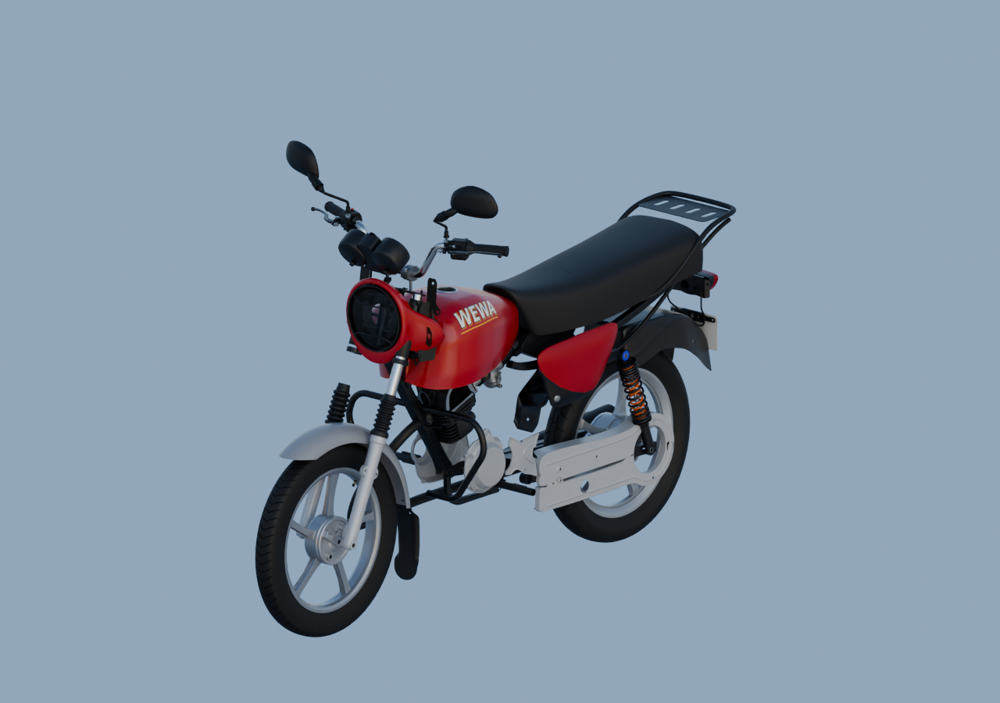

# Aperçu global avec matériaux — 78 parents

Protection avant et enveloppe de verre existantes ajoutées à la composition. La lecture réelle montre un reflet sur le verre, mais un intérieur encore sombre : le réflecteur nu manque toujours et l’optique n’est pas terminée. L’échec de lisibilité isolée du verre reste conservé dans son dossier source.

[Blender lié](../../../assets-src/moto-components/whole-exterior-material-preview-v4/whole-exterior-material-preview-v4.blend) · [Réouverture](native-reopen-check.json) · [Lecture réelle](coordinator-review.json) · [Rendu](render-report.json) · [EXR FLOAT32](raw-render-check.json).

Matériaux sources préservés, HDRI artistique neutre,16échantillons,1280×900. Placement estimé, compatibilité de variantes et attaches non reçues. Aucune réception G8 ou moto complète.
