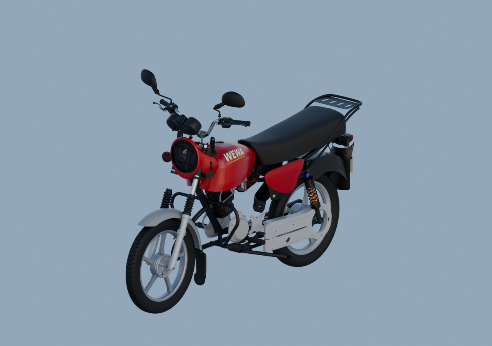
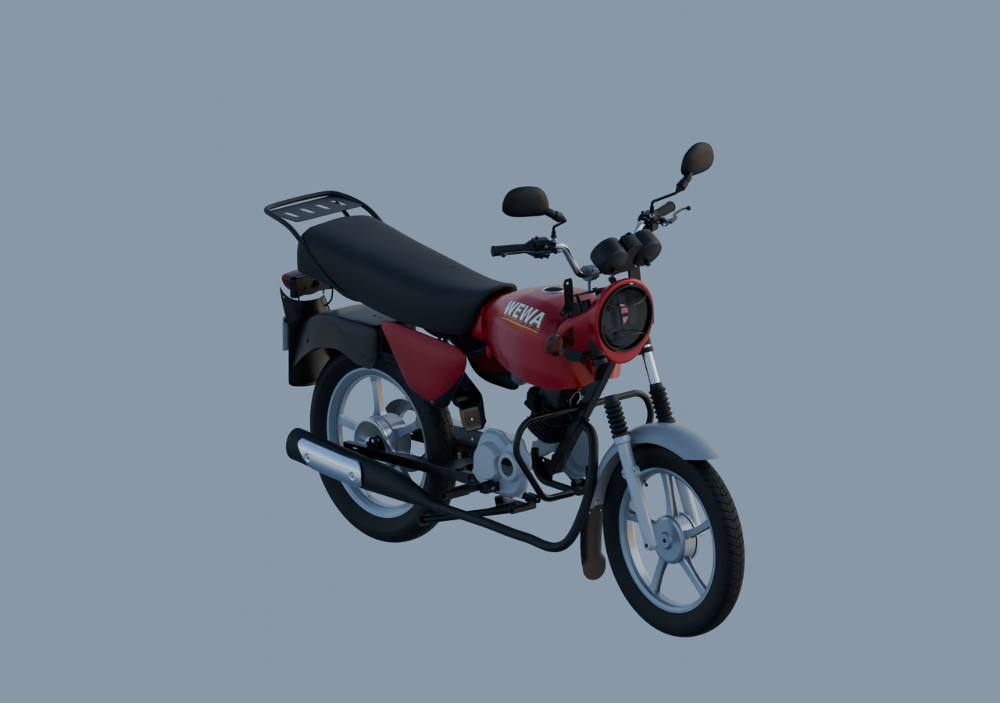

# Aperçu global avec matériaux — 88 parents, trois côtés

Les trois images natives sont réellement relues. Selle sombre, caches indépendants rouges, bavette arrière noire, feu rouge et plaque fictive «WEWA001» visibles. Le matériau gris et le contre-jour des vues précédentes ne suffisaient pas à juger la couleur du feu. Les sources originales et leurs matériaux sont préservés, avec cinq dépendances imbriquées du sélecteur vérifiées.

Il manque encore des unités répétées, l’optique interne du phare et plusieurs commandes/interfaces. La présence des béquilles et du manchon ne certifie ni leur montage ni les jeux ; l’interférence nominale manchon/tube reste signalée. Moto incomplète, aucune réception G8.

[Source Blender](../../../assets-src/moto-components/whole-exterior-material-preview-v5/whole-exterior-material-preview-v5.blend) · [Réouverture et dépendances](native-reopen-check.json) · [Rendu et caméras](render-report.json) · [Lecture](coordinator-review.json) · [EXR FLOAT32](raw-render-check.json) · [Complément gris droit/face/arrière](../whole-exterior-opposite-side-v1/README.md).

HDRI artistique neutre,16échantillons par vue,1280×900. Ce ne sont pas les rendus finaux96 de chaque pièce isolée.
