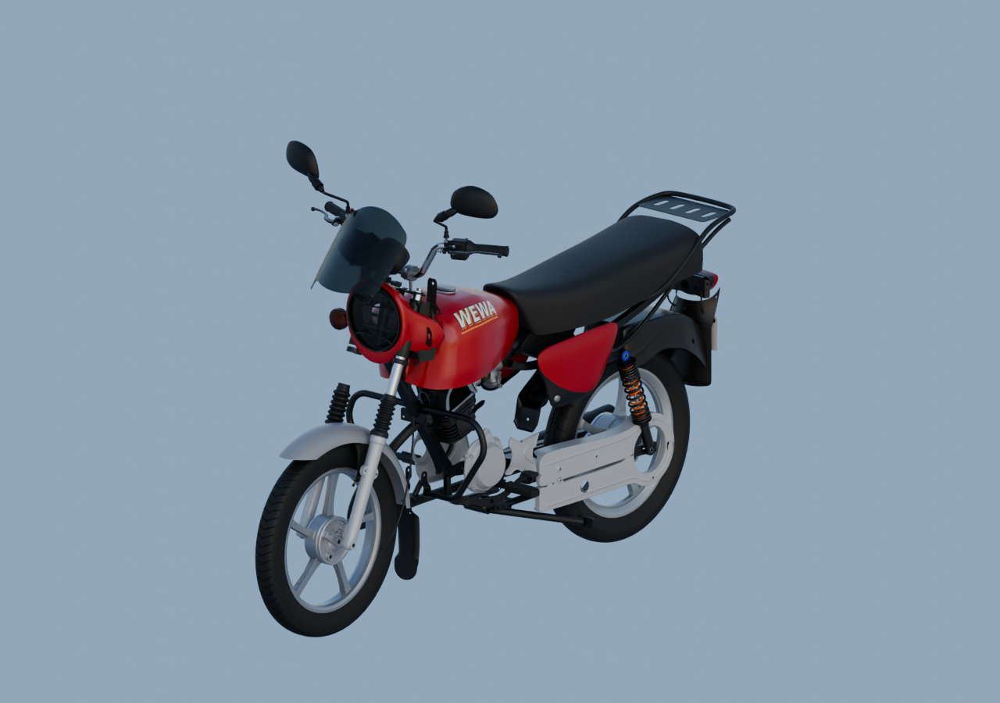
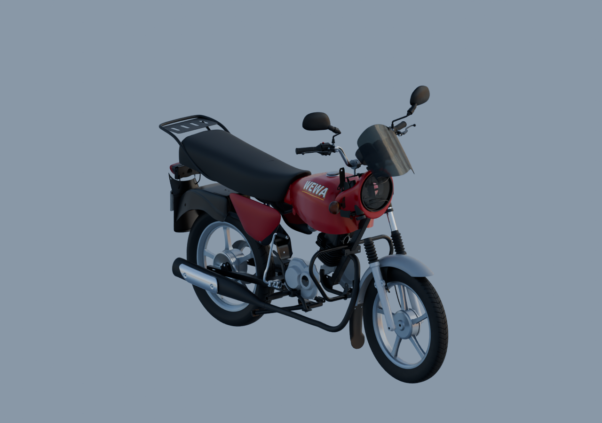
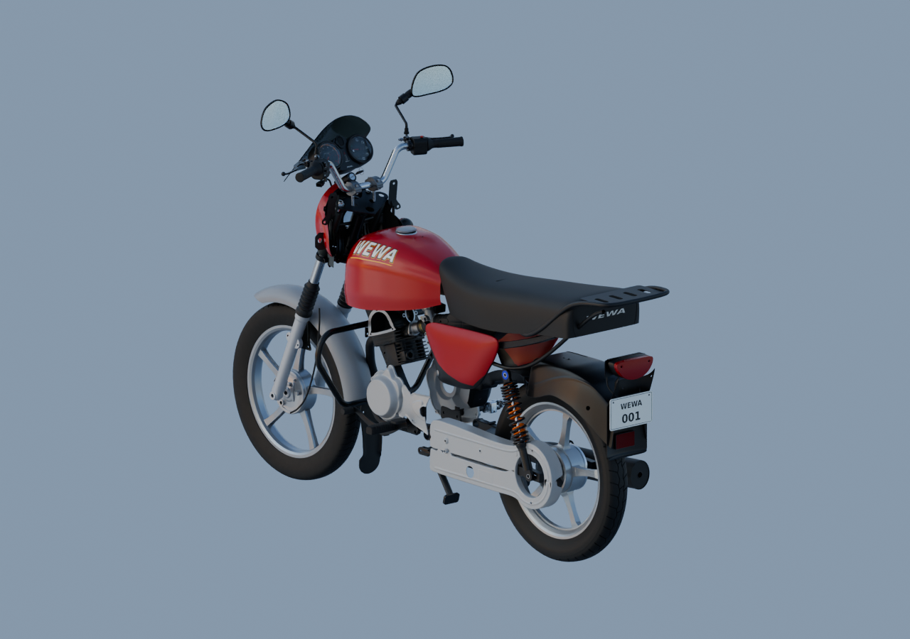

# Moto — trois vues avec matériaux v6

101 parents, même assemblage que le [contrôle gris v14](../whole-exterior-coverage-v14/README.md). Matériaux originaux conservés, éclairage HDRI artistique neutre, 16 échantillons. Selle sombre, saute-vent fumé, caches rouges, plaque fictive et catadioptre sous la plaque visibles.

Les placements et raccords restent estimés. Phare nu incomplet, répétitions en attente et unité passager non montée. Ces images ne déclarent pas la moto achevée.

[Blender](../../../assets-src/moto-components/whole-exterior-material-preview-v6/whole-exterior-material-preview-v6.blend) · [Lecture réelle](coordinator-review.json) · [Source rouverte](native-reopen-check.json) · [EXR](raw-render-check.json) · [Sources et caméras](render-report.json)
