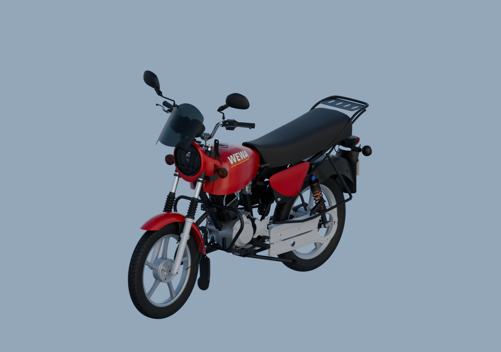
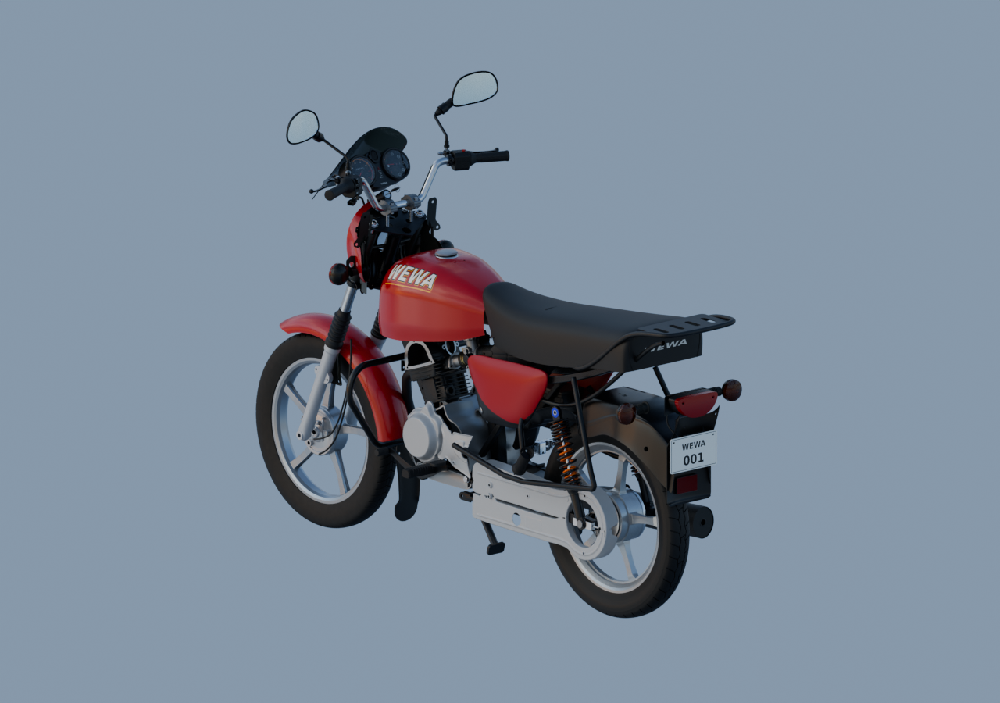

# Matières — assemblage v7

140 parents liés, trois rendus Blender natifs 1280×900 à 96 échantillons, EXR FLOAT32 conservés. Sources réouvertes et dépendances contrôlées.

[Livraison, récupération et limites](../motorcycle-assembled-v1/README.md). Les matières sombres de la selle et des tiges arrière restent sombres sous éclairage neutre. Aucun montage mécanique ou G8 reçu.
