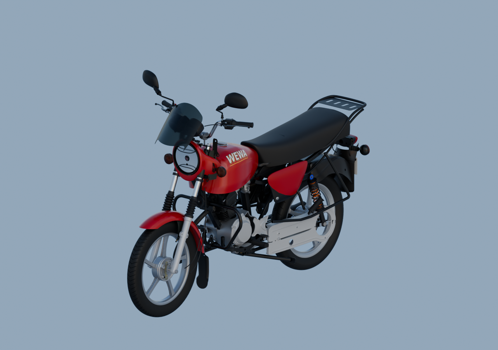
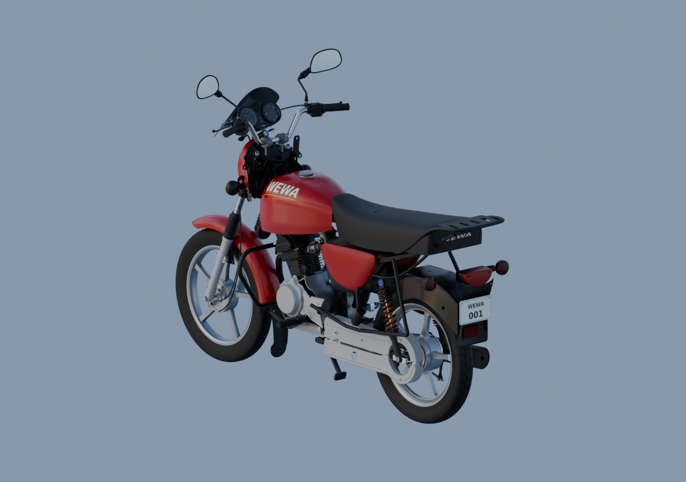

# Moto — matières v8

Trois rendus natifs1280×900,96échantillons, EXR FLOAT32 conservés.161parents réellement liés, sources/matrices et dépendances rouvertes et vérifiées.

Les couvercles moteur, bougie/capuchon, freins, gaines et klaxon sont inclus. La selle reste sombre sous ciel neutre. Le phare présente encore un disque argenté trop uniforme : sa surface frontale simplifiée ne reproduit pas la cuve réelle ni les facettes optiques. Aucune réception artistique n’est affirmée.

[Modèle, six vues moteur et récupération des dépendances](../motorcycle-assembled-v3/README.md).
