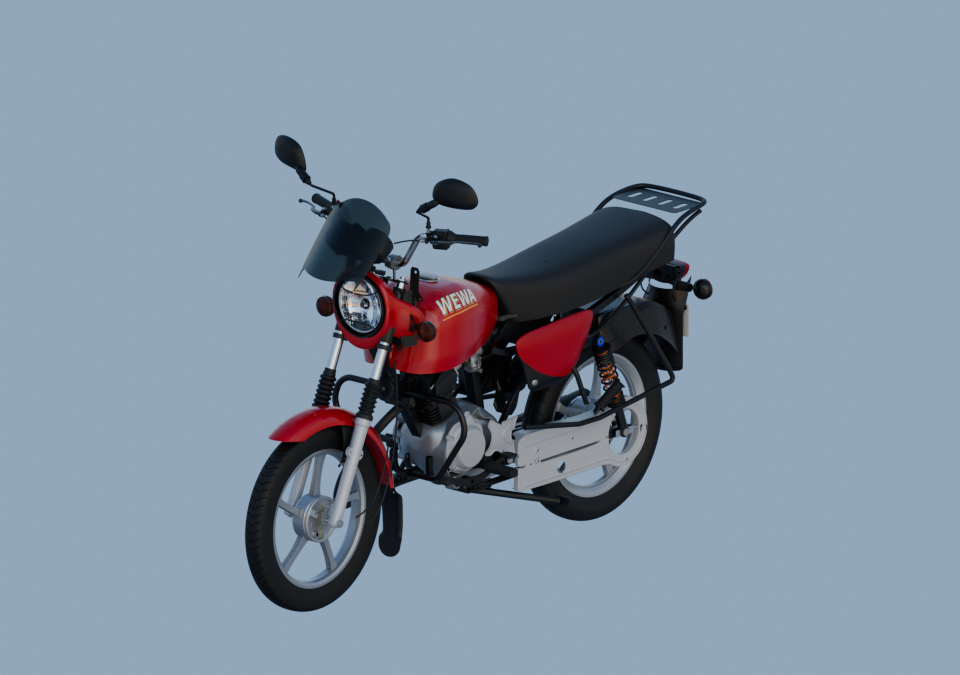

# Moto — matières v9

[Droite](material-right-quarter.png) · [Arrière](material-rear-quarter.png). Trois vrais rendus Blender Cycles à 96 échantillons, 960×675, EXR FLOAT32 conservés. Même lumière HDRI et matières des sources conservées hors des deux corrections.

162 instances liées : réflecteur concave/vitre striée/ampoule visible et enveloppe supérieure-arrière du moteur intégrés. [Fichiers et contrôles complets](../motorcycle-assembled-v4/README.md).

[Source rouverte](native-reopen-check.json) · [Bornes évaluées](native-evaluated-bounds.json) · [Contrôle EXR](raw-render-check.json). Variantes apparentées et profondeurs estimées restent explicites ; pas de réception artistique automatique.
