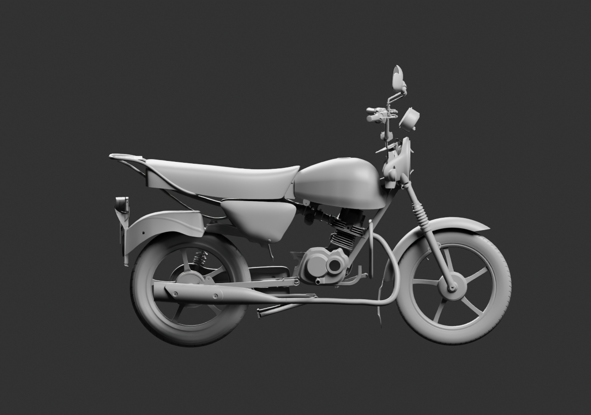
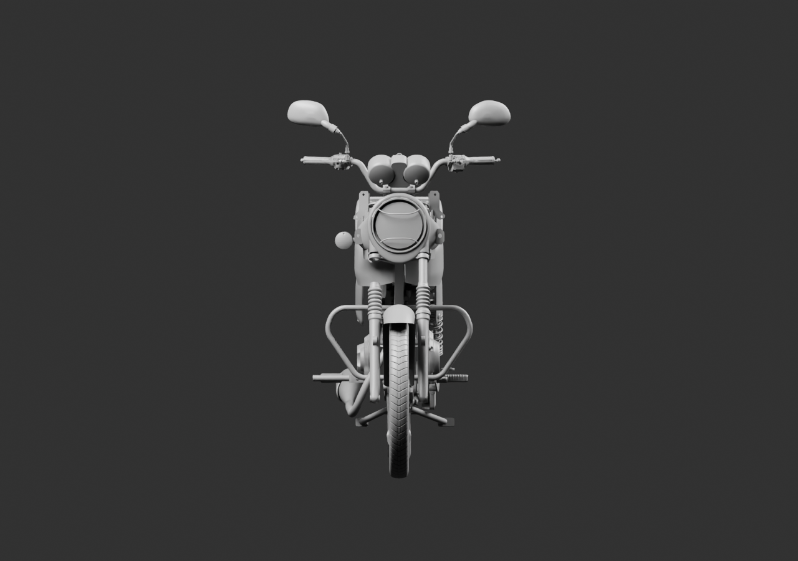
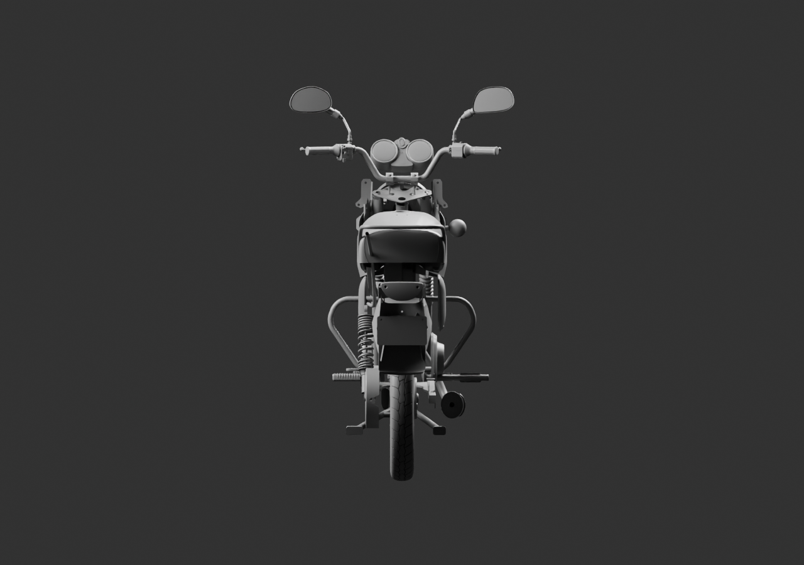

# Contrôle droit, face et arrière — même scène à88 parents

Ces trois rendus supplémentaires utilisent exactement la source globale v11, sans modification ni sauvegarde de géométrie. Le cache droit est bien orienté vers l’extérieur. Face et arrière montrent les manques : un seul clignotant, un seul amortisseur et un seul manchon conducteur, ainsi que les raccords de fourche ouverts. Les commandes arrière et repose-pieds passager ne sont pas encore tous intégrés.

Le matériau gris et le contre-jour ne permettent pas de juger la couleur du feu : un contrôle multivue avec les matériaux natifs est nécessaire. Les copies provisoires d’exemplaires restent en attente de la décision demandée, sans réception artistique implicite.

[Source exacte](../../../assets-src/moto-components/whole-exterior-coverage-v11/whole-exterior-coverage-v11.blend) · [Empreintes et caméras](render-report.json) · [Lecture](coordinator-review.json) · [EXR FLOAT32](raw-render-check.json). Aucune réception de moto complète ou G8.
