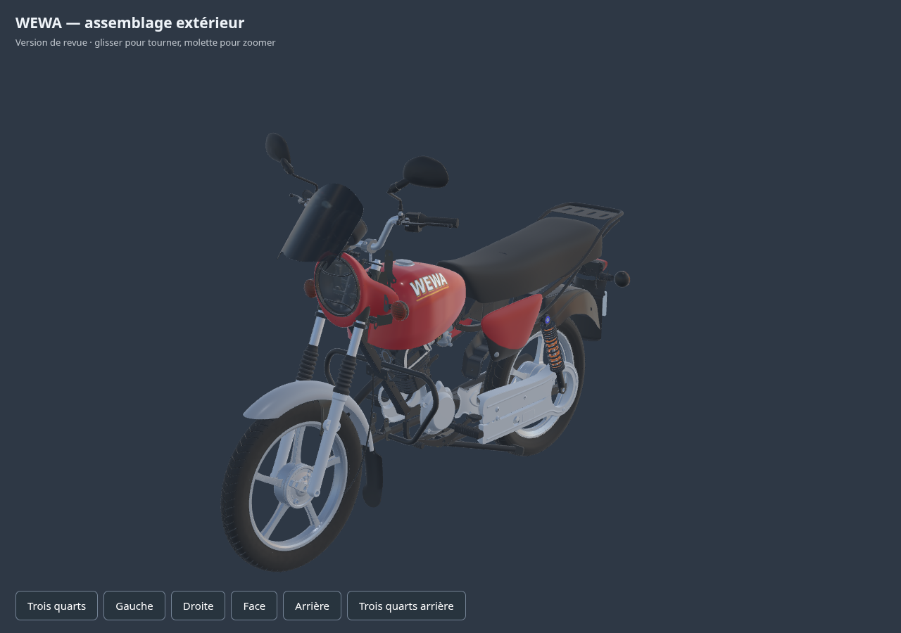

# Premier import complet réel — brouillon

114 parents,462maillages,19 142 093triangles : vraie scène glTF importée dans Babylon/Chromium logiciel. Les matrices de toutes les instances sont contrôlées, textures prêtes et canevas non vide. Les buffers restent ceux des GLB sources, sans réparation ni duplication de données.

Ce brouillon reprend le jalon v15 ; moteur central et châssis ont ensuite leur correction nativev16. Ce n’est pas la version finale ni un asset mobile optimisé. L’éclairage diffère du natif.

[glTF valide et preuve](../../../assets-src/moto-components/motorcycle-runtime-draft-v2.gltf.proof.json) · [Import réel](inspection-whole-v1/engine-check.json) · [Lecture](coordinator-review.json). Le précédent placement du glTF dans un sous-dossier est conservé : il était valide glTF, mais Babylon refuse les URI `../` ; le fichier ici est au répertoire commun, sans affaiblissement du chargeur.
